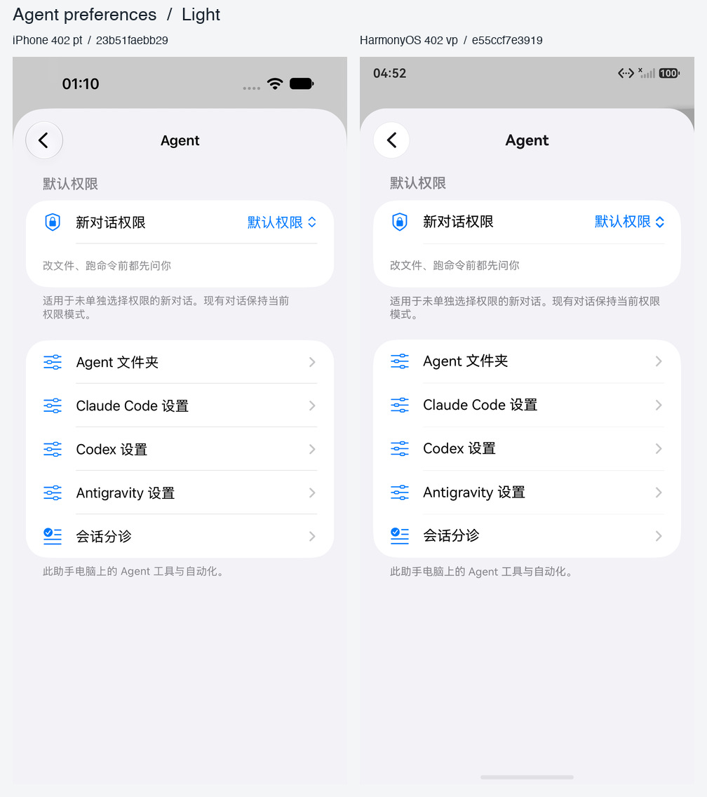
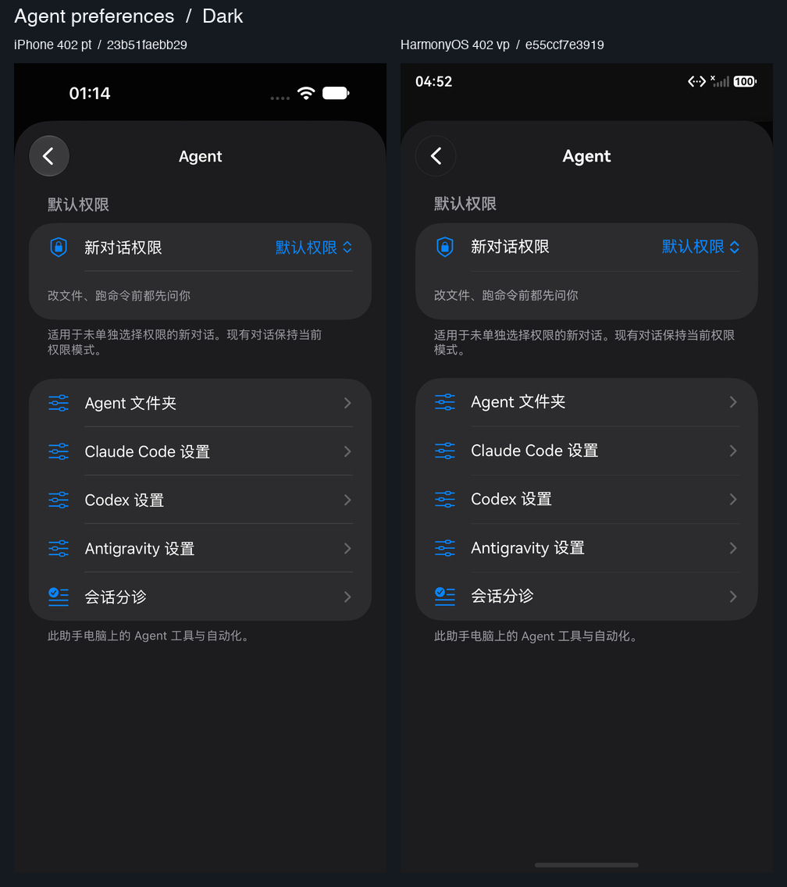
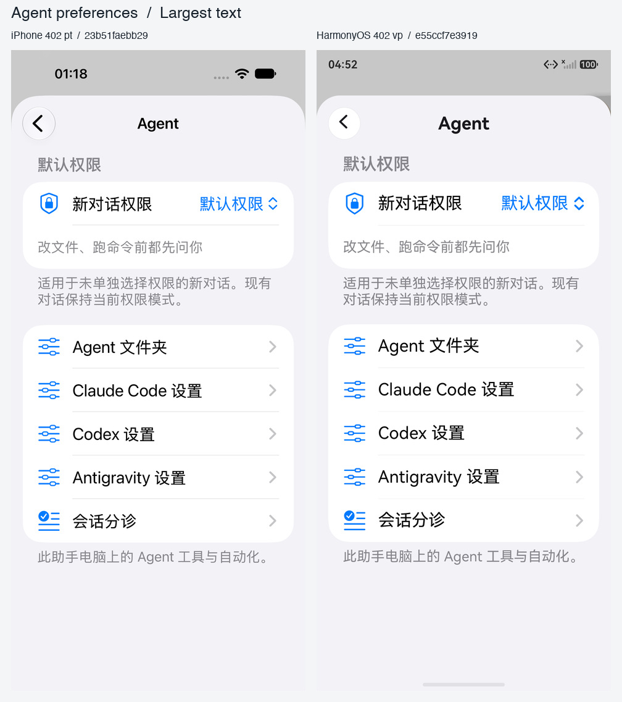

# Agent preferences and the default permission

The forms were captured on iPhone `23b51faebb29` at 402 pt and HarmonyOS `e55ccf7e3919` at 402 vp. The Settings route opened the Agent preferences page in light, dark and the largest supported text size. Each comparison shows both complete screens.

On HarmonyOS, opening the new-conversation permission menu exposed five options: Default, Allow edits, Plan mode, Automatic approval and Full access. Default was selected each time. Dismissing the menu returned to the same form with Default still selected. The synthetic Hub recorded zero assistant-setting writes, and existing sessions and pending decisions stayed unchanged. Menu and dismissal captures are HarmonyOS-only.

The original PNGs retain their native 1206 × 2622 pixels. The recorded accessibility trees and the [SHA-256 manifest](manifest.json) are included.

## Light

[iPhone original](light-iphone-form.png) · [iPhone accessibility tree](light-iphone-form.ax) · [HarmonyOS original](light-harmony-form.png) · [HarmonyOS accessibility tree](light-harmony-form.ax.json)

[HarmonyOS menu original](light-harmony-menu.png) · [Menu accessibility tree](light-harmony-menu.ax.json) · [HarmonyOS after dismissal](light-harmony-dismissed.png) · [Restored form tree](light-harmony-dismissed.ax.json)

## Dark

[iPhone original](dark-iphone-form.png) · [iPhone accessibility tree](dark-iphone-form.ax) · [HarmonyOS original](dark-harmony-form.png) · [HarmonyOS accessibility tree](dark-harmony-form.ax.json)

[HarmonyOS menu original](dark-harmony-menu.png) · [Menu accessibility tree](dark-harmony-menu.ax.json) · [HarmonyOS after dismissal](dark-harmony-dismissed.png) · [Restored form tree](dark-harmony-dismissed.ax.json)

## Largest text

[iPhone original](large-iphone-form.png) · [iPhone accessibility tree](large-iphone-form.ax) · [HarmonyOS original](large-harmony-form.png) · [HarmonyOS accessibility tree](large-harmony-form.ax.json)

[HarmonyOS menu original](large-harmony-menu.png) · [Menu accessibility tree](large-harmony-menu.ax.json) · [HarmonyOS after dismissal](large-harmony-dismissed.png) · [Restored form tree](large-harmony-dismissed.ax.json)
