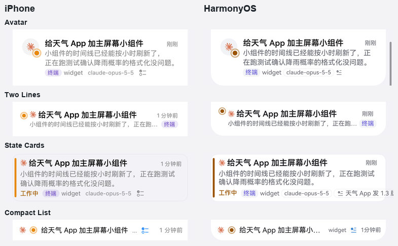

# Agents directory
Four row styles were selected through the native directory at 402 points. Both By Project and By Repository open the same MacBook widget conversation. The HarmonyOS run also exercised long press, an edge tap 2.67 points from the screen boundary, return navigation and selection persistence after relaunch.

| Row style | iPhone height | HarmonyOS height, By Project | HarmonyOS height, By Repository |
| --- | ---: | ---: | ---: |
| Avatar | 118.67 | 118.67 | 118.67 |
| Two Lines | 72.67 | 72.33 | 72.33 |
| State Cards | 106.67 | 108.00 | 107.33 |
| Compact List | 44.00 | 44.00 | 44.00 |

At maximum text size the sampled Compact List row stayed at 44 on both devices. The sampled Two Lines row measured 87.33 on iPhone and 86.33 on HarmonyOS. State Cards took taps across the full 402-point width. The largest measured row-height difference in the eleven comparisons was 1.33 points. Text fitting still visibly differs in the ordinary State Cards and Compact List examples. The iPhone card shows the linked task as an icon. HarmonyOS shows its label extending to the right edge.

## Full-size captures

| Captured state | iPhone | HarmonyOS |
| --- | --- | --- |
| Saved layout after relaunch | — | [PNG](raw/harmony/cold-restored-choice.png) · [AX](raw/harmony/cold-restored-choice.ax.json) |
| Dark / By Project / State Cards | [PNG](raw/iphone/dark-space-cards.png) · [AX](raw/iphone/dark-space-cards.ax) | [PNG](raw/harmony/dark-space-cards.png) · [AX](raw/harmony/dark-space-cards.ax.json) |
| Maximum text / By Project / Two Lines | [PNG](raw/iphone/large-space-compact.png) · [AX](raw/iphone/large-space-compact.ax) | [PNG](raw/harmony/large-space-compact.png) · [AX](raw/harmony/large-space-compact.ax.json) |
| Maximum text / By Project / Compact List | [PNG](raw/iphone/large-space-list.png) · [AX](raw/iphone/large-space-list.ax) | [PNG](raw/harmony/large-space-list.png) · [AX](raw/harmony/large-space-list.ax.json) |
| Light / State Cards long press | [PNG](raw/iphone/light-cards-actions.png) · [AX](raw/iphone/light-cards-actions.ax) | — |
| Light / Layout picker | [PNG](raw/iphone/light-display-menu.png) · [AX](raw/iphone/light-display-menu.ax) | — |
| Light / By Repository / Avatar | [PNG](raw/iphone/light-repo-avatar.png) · [AX](raw/iphone/light-repo-avatar.ax) | [PNG](raw/harmony/light-repo-avatar.png) · [AX](raw/harmony/light-repo-avatar.ax.json) |
| Light / By Repository / State Cards | [PNG](raw/iphone/light-repo-cards.png) · [AX](raw/iphone/light-repo-cards.ax) | [PNG](raw/harmony/light-repo-cards.png) · [AX](raw/harmony/light-repo-cards.ax.json) |
| Light / By Repository / Two Lines | [PNG](raw/iphone/light-repo-compact.png) · [AX](raw/iphone/light-repo-compact.ax) | [PNG](raw/harmony/light-repo-compact.png) · [AX](raw/harmony/light-repo-compact.ax.json) |
| Light / By Repository / Compact List | [PNG](raw/iphone/light-repo-list.png) · [AX](raw/iphone/light-repo-list.ax) | [PNG](raw/harmony/light-repo-list.png) · [AX](raw/harmony/light-repo-list.ax.json) |
| Light / Repo Returns List | [PNG](raw/iphone/light-repo-returns-list.png) · [AX](raw/iphone/light-repo-returns-list.ax) | — |
| Light / By Project / Avatar | [PNG](raw/iphone/light-space-avatar.png) · [AX](raw/iphone/light-space-avatar.ax) | [PNG](raw/harmony/light-space-avatar.png) · [AX](raw/harmony/light-space-avatar.ax.json) |
| Light / By Project / State Cards | [PNG](raw/iphone/light-space-cards.png) · [AX](raw/iphone/light-space-cards.ax) | [PNG](raw/harmony/light-space-cards.png) · [AX](raw/harmony/light-space-cards.ax.json) |
| Light / By Project / Two Lines | [PNG](raw/iphone/light-space-compact.png) · [AX](raw/iphone/light-space-compact.ax) | [PNG](raw/harmony/light-space-compact.png) · [AX](raw/harmony/light-space-compact.ax.json) |
| Light / By Project / Compact List | [PNG](raw/iphone/light-space-list.png) · [AX](raw/iphone/light-space-list.ax) | [PNG](raw/harmony/light-space-list.png) · [AX](raw/harmony/light-space-list.ax.json) |
| Light / Space Returns List | [PNG](raw/iphone/light-space-returns-list.png) · [AX](raw/iphone/light-space-returns-list.ax) | — |
| By Repository / Open at the screen edge | — | [PNG](raw/harmony/repo-edge-opened.png) · [AX](raw/harmony/repo-edge-opened.ax.json) |
| By Repository / Long press | — | [PNG](raw/harmony/repo-long-press.png) · [AX](raw/harmony/repo-long-press.ax.json) |
| By Repository / Open conversation | — | [PNG](raw/harmony/repo-opened.png) · [AX](raw/harmony/repo-opened.ax.json) |
| By Repository / Return to list | — | [PNG](raw/harmony/repo-returned.png) · [AX](raw/harmony/repo-returned.ax.json) |
| By Project / Open at the screen edge | — | [PNG](raw/harmony/space-edge-opened.png) · [AX](raw/harmony/space-edge-opened.ax.json) |
| By Project / Long press | — | [PNG](raw/harmony/space-long-press.png) · [AX](raw/harmony/space-long-press.ax.json) |
| By Project / Open conversation | — | [PNG](raw/harmony/space-opened.png) · [AX](raw/harmony/space-opened.ax.json) |
| By Project / Return to list | — | [PNG](raw/harmony/space-returned.png) · [AX](raw/harmony/space-returned.ax.json) |

## Files and integrity

This section contains 35 images with their native accessibility captures. Its [machine-readable index](manifest.json) records the product revision and both acquisition and public byte hashes. [SHA-256 checksums](SHA256SUMS) cover the files in this section.

Public privacy edits affect 4 image(s) and 14 accessibility file(s). The acquisition hashes identify the local originals. On affected screenshots, the mask covers the transcript paragraph exposing workspace paths. Accessibility edits retain the control hierarchy and bounds.
