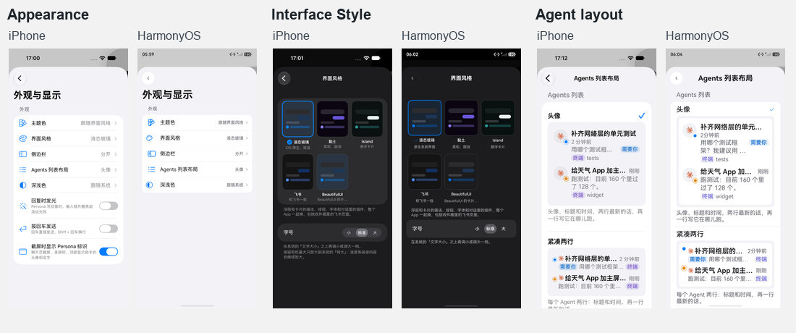

# Appearance settings
The 94 native captures cover 35 iPhone states and 59 HarmonyOS states. Each capture links its full-size image and its accessibility tree. Ordinary, dark and maximum text settings were exercised at a logical width of 402.

The two devices exercised the routes to Theme Color, Interface Style, Agent layout, Navigation and Color Scheme. The additional HarmonyOS cases record selection summaries, text size after relaunch, and synchronization between Settings and the Agents menu. Search was exercised by opening a result and returning to the same query and focus state. In the captured Appearance root, iPhone also shows Glow While Replying, Return to Send and Show the Persona Mark in Screenshots. The HarmonyOS root shows the five destination rows pictured here.

## Full-size captures

| Captured state | iPhone | HarmonyOS |
| --- | --- | --- |
| Agents Menu / Back dismisses the menu | — | [PNG](raw/harmony/agents-menu/back-dismisses-menu.png) · [AX](raw/harmony/agents-menu/back-dismisses-menu.ax.json) |
| Agents Menu / First tap opens Agents | — | [PNG](raw/harmony/agents-menu/first-tap-directory.png) · [AX](raw/harmony/agents-menu/first-tap-directory.ax.json) |
| Agents Menu / Menu after changing Settings | — | [PNG](raw/harmony/agents-menu/options-after-settings.png) · [AX](raw/harmony/agents-menu/options-after-settings.ax.json) |
| Agents Menu / Initial Agents menu | [PNG](raw/iphone/agents-menu/options-first.png) · [AX](raw/iphone/agents-menu/options-first.ax) | [PNG](raw/harmony/agents-menu/options-first.png) · [AX](raw/harmony/agents-menu/options-first.ax.json) |
| Agents Menu / Settings reads Two Lines | — | [PNG](raw/harmony/agents-menu/settings-reads-compact.png) · [AX](raw/harmony/agents-menu/settings-reads-compact.ax.json) |
| Agents Menu / Settings reads restored choice | — | [PNG](raw/harmony/agents-menu/settings-reads-restored.png) · [AX](raw/harmony/agents-menu/settings-reads-restored.ax.json) |
| Agents Menu / Select State Cards in Settings | — | [PNG](raw/harmony/agents-menu/settings-selects-cards.png) · [AX](raw/harmony/agents-menu/settings-selects-cards.ax.json) |
| Dark / Appearance | [PNG](raw/iphone/dark/appearance.png) · [AX](raw/iphone/dark/appearance.ax) | [PNG](raw/harmony/dark/appearance.png) · [AX](raw/harmony/dark/appearance.ax.json) |
| Dark / Return to Appearance | [PNG](raw/iphone/dark/appearance-return.png) · [AX](raw/iphone/dark/appearance-return.ax) | [PNG](raw/harmony/dark/appearance-return.png) · [AX](raw/harmony/dark/appearance-return.ax.json) |
| Dark / Theme Color | [PNG](raw/iphone/dark/color.png) · [AX](raw/iphone/dark/color.ax) | [PNG](raw/harmony/dark/color.png) · [AX](raw/harmony/dark/color.ax.json) |
| Dark / Agent layout | [PNG](raw/iphone/dark/layout.png) · [AX](raw/iphone/dark/layout.ax) | [PNG](raw/harmony/dark/layout.png) · [AX](raw/harmony/dark/layout.ax.json) |
| Dark / Navigation | [PNG](raw/iphone/dark/navigation.png) · [AX](raw/iphone/dark/navigation.ax) | [PNG](raw/harmony/dark/navigation.png) · [AX](raw/harmony/dark/navigation.ax.json) |
| Dark / Settings | [PNG](raw/iphone/dark/root.png) · [AX](raw/iphone/dark/root.ax) | [PNG](raw/harmony/dark/root.png) · [AX](raw/harmony/dark/root.ax.json) |
| Dark / Color Scheme | [PNG](raw/iphone/dark/scheme.png) · [AX](raw/iphone/dark/scheme.ax) | [PNG](raw/harmony/dark/scheme.png) · [AX](raw/harmony/dark/scheme.ax.json) |
| Dark / Search Settings | [PNG](raw/iphone/dark/search.png) · [AX](raw/iphone/dark/search.ax) | [PNG](raw/harmony/dark/search.png) · [AX](raw/harmony/dark/search.ax.json) |
| Dark / Open theme color from search | — | [PNG](raw/harmony/dark/search-color-direct.png) · [AX](raw/harmony/dark/search-color-direct.ax.json) |
| Dark / Open layout from search | [PNG](raw/iphone/dark/search-layout.png) · [AX](raw/iphone/dark/search-layout.ax) | [PNG](raw/harmony/dark/search-layout.png) · [AX](raw/harmony/dark/search-layout.ax.json) |
| Dark / Return to search | [PNG](raw/iphone/dark/search-return.png) · [AX](raw/iphone/dark/search-return.ax) | [PNG](raw/harmony/dark/search-return.png) · [AX](raw/harmony/dark/search-return.ax.json) |
| Dark / Interface Style | [PNG](raw/iphone/dark/style.png) · [AX](raw/iphone/dark/style.ax) | [PNG](raw/harmony/dark/style.png) · [AX](raw/harmony/dark/style.ax.json) |
| Large / Appearance | [PNG](raw/iphone/large/appearance.png) · [AX](raw/iphone/large/appearance.ax) | [PNG](raw/harmony/large/appearance.png) · [AX](raw/harmony/large/appearance.ax.json) |
| Large / Return to Appearance | [PNG](raw/iphone/large/appearance-return.png) · [AX](raw/iphone/large/appearance-return.ax) | [PNG](raw/harmony/large/appearance-return.png) · [AX](raw/harmony/large/appearance-return.ax.json) |
| Large / Theme Color | [PNG](raw/iphone/large/color.png) · [AX](raw/iphone/large/color.ax) | [PNG](raw/harmony/large/color.png) · [AX](raw/harmony/large/color.ax.json) |
| Large / Agent layout | [PNG](raw/iphone/large/layout.png) · [AX](raw/iphone/large/layout.ax) | [PNG](raw/harmony/large/layout.png) · [AX](raw/harmony/large/layout.ax.json) |
| Large / Navigation | [PNG](raw/iphone/large/navigation.png) · [AX](raw/iphone/large/navigation.ax) | [PNG](raw/harmony/large/navigation.png) · [AX](raw/harmony/large/navigation.ax.json) |
| Large / Settings | [PNG](raw/iphone/large/root.png) · [AX](raw/iphone/large/root.ax) | [PNG](raw/harmony/large/root.png) · [AX](raw/harmony/large/root.ax.json) |
| Large / Color Scheme | [PNG](raw/iphone/large/scheme.png) · [AX](raw/iphone/large/scheme.ax) | [PNG](raw/harmony/large/scheme.png) · [AX](raw/harmony/large/scheme.ax.json) |
| Large / Search Settings | [PNG](raw/iphone/large/search.png) · [AX](raw/iphone/large/search.ax) | [PNG](raw/harmony/large/search.png) · [AX](raw/harmony/large/search.ax.json) |
| Large / Open theme color from search | — | [PNG](raw/harmony/large/search-color-direct.png) · [AX](raw/harmony/large/search-color-direct.ax.json) |
| Large / Open layout from search | [PNG](raw/iphone/large/search-layout.png) · [AX](raw/iphone/large/search-layout.ax) | [PNG](raw/harmony/large/search-layout.png) · [AX](raw/harmony/large/search-layout.ax.json) |
| Large / Return to search | [PNG](raw/iphone/large/search-return.png) · [AX](raw/iphone/large/search-return.ax) | [PNG](raw/harmony/large/search-return.png) · [AX](raw/harmony/large/search-return.ax.json) |
| Large / Interface Style | [PNG](raw/iphone/large/style.png) · [AX](raw/iphone/large/style.ax) | [PNG](raw/harmony/large/style.png) · [AX](raw/harmony/large/style.ax.json) |
| Light / Appearance | [PNG](raw/iphone/light/appearance.png) · [AX](raw/iphone/light/appearance.ax) | [PNG](raw/harmony/light/appearance.png) · [AX](raw/harmony/light/appearance.ax.json) |
| Light / Return to Appearance | [PNG](raw/iphone/light/appearance-return.png) · [AX](raw/iphone/light/appearance-return.ax) | [PNG](raw/harmony/light/appearance-return.png) · [AX](raw/harmony/light/appearance-return.ax.json) |
| Light / Theme Color | [PNG](raw/iphone/light/color.png) · [AX](raw/iphone/light/color.ax) | [PNG](raw/harmony/light/color.png) · [AX](raw/harmony/light/color.ax.json) |
| Light / Changed theme color | [PNG](raw/iphone/light/color-changed.png) · [AX](raw/iphone/light/color-changed.ax) | — |
| Light / Color Selected | — | [PNG](raw/harmony/light/color-selected.png) · [AX](raw/harmony/light/color-selected.ax.json) |
| Light / Color Summary | — | [PNG](raw/harmony/light/color-summary.png) · [AX](raw/harmony/light/color-summary.ax.json) |
| Light / Agent layout | [PNG](raw/iphone/light/layout.png) · [AX](raw/iphone/light/layout.ax) | [PNG](raw/harmony/light/layout.png) · [AX](raw/harmony/light/layout.ax.json) |
| Light / Layout Selected | — | [PNG](raw/harmony/light/layout-selected.png) · [AX](raw/harmony/light/layout-selected.ax.json) |
| Light / Layout Summary | — | [PNG](raw/harmony/light/layout-summary.png) · [AX](raw/harmony/light/layout-summary.ax.json) |
| Light / Navigation | [PNG](raw/iphone/light/navigation.png) · [AX](raw/iphone/light/navigation.ax) | [PNG](raw/harmony/light/navigation.png) · [AX](raw/harmony/light/navigation.ax.json) |
| Light / Navigation Selected | — | [PNG](raw/harmony/light/navigation-selected.png) · [AX](raw/harmony/light/navigation-selected.ax.json) |
| Light / Navigation Summary | — | [PNG](raw/harmony/light/navigation-summary.png) · [AX](raw/harmony/light/navigation-summary.ax.json) |
| Light / Settings | [PNG](raw/iphone/light/root.png) · [AX](raw/iphone/light/root.ax) | [PNG](raw/harmony/light/root.png) · [AX](raw/harmony/light/root.ax.json) |
| Light / Color Scheme | [PNG](raw/iphone/light/scheme.png) · [AX](raw/iphone/light/scheme.ax) | [PNG](raw/harmony/light/scheme.png) · [AX](raw/harmony/light/scheme.ax.json) |
| Light / Scheme Selected | — | [PNG](raw/harmony/light/scheme-selected.png) · [AX](raw/harmony/light/scheme-selected.ax.json) |
| Light / Scheme Summary | — | [PNG](raw/harmony/light/scheme-summary.png) · [AX](raw/harmony/light/scheme-summary.ax.json) |
| Light / Search Settings | [PNG](raw/iphone/light/search.png) · [AX](raw/iphone/light/search.ax) | [PNG](raw/harmony/light/search.png) · [AX](raw/harmony/light/search.ax.json) |
| Light / Open theme color from search | — | [PNG](raw/harmony/light/search-color-direct.png) · [AX](raw/harmony/light/search-color-direct.ax.json) |
| Light / Open layout from search | [PNG](raw/iphone/light/search-layout.png) · [AX](raw/iphone/light/search-layout.ax) | [PNG](raw/harmony/light/search-layout.png) · [AX](raw/harmony/light/search-layout.ax.json) |
| Light / Return to search | [PNG](raw/iphone/light/search-return.png) · [AX](raw/iphone/light/search-return.ax) | [PNG](raw/harmony/light/search-return.png) · [AX](raw/harmony/light/search-return.ax.json) |
| Light / Interface Style | [PNG](raw/iphone/light/style.png) · [AX](raw/iphone/light/style.ax) | [PNG](raw/harmony/light/style.png) · [AX](raw/harmony/light/style.ax.json) |
| Light / Style Selected | — | [PNG](raw/harmony/light/style-selected.png) · [AX](raw/harmony/light/style-selected.ax.json) |
| Light / Style Summary | — | [PNG](raw/harmony/light/style-summary.png) · [AX](raw/harmony/light/style-summary.ax.json) |
| Text Size / Relaunch with saved size | — | [PNG](raw/harmony/text-size/cold-reopen.png) · [AX](raw/harmony/text-size/cold-reopen.ax.json) |
| Text Size / Initial text size | — | [PNG](raw/harmony/text-size/initial.png) · [AX](raw/harmony/text-size/initial.ax.json) |
| Text Size / Larger text | — | [PNG](raw/harmony/text-size/larger.png) · [AX](raw/harmony/text-size/larger.ax.json) |
| Text Size / Larger before restart | — | [PNG](raw/harmony/text-size/larger-before-restart.png) · [AX](raw/harmony/text-size/larger-before-restart.ax.json) |
| Text Size / Restored text size | — | [PNG](raw/harmony/text-size/restored.png) · [AX](raw/harmony/text-size/restored.ax.json) |
| Text Size / Smaller text | — | [PNG](raw/harmony/text-size/smaller.png) · [AX](raw/harmony/text-size/smaller.ax.json) |

## Files and integrity

This section contains 94 images with their native accessibility captures. Its [machine-readable index](manifest.json) records the product revision and both acquisition and public byte hashes. [SHA-256 checksums](SHA256SUMS) cover the files in this section.

Public privacy edits affect 0 image(s) and 4 accessibility file(s). The acquisition hashes identify the local originals. On affected screenshots, the mask covers the transcript paragraph exposing workspace paths. Accessibility edits retain the control hierarchy and bounds.
