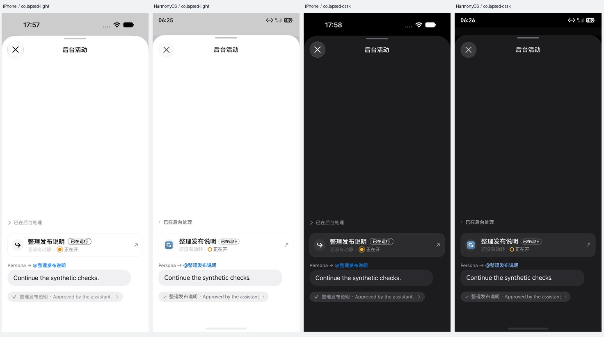
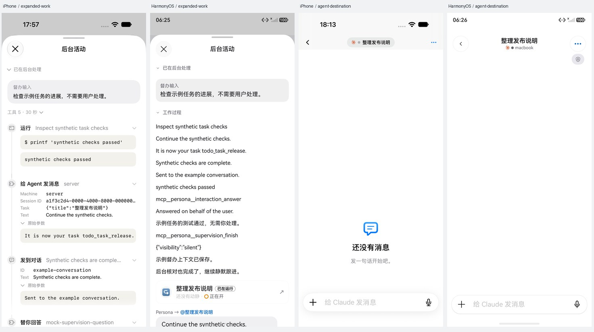

# Background activity on iPhone and HarmonyOS

The iPhone source was `c2d44cc1406c` and the HarmonyOS source was `7ef860f483d2`. Both native clients used the stock synthetic fixture with Tasks and Supervision enabled on 402-point / 402-vp screens. Each linked screenshot retains its original 1206 × 2622 pixels. The controls are excerpts from the corresponding platform accessibility tree. The manifest gives the SHA-256 of each original tree and capture.

The top of the folded round measured 560.7 pt on iPhone and 560.0 vp on HarmonyOS. The dispatched task started at 604.3 and 604.0, the routed message at 684.3 and 684.7, and the answered row at 764.3 and 764.0. The sampled sheet, routed-message fill and answer-chip fill agreed on both phones in light and dark appearance.

## Interaction

Both the selected Assistant menu and the Inbox menu opened the same read-only round. Expanding work displayed five separately checked tool outputs and messages. Opening and closing the audit from the Inbox did not add a seen record or send a message. Tapping the dispatch selected its Agent behind the sheet; closing the sheet revealed the release-notes Agent. On HarmonyOS the routed task link also opened the ordinary task detail and returned to the audit.

| State | iPhone | HarmonyOS |
| --- | --- | --- |
| Initially folded, light appearance | [Screen](iPhone/collapsed-light.png) · [Controls](iPhone/collapsed-light.controls.json) | [Screen](HarmonyOS/collapsed-light.png) · [Controls](HarmonyOS/collapsed-light.controls.json) |
| Initially folded, dark appearance | [Screen](iPhone/collapsed-dark.png) · [Controls](iPhone/collapsed-dark.controls.json) | [Screen](HarmonyOS/collapsed-dark.png) · [Controls](HarmonyOS/collapsed-dark.controls.json) |
| Question and recorded answer | [Screen](iPhone/answered.png) · [Controls](iPhone/answered.controls.json) | [Screen](HarmonyOS/answered.png) · [Controls](HarmonyOS/answered.controls.json) |
| Retrieved tool calls, outputs and messages | [Screen](iPhone/expanded-work.png) · [Controls](iPhone/expanded-work.controls.json) | [Screen](HarmonyOS/expanded-work.png) · [Controls](HarmonyOS/expanded-work.controls.json) |
| Expanded work in dark appearance | [Screen](iPhone/expanded-work-dark.png) · [Controls](iPhone/expanded-work-dark.controls.json) | [Screen](HarmonyOS/expanded-work-dark.png) · [Controls](HarmonyOS/expanded-work-dark.controls.json) |
| Selected Assistant menu | [Screen](iPhone/main-menu.png) · [Controls](iPhone/main-menu.controls.json) | [Screen](HarmonyOS/main-menu.png) · [Controls](HarmonyOS/main-menu.controls.json) |
| The same quiet round reached from Main | [Screen](iPhone/main-activity.png) · [Controls](iPhone/main-activity.controls.json) | [Screen](HarmonyOS/main-activity.png) · [Controls](HarmonyOS/main-activity.controls.json) |
| An explicit dispatch selects its Agent behind the sheet | [Screen](iPhone/selected-agent.png) · [Controls](iPhone/selected-agent.controls.json) | [Screen](HarmonyOS/selected-agent.png) · [Controls](HarmonyOS/selected-agent.controls.json) |
| Destination Agent after closing the sheet | [Screen](iPhone/agent-destination.png) · [Controls](iPhone/agent-destination.controls.json) | [Screen](HarmonyOS/agent-destination.png) · [Controls](HarmonyOS/agent-destination.controls.json) |

[Sources and checksums](manifest.json) · [37-page comparison](https://github.com/nwverse/persona/blob/91e0008b50a3c0807b28dc397f89e3e3a5aa2e29/pr-assets/12495/native-a771989e/README.md) · [Appearance settings and Agents](https://github.com/nwverse/persona/blob/bc1b575badf6b70281a8ba715bf990bbefb84095/pr-assets/12495/appearance-agents-361c7892/README.md) · [Five interface styles](https://github.com/nwverse/persona/blob/fc4c8404ad8410de5edcfdae5126cc095334d772/pr-assets/12495/interface-styles-361c7892/README.md)
