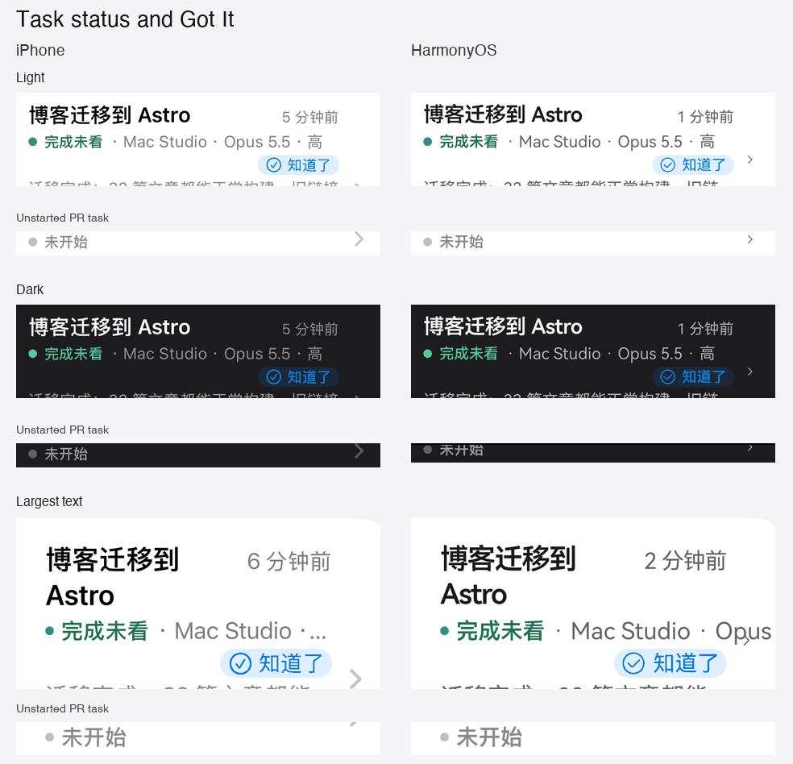

# Compact task status and Got It

Both phones present the same synthetic task states. “博客迁移到 Astro” reads “完成未看”. “登录页加验证码” reads “未开始”. The test opened the to-do list, filed the blog task, used Undo, and checked the unchanged PR task in three appearances.

HarmonyOS `4d6f313e50b1` and iPhone `c2d44cc1406c` used one isolated service in consecutive device sessions. Each client sent one PUT and one DELETE per appearance. A separate native interaction filed the promoted related task and undid that task. The synthetic service then restored the first mark before the iPhone session.

| Appearance | Before | Filed | Restored | PR task |
| --- | --- | --- | --- | --- |
| Light | [iPhone](originals/iphone/light/list.png) · [HarmonyOS](originals/harmonyos/light/list.png) | [iPhone](originals/iphone/light/filed.png) · [HarmonyOS](originals/harmonyos/light/filed.png) | [iPhone](originals/iphone/light/undo.png) · [HarmonyOS](originals/harmonyos/light/undo.png) | [iPhone](originals/iphone/light/held.png) · [HarmonyOS](originals/harmonyos/light/held.png) |
| Dark | [iPhone](originals/iphone/dark/list.png) · [HarmonyOS](originals/harmonyos/dark/list.png) | [iPhone](originals/iphone/dark/filed.png) · [HarmonyOS](originals/harmonyos/dark/filed.png) | [iPhone](originals/iphone/dark/undo.png) · [HarmonyOS](originals/harmonyos/dark/undo.png) | [iPhone](originals/iphone/dark/held.png) · [HarmonyOS](originals/harmonyos/dark/held.png) |
| Large | [iPhone](originals/iphone/large/list.png) · [HarmonyOS](originals/harmonyos/large/list.png) | [iPhone](originals/iphone/large/filed.png) · [HarmonyOS](originals/harmonyos/large/filed.png) | [iPhone](originals/iphone/large/undo.png) · [HarmonyOS](originals/harmonyos/large/undo.png) | [iPhone](originals/iphone/large/held.png) · [HarmonyOS](originals/harmonyos/large/held.png) |

## Button size and color

The accessibility frame covers the button content. The solid capsule extends one point above and below the content. A tap four points below the content filed the task in light mode. A tap four points above it filed the task in dark mode. The largest-text run tested the center. All results use 3 physical pixels per logical unit.

| Appearance | iPhone control (pt) | HarmonyOS control (vp) | iPhone solid capsule (pt) | HarmonyOS solid capsule (vp) |
| --- | --- | --- | --- | --- |
| Light | 66 × 14.3 | 66.33 × 14.33 | 65.33 × 16.33 | 66.33 × 16.33 |
| Dark | 66 × 14.3 | 66.33 × 14.33 | 66 × 16.33 | 66.33 × 16.33 |
| Large | 91 × 21.7 | 91.33 × 21.67 | 91 × 23.67 | 91.33 × 23.67 |

The dark capsule measured RGB (26, 40, 57) on iPhone and (26, 41, 57) on HarmonyOS. Solid button text and both task-status colors matched across the three appearances. Independently scrolled screenshots preserve the scroll position of each native view. The dark HarmonyOS frame catches the PR task at the upper scrolling boundary, which clips the top of the status label in that original. The captures also retain each device’s elapsed-time label from its own turn on the same service.

Two rows have the same blog title. The extra HarmonyOS pass [filed the first task](originals/harmonyos/large/rebind-first.png), [filed its newly promoted sibling](originals/harmonyos/large/rebind-second.png), then [restored that sibling](originals/harmonyos/large/rebind-undo.png). The service recorded the second task’s ID on the second and third requests.

The same-input replay covers all 21 tasks and 30 sessions from the release fixture, with 17 release options enabled. The earlier sorting and grouping checks have their own source and receipt in the manifest.

The manifest includes both native accessibility digests and application-only control excerpts for every original image. [Evidence manifest](manifest.json) · [File digests](SHA256SUMS)

## Source revisions

| Artifact | Exact revision or SHA-256 |
| --- | --- |
| HarmonyOS product | `4d6f313e50b152c46530b018dc8f7e702016f94e` |
| Installed HarmonyOS HAP | `dda48eff05820e231506557bf6868a4fc97eeaeeca8bb1e75c8f35022e4d995e` |
| iPhone product | `c2d44cc1406c9127e585f430ed692261edf24eff` |
| iPhone Apple source tree | `8c901a437c26520cf2cc3bac1f4c2258ac0ca7e5` |
| Installed iPhone Persona | `65e36482774bab1500cf2d95399f922c3ec9d657d65801a1b886a366f30aa685` |
| Installed iPhone Persona.debug.dylib | `bfd66cf5ef3f3efeecbf5114aa063d19dbffceb43f7850b78f89683b0c70c00a` |

Screenshot and original native hierarchy SHA-256 for each view

| Screenshot | PNG SHA-256 | Native hierarchy SHA-256 |
| --- | --- | --- |
| [iPhone light list](originals/iphone/light/list.png) | `95cf06b4cb5f0503ee95465ec0bd6f1bff2906f5b44431903ec5a07de59a5e12` | `e0368eaaf5303acdfc9359c5ecc0eb4655395085a97471afb134374c0918e6b6` |
| [HarmonyOS light list](originals/harmonyos/light/list.png) | `4ea9fbca7ab23bf9eb282916d96683a2bbb7145143ea6e5ce89d68560776738e` | `f701e62c13450dcb79c7be44bea6e9db9858b8268901396c7090e237d39185ca` |
| [iPhone light filed](originals/iphone/light/filed.png) | `1ec8622419c44877b7063ab098194f82de68cca18da9996e628fb6b75cf94579` | `69bac618d2741d2856f660ad6e53f57a26020e2f30b315d6e69c74c03b6c0933` |
| [HarmonyOS light filed](originals/harmonyos/light/filed.png) | `59565f5458fff6198233aae539d18b15727f75f1a3c40885328272a77247fd07` | `d5f7cc814dea991189c18d3106041c66cbcb40c3dc4b0d66045320ae5b5a25d5` |
| [iPhone light undo](originals/iphone/light/undo.png) | `95cf06b4cb5f0503ee95465ec0bd6f1bff2906f5b44431903ec5a07de59a5e12` | `0d1aca9e2aae02dcc9338b24c5c4b8240fe11df177cd9ba38bf90cf7f6075817` |
| [HarmonyOS light undo](originals/harmonyos/light/undo.png) | `4ea9fbca7ab23bf9eb282916d96683a2bbb7145143ea6e5ce89d68560776738e` | `f701e62c13450dcb79c7be44bea6e9db9858b8268901396c7090e237d39185ca` |
| [iPhone light held](originals/iphone/light/held.png) | `95cf06b4cb5f0503ee95465ec0bd6f1bff2906f5b44431903ec5a07de59a5e12` | `30c3acd59dfd963305d96ee0e9b512ce04d2fd8ef90f30857dca07189521937a` |
| [HarmonyOS light held](originals/harmonyos/light/held.png) | `4ea9fbca7ab23bf9eb282916d96683a2bbb7145143ea6e5ce89d68560776738e` | `f701e62c13450dcb79c7be44bea6e9db9858b8268901396c7090e237d39185ca` |
| [iPhone dark list](originals/iphone/dark/list.png) | `0a1db8dd03ba071e321d3c5c880fd47b1696f0c4668fde66f961e40ac5e60875` | `eeec835b120f4046efa9f581a218e171dd7b68645155c9a5bdf4d05647b9c4c6` |
| [HarmonyOS dark list](originals/harmonyos/dark/list.png) | `44ff9d8a98a561f06266fb19d067ef93e1515cf31e7fe7b732ad135ca3329c36` | `ed17d70d6d582c3f6d27921b9b5577c96dfc460f93901faea2f5bbe2ba9341c4` |
| [iPhone dark filed](originals/iphone/dark/filed.png) | `1ee47867c5ec01a4a62a1fe34e4d8e309d9596a9212a0c3346498f8e342c5ab5` | `09b193494563cffaedc72bcaa48c0bfa907fd925e0a32385d07e8a1b6c7c0356` |
| [HarmonyOS dark filed](originals/harmonyos/dark/filed.png) | `527be75f567afa46fa9128662a1e72c99e918c46b617ea7f697517f992188171` | `6eb2a3e505994da35e70168b6015e438c90ff91b29a74fd77d1a23e8f8edcf38` |
| [iPhone dark undo](originals/iphone/dark/undo.png) | `0a1db8dd03ba071e321d3c5c880fd47b1696f0c4668fde66f961e40ac5e60875` | `8e9828573d92a245dda4d3c4238655041ebdd7a1d3e4d0aecf1b1680c320eaca` |
| [HarmonyOS dark undo](originals/harmonyos/dark/undo.png) | `44ff9d8a98a561f06266fb19d067ef93e1515cf31e7fe7b732ad135ca3329c36` | `ed17d70d6d582c3f6d27921b9b5577c96dfc460f93901faea2f5bbe2ba9341c4` |
| [iPhone dark held](originals/iphone/dark/held.png) | `0a1db8dd03ba071e321d3c5c880fd47b1696f0c4668fde66f961e40ac5e60875` | `b39d34a161d0cdfbbd0648ede0a07af4fc3aee37e9ea8b0e448bc5256f960c3c` |
| [HarmonyOS dark held](originals/harmonyos/dark/held.png) | `44ff9d8a98a561f06266fb19d067ef93e1515cf31e7fe7b732ad135ca3329c36` | `ed17d70d6d582c3f6d27921b9b5577c96dfc460f93901faea2f5bbe2ba9341c4` |
| [iPhone large list](originals/iphone/large/list.png) | `6865e59663a6ed6908305ef31baf95f3d623bae6bebb852a0ab3fd3368d49ea8` | `29c332a81b328abc29bf9ca4def4dc2141350f6833cd48cd1b780cf25a7e8913` |
| [HarmonyOS large list](originals/harmonyos/large/list.png) | `e86c6875b0edea481ed226a545d1ce324f73f0bab425d11e02d8c680adb33ac5` | `e476ce9569cfa61f596f9c793f6b0bce1b01819b71143b4b3f75038686bf8c1f` |
| [iPhone large filed](originals/iphone/large/filed.png) | `80892f51c1fe98867fc0c8643ae2c9844e4ddd98f88667e92e1faf2a0751793b` | `e7b2ce822341a3822cf39469cea55cba1d5d4b71fd0aaf0e8772a9bb2ea2f2e4` |
| [HarmonyOS large filed](originals/harmonyos/large/filed.png) | `ac755ea9fa88ad9a3eb920048380de59e8eeb1de3f362c253248d01706a88091` | `37f5f6a644f0bd8a387946735c6bf40b3c33fa90eca79593df56f37a178d785f` |
| [iPhone large undo](originals/iphone/large/undo.png) | `6865e59663a6ed6908305ef31baf95f3d623bae6bebb852a0ab3fd3368d49ea8` | `aa16ee6bf5f72a99a2d636e260ff140dfd68d92f8af4a990eefe3816f50d4236` |
| [HarmonyOS large undo](originals/harmonyos/large/undo.png) | `83e1fa25b3d77a59d829e4f0c19f17a2d94aea5c05a60d3df63e3fa5e6f3a984` | `e476ce9569cfa61f596f9c793f6b0bce1b01819b71143b4b3f75038686bf8c1f` |
| [iPhone large held](originals/iphone/large/held.png) | `62ea4c22aaa9e22e08e060c3f87dadbd6fb88992e22bc30b570fe2234927abf2` | `0af136b3a9a55bf28b29aab8916f3b080392cc334783e18607bf4435fcb0e0fb` |
| [HarmonyOS large held](originals/harmonyos/large/held.png) | `6a98fc3be5769a263eb6dfc126b54a1b0ee8b50ca3ddb305e11c5e7ef73c9d95` | `d17bc1bbf0d90a6a3d4287e49bfe48c27ccd04b174275026028df6baab085bad` |
| [HarmonyOS large rebind-first](originals/harmonyos/large/rebind-first.png) | `613e280c53446170b4ef1533d0da913253b4e3221868d1990e297d9c2b4097fb` | `3e049323bdae0df96799c36e4d45edf9002486ff7986efc49c9fe981137629d2` |
| [HarmonyOS large rebind-second](originals/harmonyos/large/rebind-second.png) | `72b6f0c9054785ab3c723d0ea564ad352013afa95d80179e8094126df92bb727` | `c0a7c2d656442cf15a59913cbf65adb9b131f2db8b890ac7944a9c7a17127ab5` |
| [HarmonyOS large rebind-undo](originals/harmonyos/large/rebind-undo.png) | `213b141d34f9060c2617ad5de68a8c9cf9334a87e30e46b0fde516e27711b0a0` | `35df64ac09a9941829b8a1110c7053d0922aab8c700a1d2872df6499dbacd8d3` |

