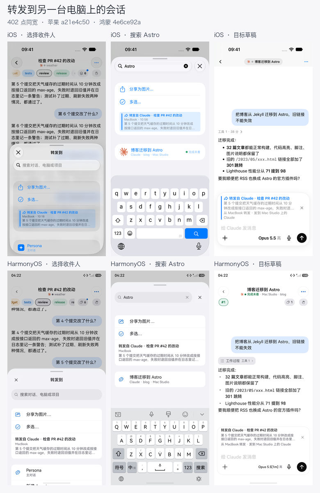
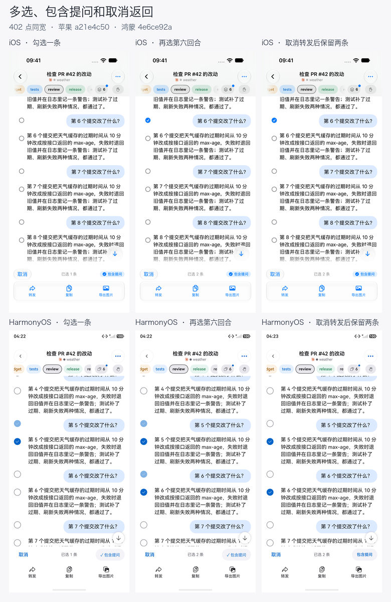

# Native phone message forwarding

These boards show the same synthetic conversation and target on an iPhone 18 Pro simulator and a HarmonyOS API 26 emulator. Both display widths are 402 logical units. The top row is iPhone `a21e4c50893c`. The bottom row is HarmonyOS `4e6ce92ac624`.

The source was the fifth and sixth replies. Canceling the recipient picker restored the two selected replies. Choosing the Astro conversation on a different machine preserved its existing draft. The synthetic Hub received zero message writes before Send and one after the explicit tap. Both platforms retained the source project and tab, and the source link reopened its conversation. A separate run transferred a real PNG. The system image exporter was dismissed without choosing a recipient.

The subsequent HarmonyOS detent change was checked by physically opening the recipient picker, dragging large and back, searching with the keyboard visible, canceling and returning. Both native medium positions were 415 logical units from the top. In the full position the iPhone measured 62 and HarmonyOS measured 63. The system keyboards and their actions remain platform-specific. The displayed boards retain the original captures from before the last spacing adjustment.

The manifest lists native image and accessibility hashes, the two board hashes and the separate workflow evidence digests. The later iPhone reference for the wider PR review is `c2d44cc1406c`.
