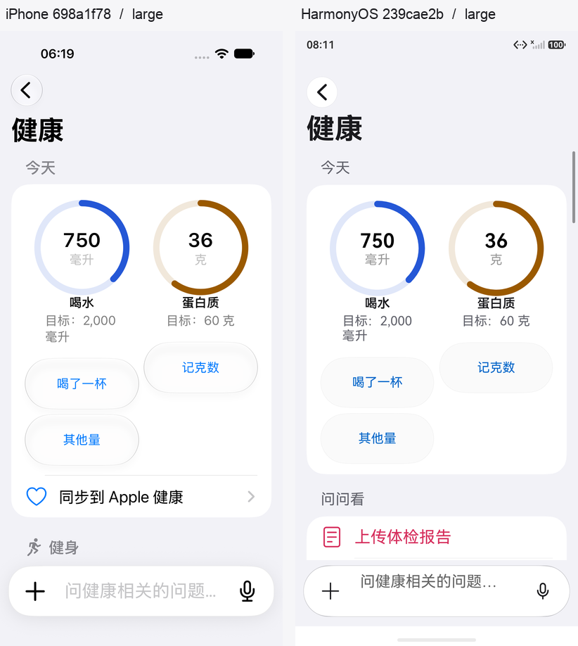

# 健康首页与历史会话

鸿蒙 `239cae2b36f0` 与 iPhone `698a1f789dff` 都从抽屉进入健康页。原屏均为 1206 × 2622 像素，宽 402 逻辑单位。这些数据来自隔离的合成账户。[来源及原图](manifest.json) · [逐控件测量](controls.json) · [排序与时间记录](ordered-rows.json)

| 外观 | 首页全幅 | 建议及历史逐行对照 | 鸿蒙上传菜单 |
| --- | --- | --- | --- |
| 浅色 | [两端首页](home-light.png) | [八行原屏节选](rows-light.png) | [选择上传方式](originals/harmony-light-report-menu.png) |
| 深色 | [两端首页](home-dark.png) | [八行原屏节选](rows-dark.png) | [选择上传方式](originals/harmony-dark-report-menu.png) |
| 最大字号 | [两端首页](home-large.png) | [八行原屏节选](rows-large.png) | [选择上传方式](originals/harmony-large-report-menu.png) |

四条历史在两端三档均按最近更新排列，从「今天吃了什么」到「这周的睡眠」「体检报告：血脂」「步数目标」。鸿蒙采集前后读回同四条服务端记录，四个更新时间逐项相同。iPhone 使用独立合成样本。

四条建议顺次为「这周我睡得怎么样？」「最近 7 天步数和上周比怎么样」「我的静息心率最近有变化吗」「帮我记一下今天体重 62.5 kg」。鸿蒙每档通过连续滚动完整看见八行。iPhone 在最大字号只露出第四条建议的两段，普通和深色也只露出「体检报告：血脂」历史行的局部。配图分别保留已拍到的片段。

历史行布局仍有差距。iPhone 普通和深色的打开触区均高 70.3，鸿蒙为 48 至 56.67。最大字号的四行，iPhone 均高 85，鸿蒙均高 189。鸿蒙的标题和摘要明显更大，另有独立的归档按钮，iPhone 还展示相对时间。逐行数据及图像可在上表查看。

两端均显示饮水 750 / 2,000 毫升和蛋白质 36 / 60 克。普通及深色的饮水目标各占一行。最大字号的第一行止于「2,000」，第二行完整显示「毫升」，六张原屏均另做了局部文字识别。两端圆环的进度和轨道色值相同。

三档报告行均宽 370，常规与深色高约 52.3，最大字号高约 59.3。鸿蒙三档实际进入「上传 PDF」「上传照片」菜单，取消后回到健康页。iPhone 三档原生测试确认入口可点。两端菜单入口各自滚动到可见位置。[报告入口实像](report-entry.png)

底栏两端均宽 378。常规和深色的起点约为 y 779.7、高 52.3，最大字号均为 y 760、高 72。鸿蒙返回键触区仍比 iPhone 低 3 个逻辑单位。最大字号三项快捷操作的纵向差为 −1.63、−1.67、+0.37，原生字体的字墨仍有细微差异。Apple 健康授权和运动系统数据有独立行。

本次普通导航没有点建议或打开历史，没有创建会话、发送消息或选择上传文件。鸿蒙 Hub 收到的写请求为零。iPhone 的样本初始化、预热、偏好及后台同步计数见清单。上一版保留在独立 H27 附件，来源摘要已写入本清单。

[逐文件 SHA-256](SHA256SUMS)
