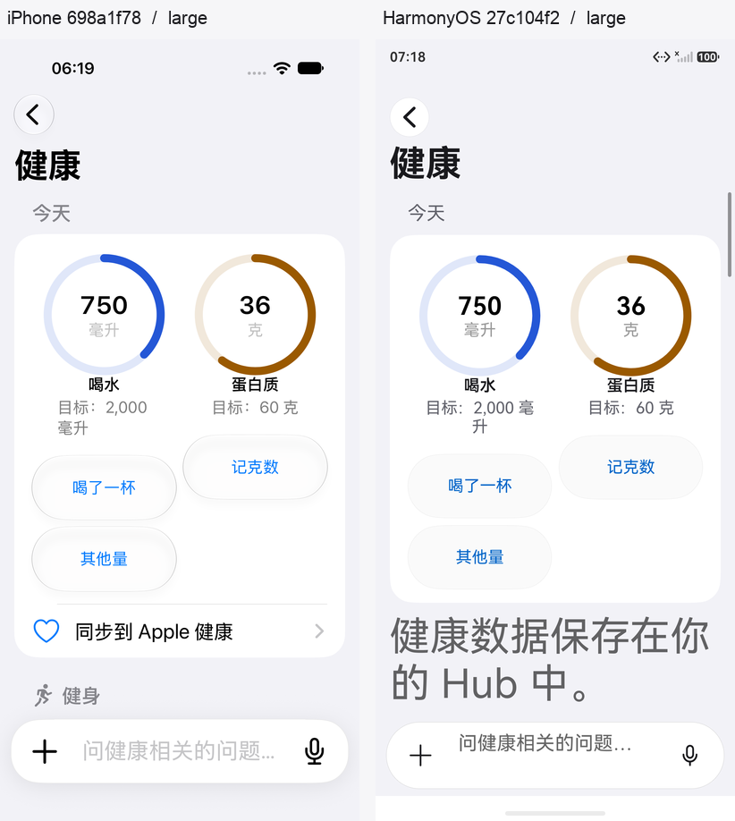

# Health home on HarmonyOS and iPhone

HarmonyOS `27c104f22881` and iPhone `698a1f789dff` were captured at 402 logical units wide, using the same synthetic intake values and four existing conversations. The screenshots retain their original 1206 × 2622 pixels. The largest text setting was used on both systems. [Source manifest](manifest.json) · [Measured native controls](controls.json)

| Appearance | Full home comparison | iPhone original | HarmonyOS original | HarmonyOS report menu |
| --- | --- | --- | --- | --- |
| Light | [Side by side](home-light.png) | [Home](originals/iphone-light-home.png) | [Home](originals/harmony-light-home.png) | [PDF and photo options](originals/harmony-light-report-menu.png) |
| Dark | [Side by side](home-dark.png) | [Home](originals/iphone-dark-home.png) | [Home](originals/harmony-dark-home.png) | [PDF and photo options](originals/harmony-dark-report-menu.png) |
| Largest text | [Side by side](home-large.png) | [Home](originals/iphone-large-home.png) | [Home](originals/harmony-large-home.png) | [PDF and photo options](originals/harmony-large-report-menu.png) |

Both apps show 750 of 2,000 ml of water and 36 of 60 g of protein. In light and dark appearance, the top edges of both rings match and the three quick actions differ vertically by 0.3 logical units. At the largest size, the rings differ by 1.1 and the quick actions by at most 1.7. The native progress and track colors match for both rings.

The HarmonyOS attachment and microphone controls are about 4.6 logical units lower. The largest attachment glyph stays within its 68-unit hit area. The water goal wraps its unit “毫升” together on iPhone; HarmonyOS puts “升” alone on the second line. The selectable report row is 370 units wide on iPhone and 342 on HarmonyOS. Apple Health-specific account permissions and activity rows appear below the shared intake panel.

The report action was enabled in all three appearances. On HarmonyOS, tapping it opened the native “上传 PDF” and “上传照片” options, and closing the menu returned to Health. The iPhone test verified its report action was hittable. The screenshots of this row were captured after each platform scrolled to it. [Report row details](report-entry.png)

The four synthetic history rows were observed on both platforms in every appearance: “今天吃了什么”, “体检报告：血脂”, “步数目标” and “这周的睡眠”. Their original visible frames and individual native accessibility evidence hashes are indexed in the manifest. No document or photo was selected. The HarmonyOS navigation run observed zero writes. On iPhone the run observed no new messages, decisions, file uploads or sessions. Fixture seeding, preferences, warm-up and background sync are recorded separately in the manifest.

原图和控件节选均来自这两个明确版本。首页对齐使用顶部状态；报告入口单独滚动到可见位置。健康数据均为专用测试样本。原始控件树的摘要保留在清单中。公开节选仅含界面内容、几何和实际可用状态。

[SHA-256 file inventory](SHA256SUMS)
