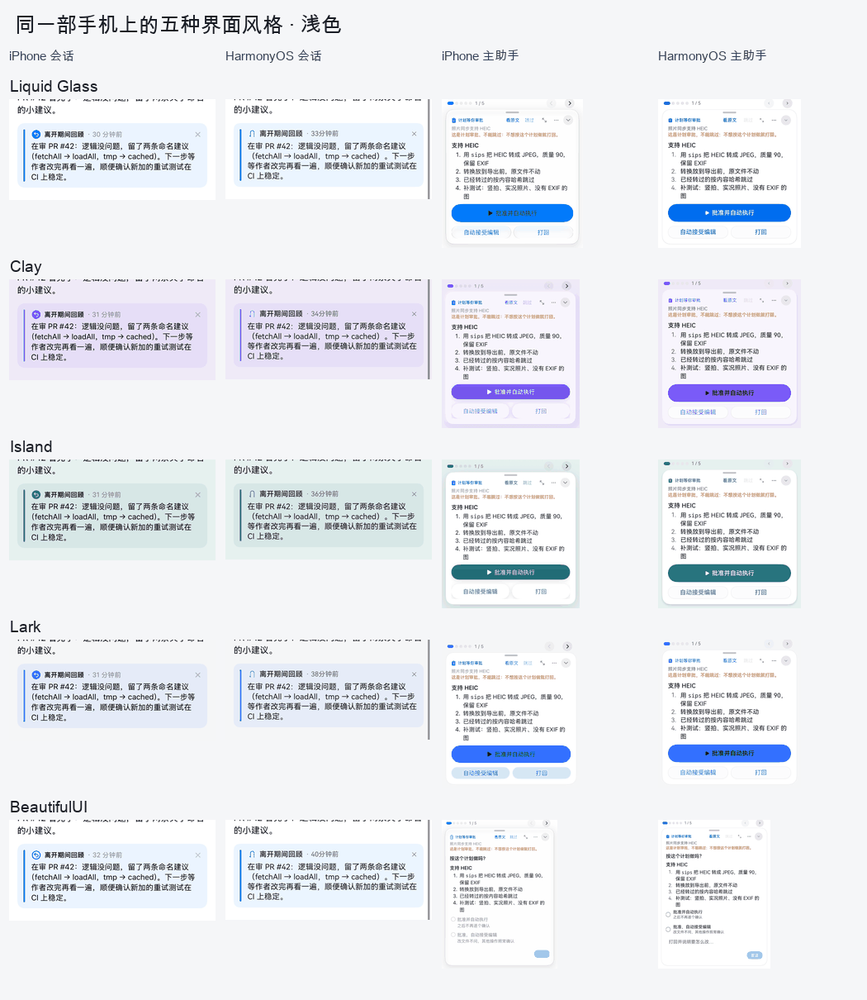
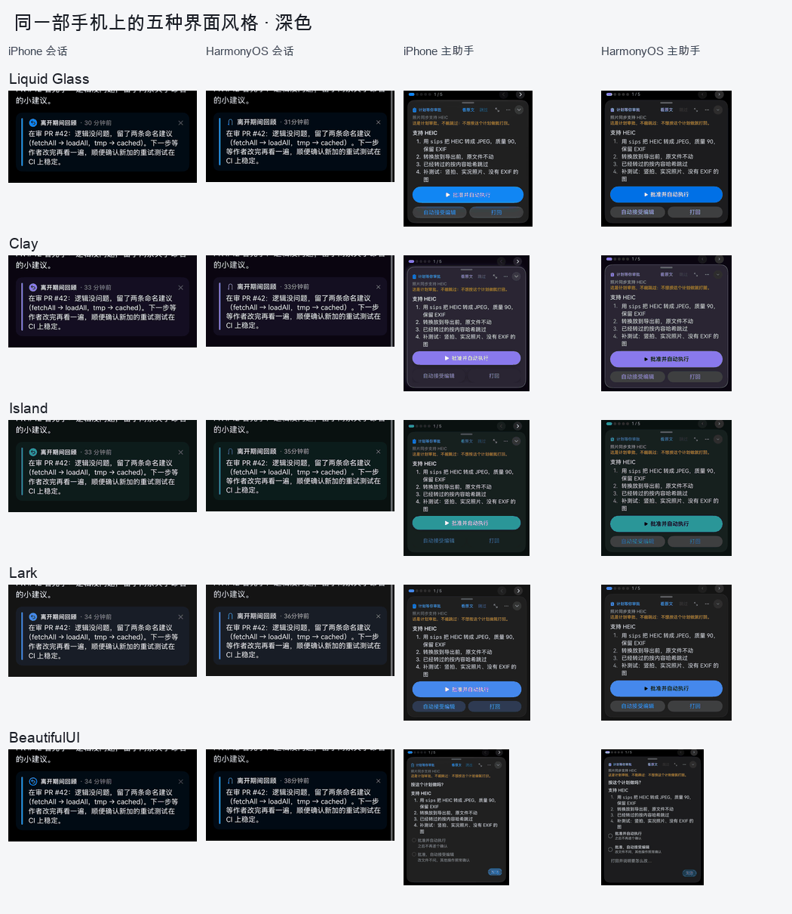

# Interface styles
Each of Liquid Glass, Clay, Island, Lark and BeautifulUI was selected in light and dark mode. The two native pages in each mode are the MacBook PR #42 conversation and the main Persona conversation with the HEIC approval card. The selected style survived relaunch and also changed in the running application. The forty unmodified full screenshots and public application-control excerpts are linked below. Each excerpt retains its source accessibility hash, native role, bounds and semantic label. Across these captures, the exports contain 420 controls. The [frame export index](original-frame-export.json) identifies the source and public control file for every capture.

The sampled dark Island page background measured RGB (10, 17, 16) on iPhone and (9, 17, 16) on HarmonyOS. The recorded active count was 15 on both devices. The Needs You count in this build was 4 on iPhone and 7 on HarmonyOS. The [style capture receipt](source-receipt.json) identifies these exact images and the crop used for each board.

## Full-size captures

| Captured state | iPhone | HarmonyOS |
| --- | --- | --- |
| Dark / BeautifulUI / Agent conversation | [PNG](raw/iphone/dark/beautiful/agent-chat.png) · [AX](accessibility-excerpts/dark-beautiful-agent-chat-iphone.json) | [PNG](raw/harmony/dark/beautiful/agent-chat.png) · [AX](accessibility-excerpts/dark-beautiful-agent-chat-harmony.json) |
| Dark / BeautifulUI / Persona decision card | [PNG](raw/iphone/dark/beautiful/persona.png) · [AX](accessibility-excerpts/dark-beautiful-persona-iphone.json) | [PNG](raw/harmony/dark/beautiful/persona.png) · [AX](accessibility-excerpts/dark-beautiful-persona-harmony.json) |
| Dark / Clay / Agent conversation | [PNG](raw/iphone/dark/clay/agent-chat.png) · [AX](accessibility-excerpts/dark-clay-agent-chat-iphone.json) | [PNG](raw/harmony/dark/clay/agent-chat.png) · [AX](accessibility-excerpts/dark-clay-agent-chat-harmony.json) |
| Dark / Clay / Persona decision card | [PNG](raw/iphone/dark/clay/persona.png) · [AX](accessibility-excerpts/dark-clay-persona-iphone.json) | [PNG](raw/harmony/dark/clay/persona.png) · [AX](accessibility-excerpts/dark-clay-persona-harmony.json) |
| Dark / Liquid Glass / Agent conversation | [PNG](raw/iphone/dark/glass/agent-chat.png) · [AX](accessibility-excerpts/dark-glass-agent-chat-iphone.json) | [PNG](raw/harmony/dark/glass/agent-chat.png) · [AX](accessibility-excerpts/dark-glass-agent-chat-harmony.json) |
| Dark / Liquid Glass / Persona decision card | [PNG](raw/iphone/dark/glass/persona.png) · [AX](accessibility-excerpts/dark-glass-persona-iphone.json) | [PNG](raw/harmony/dark/glass/persona.png) · [AX](accessibility-excerpts/dark-glass-persona-harmony.json) |
| Dark / Island / Agent conversation | [PNG](raw/iphone/dark/island/agent-chat.png) · [AX](accessibility-excerpts/dark-island-agent-chat-iphone.json) | [PNG](raw/harmony/dark/island/agent-chat.png) · [AX](accessibility-excerpts/dark-island-agent-chat-harmony.json) |
| Dark / Island / Persona decision card | [PNG](raw/iphone/dark/island/persona.png) · [AX](accessibility-excerpts/dark-island-persona-iphone.json) | [PNG](raw/harmony/dark/island/persona.png) · [AX](accessibility-excerpts/dark-island-persona-harmony.json) |
| Dark / Lark / Agent conversation | [PNG](raw/iphone/dark/lark/agent-chat.png) · [AX](accessibility-excerpts/dark-lark-agent-chat-iphone.json) | [PNG](raw/harmony/dark/lark/agent-chat.png) · [AX](accessibility-excerpts/dark-lark-agent-chat-harmony.json) |
| Dark / Lark / Persona decision card | [PNG](raw/iphone/dark/lark/persona.png) · [AX](accessibility-excerpts/dark-lark-persona-iphone.json) | [PNG](raw/harmony/dark/lark/persona.png) · [AX](accessibility-excerpts/dark-lark-persona-harmony.json) |
| Light / BeautifulUI / Agent conversation | [PNG](raw/iphone/light/beautiful/agent-chat.png) · [AX](accessibility-excerpts/light-beautiful-agent-chat-iphone.json) | [PNG](raw/harmony/light/beautiful/agent-chat.png) · [AX](accessibility-excerpts/light-beautiful-agent-chat-harmony.json) |
| Light / BeautifulUI / Persona decision card | [PNG](raw/iphone/light/beautiful/persona.png) · [AX](accessibility-excerpts/light-beautiful-persona-iphone.json) | [PNG](raw/harmony/light/beautiful/persona.png) · [AX](accessibility-excerpts/light-beautiful-persona-harmony.json) |
| Light / Clay / Agent conversation | [PNG](raw/iphone/light/clay/agent-chat.png) · [AX](accessibility-excerpts/light-clay-agent-chat-iphone.json) | [PNG](raw/harmony/light/clay/agent-chat.png) · [AX](accessibility-excerpts/light-clay-agent-chat-harmony.json) |
| Light / Clay / Persona decision card | [PNG](raw/iphone/light/clay/persona.png) · [AX](accessibility-excerpts/light-clay-persona-iphone.json) | [PNG](raw/harmony/light/clay/persona.png) · [AX](accessibility-excerpts/light-clay-persona-harmony.json) |
| Light / Liquid Glass / Agent conversation | [PNG](raw/iphone/light/glass/agent-chat.png) · [AX](accessibility-excerpts/light-glass-agent-chat-iphone.json) | [PNG](raw/harmony/light/glass/agent-chat.png) · [AX](accessibility-excerpts/light-glass-agent-chat-harmony.json) |
| Light / Liquid Glass / Persona decision card | [PNG](raw/iphone/light/glass/persona.png) · [AX](accessibility-excerpts/light-glass-persona-iphone.json) | [PNG](raw/harmony/light/glass/persona.png) · [AX](accessibility-excerpts/light-glass-persona-harmony.json) |
| Light / Island / Agent conversation | [PNG](raw/iphone/light/island/agent-chat.png) · [AX](accessibility-excerpts/light-island-agent-chat-iphone.json) | [PNG](raw/harmony/light/island/agent-chat.png) · [AX](accessibility-excerpts/light-island-agent-chat-harmony.json) |
| Light / Island / Persona decision card | [PNG](raw/iphone/light/island/persona.png) · [AX](accessibility-excerpts/light-island-persona-iphone.json) | [PNG](raw/harmony/light/island/persona.png) · [AX](accessibility-excerpts/light-island-persona-harmony.json) |
| Light / Lark / Agent conversation | [PNG](raw/iphone/light/lark/agent-chat.png) · [AX](accessibility-excerpts/light-lark-agent-chat-iphone.json) | [PNG](raw/harmony/light/lark/agent-chat.png) · [AX](accessibility-excerpts/light-lark-agent-chat-harmony.json) |
| Light / Lark / Persona decision card | [PNG](raw/iphone/light/lark/persona.png) · [AX](accessibility-excerpts/light-lark-persona-iphone.json) | [PNG](raw/harmony/light/lark/persona.png) · [AX](accessibility-excerpts/light-lark-persona-harmony.json) |

## Files and integrity

This section contains 40 images with their native accessibility captures. Its [machine-readable index](manifest.json) records the product revision and both acquisition and public byte hashes. [SHA-256 checksums](SHA256SUMS) cover the files in this section.
