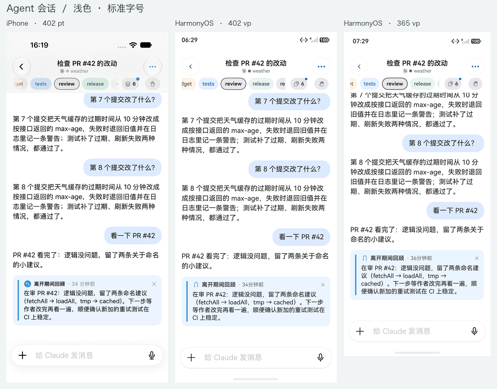
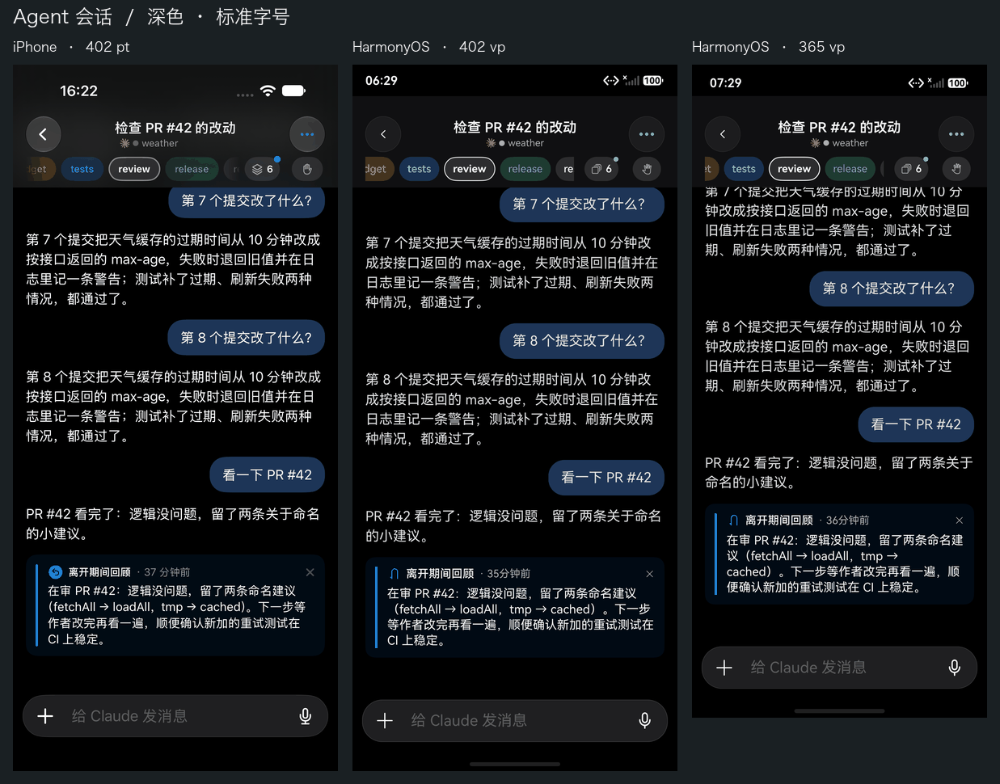
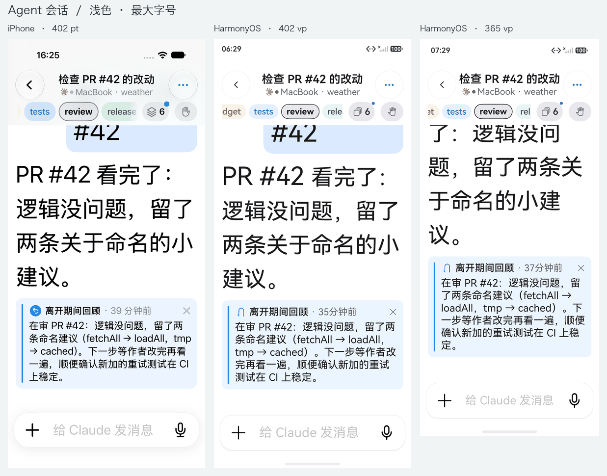

# Agent 会话 · Agent conversation

[返回全部页面 · All pages](../README.md)

打开 weather 的 PR #42 会话，核对用户消息、回复与回顾。
Open the PR #42 conversation with the seeded review history.

Three independent native captures, left to right: iPhone 402 pt, HarmonyOS 402 vp, HarmonyOS 365 vp. The complete screen, including system bars, is visible.

[Download all original screenshots and accessibility trees for this page](../originals/agent-chat.zip?raw=1) · [Source and capture method](../SOURCES.md)

Original archive SHA-256: 41ee9cd8513a5b198dadd5e98eac0f237025c1ed2d4ca6ea391aa4ea6739d576

## 浅色 · 标准字号

| Device | Pixels | Captured at | PNG digest | Hierarchy digest |
| --- | --- | --- | --- | --- |
| iPhone 402 pt | 1206 × 2622 | 2026-11-23T08:19:50.959+00:00 | 71d54ba86e27f2fb | 6175d8282e3f2e7a |
| HarmonyOS 402 vp | 1206 × 2622 | 2026-11-23T18:29:08+08:00 | 7f3ee3ea580c6ee2 | 699d82cde35c75ee |
| HarmonyOS 365 vp | 1280 × 2832 | 2026-11-23T19:29:15+08:00 | 013422fd4b88d850 | 704ad30c386207e3 |

## 深色 · 标准字号

| Device | Pixels | Captured at | PNG digest | Hierarchy digest |
| --- | --- | --- | --- | --- |
| iPhone 402 pt | 1206 × 2622 | 2026-11-23T08:22:51.658+00:00 | 070ef1ed21935246 | 3ea85586052b3c12 |
| HarmonyOS 402 vp | 1206 × 2622 | 2026-11-23T18:29:12+08:00 | 2597b050b3cdf931 | 650a2584b22b94bc |
| HarmonyOS 365 vp | 1280 × 2832 | 2026-11-23T19:29:19+08:00 | 679bef120a94bc55 | 51b6c9d1804ff1f1 |

## 浅色 · 最大字号

| Device | Pixels | Captured at | PNG digest | Hierarchy digest |
| --- | --- | --- | --- | --- |
| iPhone 402 pt | 1206 × 2622 | 2026-11-23T08:25:35.181+00:00 | 72e15a1c3bce5706 | 3cad827db3be38e4 |
| HarmonyOS 402 vp | 1206 × 2622 | 2026-11-23T18:29:16+08:00 | bc74640072691da3 | 2152f63d9a38fd4f |
| HarmonyOS 365 vp | 1280 × 2832 | 2026-11-23T19:29:26+08:00 | e31e70438522b076 | a10af6c8c111e8fa |

Full 64-character digests and ZIP entry paths are under this page in the [manifest](../manifest.json).

[← Agents 列表](agents.md)
[会话小结详情 →](recap-detail.md)
