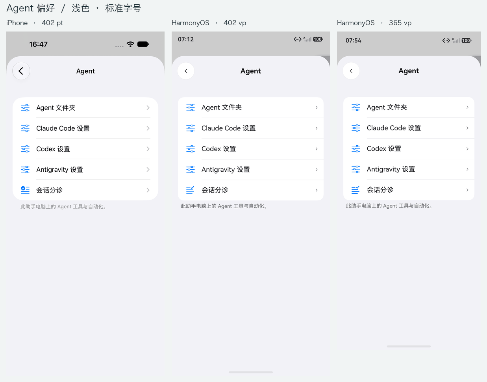
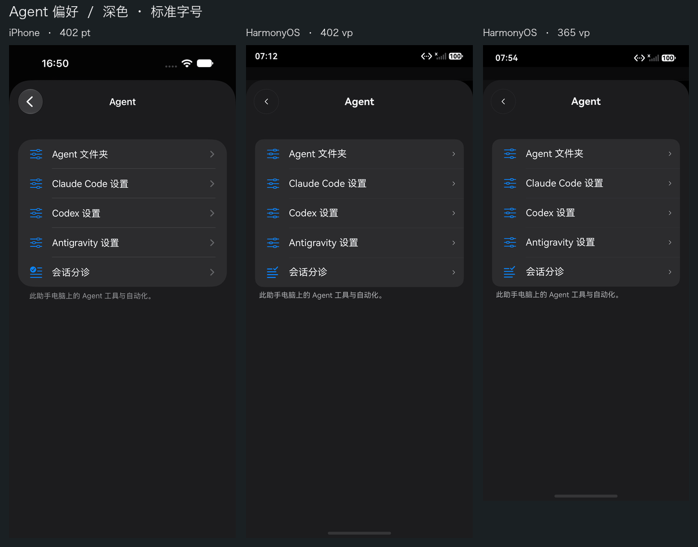
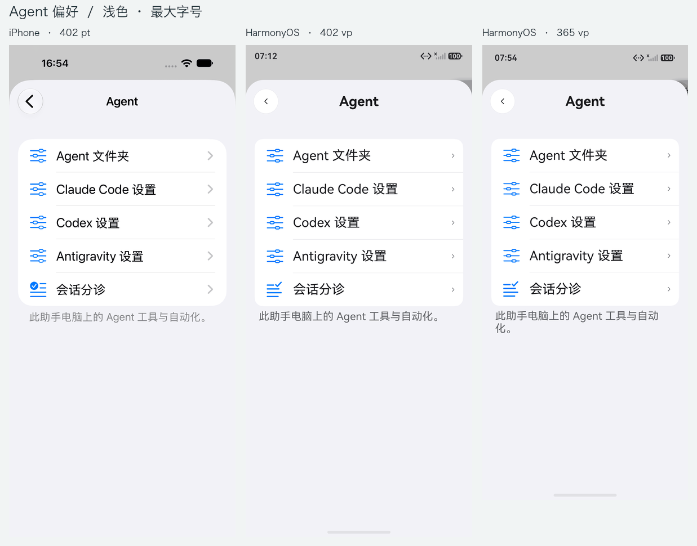

# Agent 偏好 · Agent preferences

[返回全部页面 · All pages](../README.md)

从设置进入 Agent 选项。
Open Agent preferences from Settings search and return to the same query.

Three independent native captures, left to right: iPhone 402 pt, HarmonyOS 402 vp, HarmonyOS 365 vp. The complete screen, including system bars, is visible.

[Download all original screenshots and accessibility trees for this page](../originals/agent-preferences.zip?raw=1) · [Source and capture method](../SOURCES.md)

Original archive SHA-256: ffdd8bca963ebf86414bb2370b0a8353b3ed3ecc236656936553fd8cddbd2f8e

## 浅色 · 标准字号

| Device | Pixels | Captured at | PNG digest | Hierarchy digest |
| --- | --- | --- | --- | --- |
| iPhone 402 pt | 1206 × 2622 | 2026-11-23T08:47:09.419+00:00 | 25872e78165a99fc | 1f3e0ab644901093 |
| HarmonyOS 402 vp | 1206 × 2622 | 2026-11-23T19:12:39+08:00 | 20aae5d5ee8ed283 | 6bc8527e08affdb6 |
| HarmonyOS 365 vp | 1280 × 2832 | 2026-11-23T19:54:21+08:00 | e83486032e7d924d | 21cca861ec03e371 |

## 深色 · 标准字号

| Device | Pixels | Captured at | PNG digest | Hierarchy digest |
| --- | --- | --- | --- | --- |
| iPhone 402 pt | 1206 × 2622 | 2026-11-23T08:50:56.643+00:00 | 4742b683886c6eaf | 96da7d3266364a3e |
| HarmonyOS 402 vp | 1206 × 2622 | 2026-11-23T19:12:43+08:00 | 29674a6dc8b2ca06 | e5c7a30d7177e3fc |
| HarmonyOS 365 vp | 1280 × 2832 | 2026-11-23T19:54:25+08:00 | 9372305f8285714d | 33bfcda01d77de4e |

## 浅色 · 最大字号

| Device | Pixels | Captured at | PNG digest | Hierarchy digest |
| --- | --- | --- | --- | --- |
| iPhone 402 pt | 1206 × 2622 | 2026-11-23T08:54:40.360+00:00 | 2300ebede694c64b | 166f0d38c035647d |
| HarmonyOS 402 vp | 1206 × 2622 | 2026-11-23T19:12:47+08:00 | 9399a1642ef135c3 | 82abc58a74416190 |
| HarmonyOS 365 vp | 1280 × 2832 | 2026-11-23T19:54:29+08:00 | ac8c20dd37364d1f | 30ab6cbf4956dc0a |

Full 64-character digests and ZIP entry paths are under this page in the [manifest](../manifest.json).

[← 语言](language.md)
[搜索会话内容 →](search.md)
