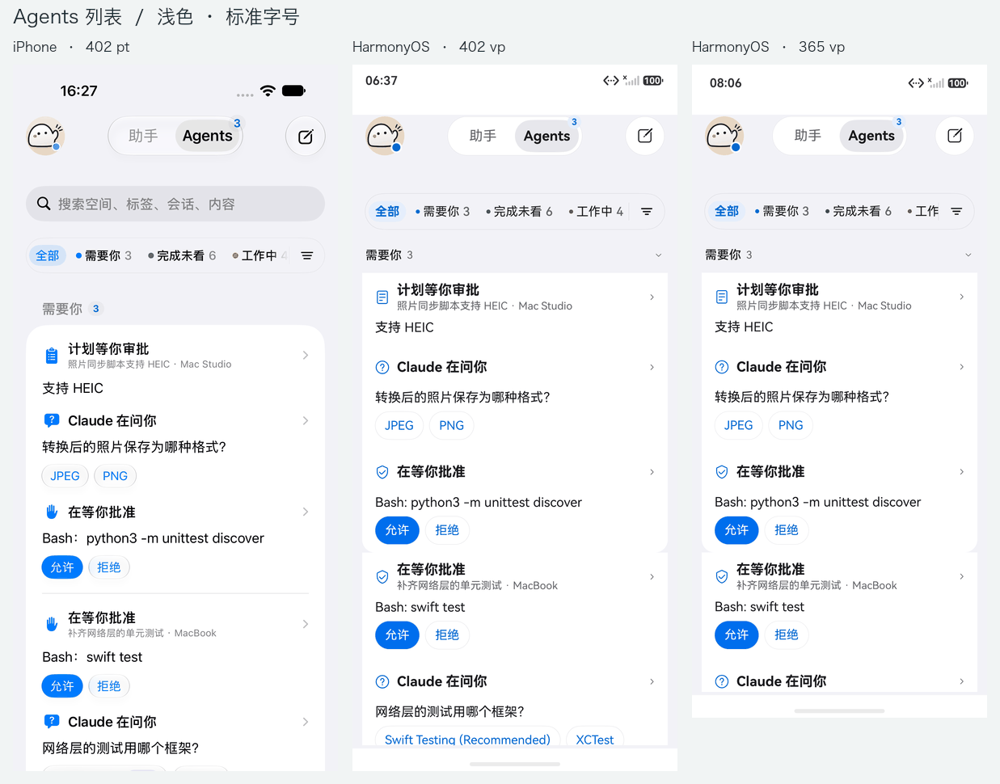
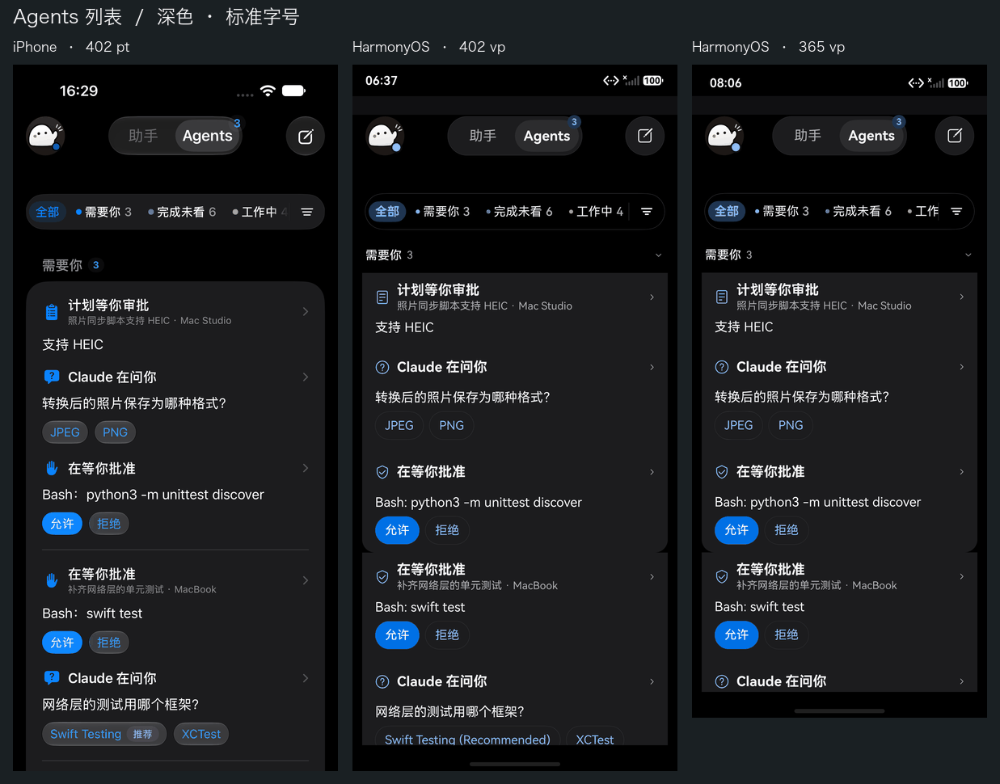
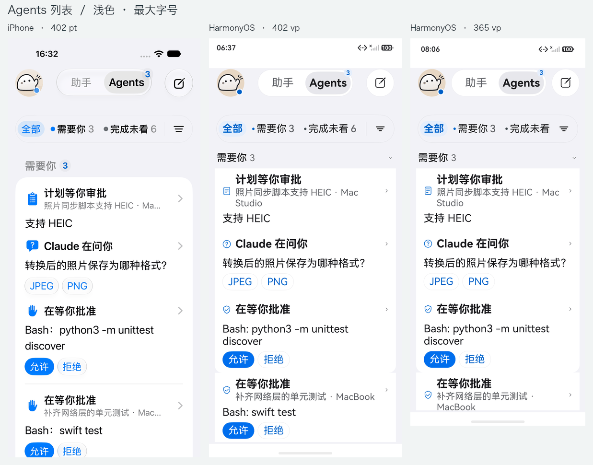

# Agents 列表 · Agent list

[返回全部页面 · All pages](../README.md)

按状态浏览 Agents，区分需要处理和正在工作的会话。

Three independent native captures, left to right: iPhone 402 pt, HarmonyOS 402 vp, HarmonyOS 365 vp. The complete screen, including system bars, is visible.

[Download all original screenshots and accessibility trees for this page](../originals/agents.zip?raw=1) · [Source and capture method](../SOURCES.md)

Original archive SHA-256: a244731774a981cd4cf71bd2150b54114a8cdf10a3f3ddf74c4e7697e4bd3155

## 浅色 · 标准字号

| Device | Pixels | Captured at | PNG digest | Hierarchy digest |
| --- | --- | --- | --- | --- |
| iPhone 402 pt | 1206 × 2622 | 2026-11-23T08:27:15.162+00:00 | 06432675dd110273 | fa63bc41e4a44f3d |
| HarmonyOS 402 vp | 1206 × 2622 | 2026-11-23T18:37:43+08:00 | 4d5bd97325759e5e | 4040147657dcec43 |
| HarmonyOS 365 vp | 1280 × 2832 | 2026-11-23T20:06:46+08:00 | 45df59d8047b5d02 | 54cb80f864792c21 |

## 深色 · 标准字号

| Device | Pixels | Captured at | PNG digest | Hierarchy digest |
| --- | --- | --- | --- | --- |
| iPhone 402 pt | 1206 × 2622 | 2026-11-23T08:29:43.652+00:00 | e9095c7f80639913 | f44f7475a4d27535 |
| HarmonyOS 402 vp | 1206 × 2622 | 2026-11-23T18:37:47+08:00 | 18c8d19502033d7d | 40020d03d05663b6 |
| HarmonyOS 365 vp | 1280 × 2832 | 2026-11-23T20:06:50+08:00 | b98017c47679fc93 | 5d7f1a0c67adeff8 |

## 浅色 · 最大字号

| Device | Pixels | Captured at | PNG digest | Hierarchy digest |
| --- | --- | --- | --- | --- |
| iPhone 402 pt | 1206 × 2622 | 2026-11-23T08:32:13.645+00:00 | 44f0caffbfb93728 | de57f2e684db8b6c |
| HarmonyOS 402 vp | 1206 × 2622 | 2026-11-23T18:37:51+08:00 | 8b8c0fbbd5f4b150 | 15d8da6ccbefe969 |
| HarmonyOS 365 vp | 1280 × 2832 | 2026-11-23T20:06:54+08:00 | 36037088ed13b03c | 84d52fda277cf1bd |

Full 64-character digests and ZIP entry paths are under this page in the [manifest](../manifest.json).

[← 提交 Agent 配置](start-ready.md)
[Agent 会话 →](agent-chat.md)
