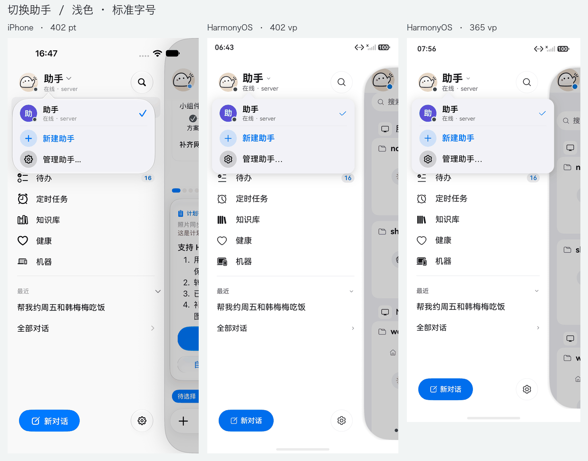
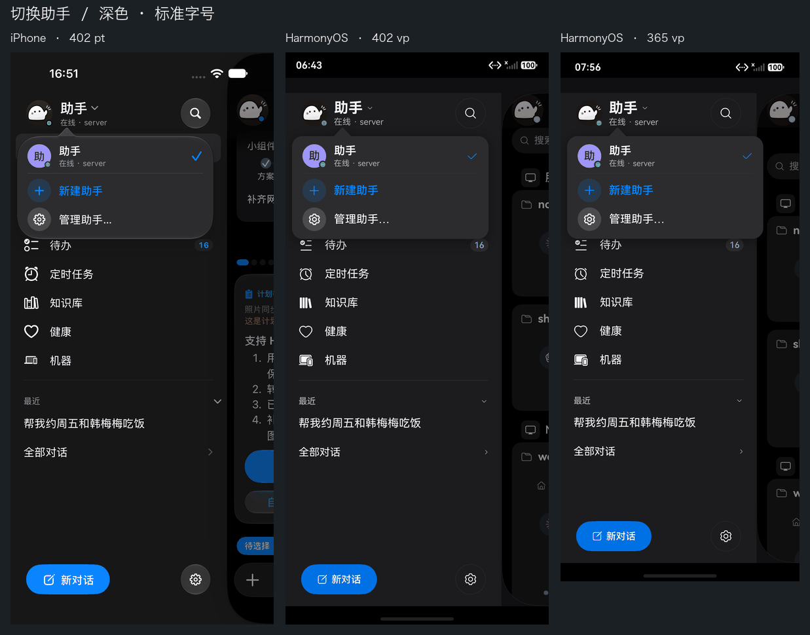
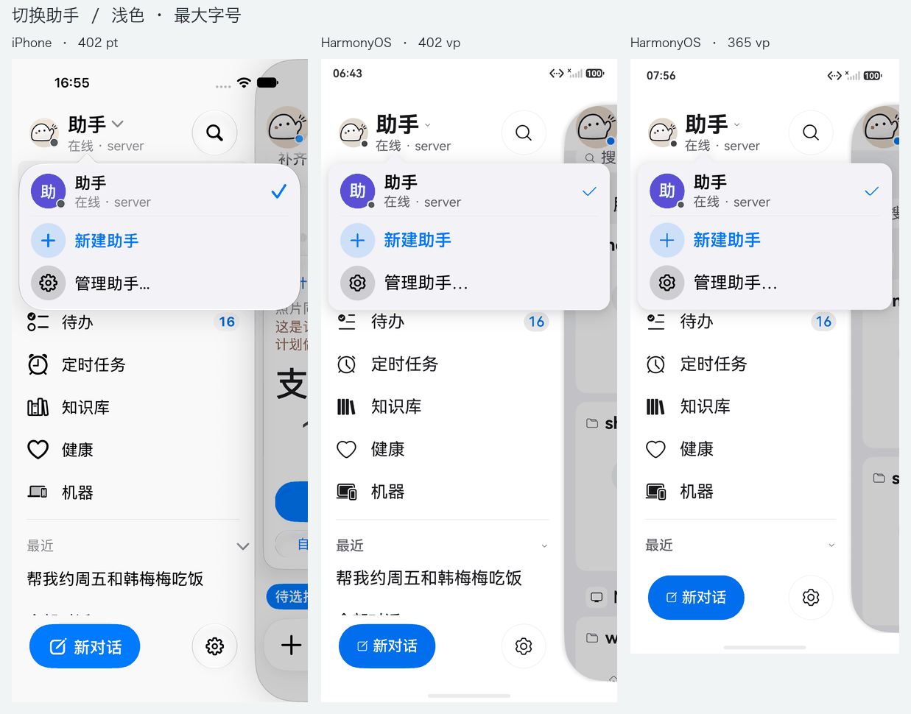

# 切换助手 · Switch assistants

[返回全部页面 · All pages](../README.md)

从当前助手打开助手切换菜单。

Three independent native captures, left to right: iPhone 402 pt, HarmonyOS 402 vp, HarmonyOS 365 vp. The complete screen, including system bars, is visible.

[Download all original screenshots and accessibility trees for this page](../originals/assistant-menu.zip?raw=1) · [Source and capture method](../SOURCES.md)

Original archive SHA-256: 15e0cc4920430c77e98ea5f901269bf12ab515a10cb9cd81209216e1f59a9022

## 浅色 · 标准字号

| Device | Pixels | Captured at | PNG digest | Hierarchy digest |
| --- | --- | --- | --- | --- |
| iPhone 402 pt | 1206 × 2622 | 2026-11-23T08:47:41.258+00:00 | 30d62f8f500e0586 | aeb9de7fcf903993 |
| HarmonyOS 402 vp | 1206 × 2622 | 2026-11-23T18:43:00+08:00 | 010fae8b3b530cba | aaf12e9e2ad81f48 |
| HarmonyOS 365 vp | 1280 × 2832 | 2026-11-23T19:56:24+08:00 | dc72ddfad63a9d33 | cfa3d90a75fa072d |

## 深色 · 标准字号

| Device | Pixels | Captured at | PNG digest | Hierarchy digest |
| --- | --- | --- | --- | --- |
| iPhone 402 pt | 1206 × 2622 | 2026-11-23T08:51:28.308+00:00 | 00f36903a0a14a15 | 6d7e98eb95e16eeb |
| HarmonyOS 402 vp | 1206 × 2622 | 2026-11-23T18:43:05+08:00 | 688d3c9557a5f6e3 | 12fccc20d53bccdd |
| HarmonyOS 365 vp | 1280 × 2832 | 2026-11-23T19:56:29+08:00 | f404fa4d44cb35a6 | 6577b8cfb1e108e4 |

## 浅色 · 最大字号

| Device | Pixels | Captured at | PNG digest | Hierarchy digest |
| --- | --- | --- | --- | --- |
| iPhone 402 pt | 1206 × 2622 | 2026-11-23T08:55:13.958+00:00 | 947418e651701e70 | 181114d1153edec2 |
| HarmonyOS 402 vp | 1206 × 2622 | 2026-11-23T18:43:10+08:00 | 862a14734334c805 | 6b25a17ca9f522fa |
| HarmonyOS 365 vp | 1280 × 2832 | 2026-11-23T19:56:35+08:00 | 6aa06007e53a5017 | 9c99b877d4b9f611 |

Full 64-character digests and ZIP entry paths are under this page in the [manifest](../manifest.json).

[← 侧栏](drawer.md)
[设置 →](settings.md)
