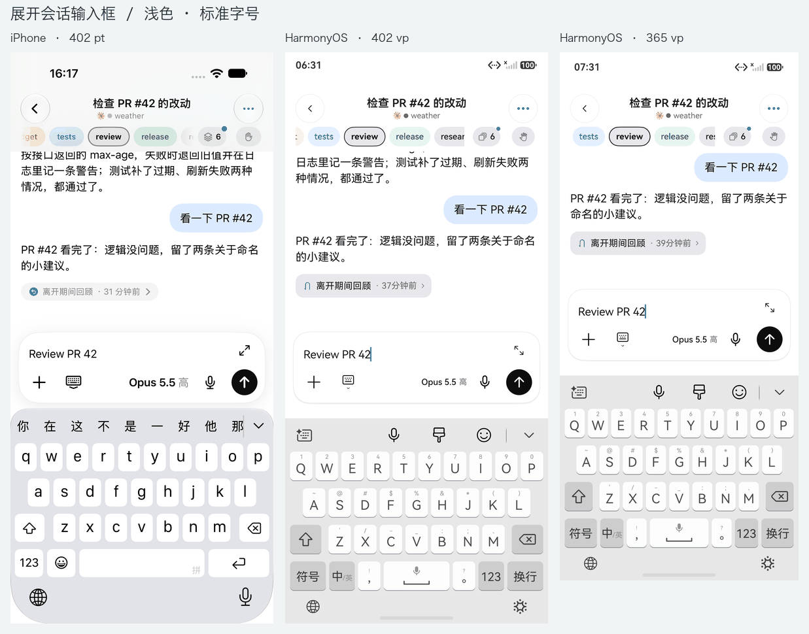
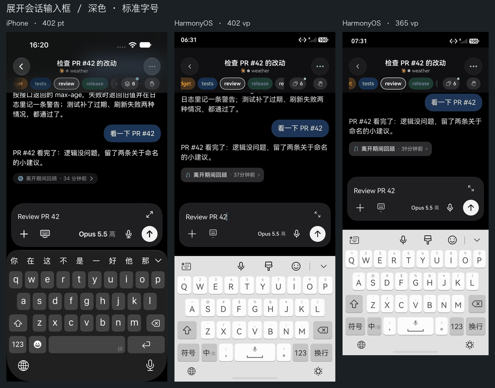
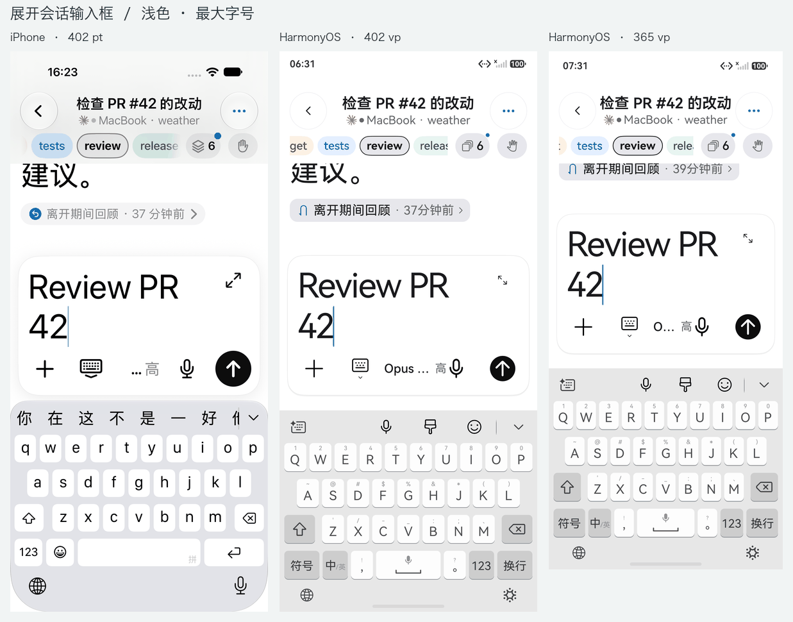

# 展开会话输入框 · Focused composer

[返回全部页面 · All pages](../README.md)

聚焦 PR #42 的输入框，核对草稿、键盘和发送控件的位置。
Focus the PR #42 composer and return from its full-screen editor to the same draft.

Three independent native captures, left to right: iPhone 402 pt, HarmonyOS 402 vp, HarmonyOS 365 vp. The complete screen, including system bars, is visible.

[Download all original screenshots and accessibility trees for this page](../originals/composer.zip?raw=1) · [Source and capture method](../SOURCES.md)

Original archive SHA-256: 41b7966a47d695f83a9f1b0741e541e075ad46e9a47b639d473732ca235b9d6a

## 浅色 · 标准字号

| Device | Pixels | Captured at | PNG digest | Hierarchy digest |
| --- | --- | --- | --- | --- |
| iPhone 402 pt | 1206 × 2622 | 2026-11-23T08:17:00.811+00:00 | 33b522f1b70289b9 | 45f397d01e09f545 |
| HarmonyOS 402 vp | 1206 × 2622 | 2026-11-23T18:31:26+08:00 | 65ca0ca612094427 | 1cef08c06023450e |
| HarmonyOS 365 vp | 1280 × 2832 | 2026-11-23T19:31:35+08:00 | 5e2a8034f9986a02 | 7de4eb2a2b460574 |

## 深色 · 标准字号

| Device | Pixels | Captured at | PNG digest | Hierarchy digest |
| --- | --- | --- | --- | --- |
| iPhone 402 pt | 1206 × 2622 | 2026-11-23T08:20:42.396+00:00 | c5317909460c477c | 2a64006f7cb838db |
| HarmonyOS 402 vp | 1206 × 2622 | 2026-11-23T18:31:30+08:00 | 1246986adae8e4c3 | 0fe8b1d278210c5a |
| HarmonyOS 365 vp | 1280 × 2832 | 2026-11-23T19:31:38+08:00 | 5b6cf1556fc30164 | 3ab309b40c3ffbf9 |

## 浅色 · 最大字号

| Device | Pixels | Captured at | PNG digest | Hierarchy digest |
| --- | --- | --- | --- | --- |
| iPhone 402 pt | 1206 × 2622 | 2026-11-23T08:23:41.445+00:00 | 3263efb86cf15fb5 | 865838c7712e08b9 |
| HarmonyOS 402 vp | 1206 × 2622 | 2026-11-23T18:31:34+08:00 | 82890ba44bb598a0 | d8b9bf6be9b24a5c |
| HarmonyOS 365 vp | 1280 × 2832 | 2026-11-23T19:31:43+08:00 | b01e5680346b090b | 644b91f37e6383ae |

Full 64-character digests and ZIP entry paths are under this page in the [manifest](../manifest.json).

[← Persona 主对话](persona.md)
[回看会话记录 →](reading-history.md)
