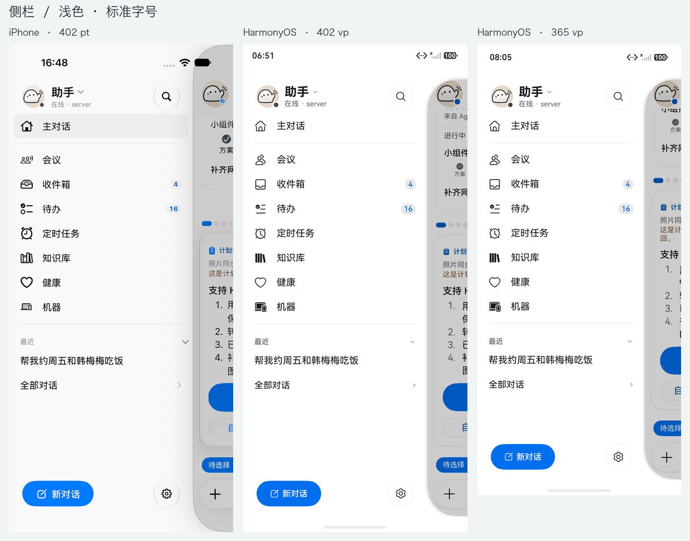
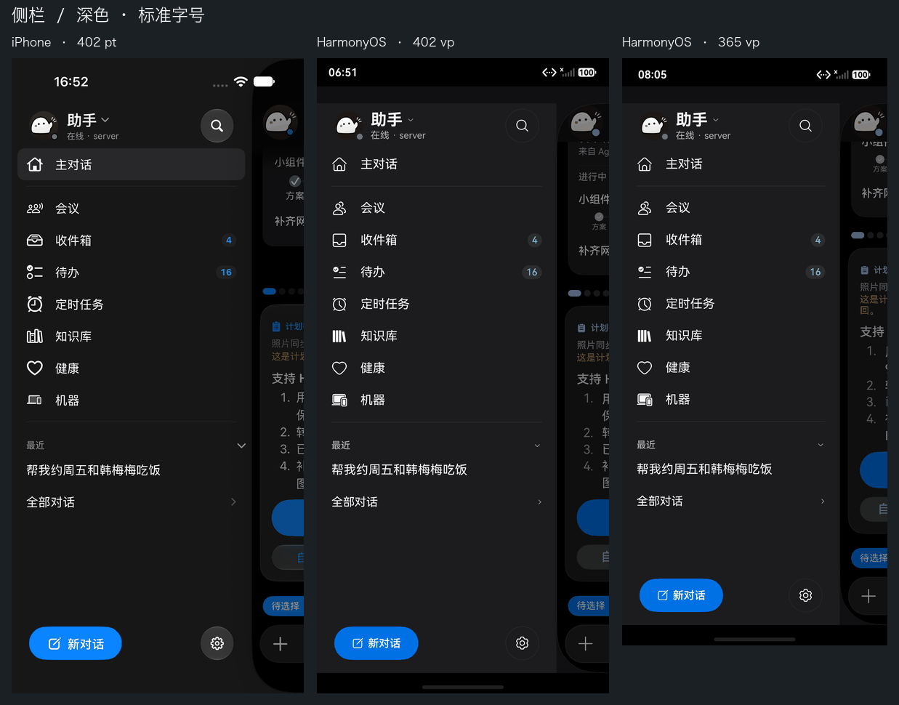
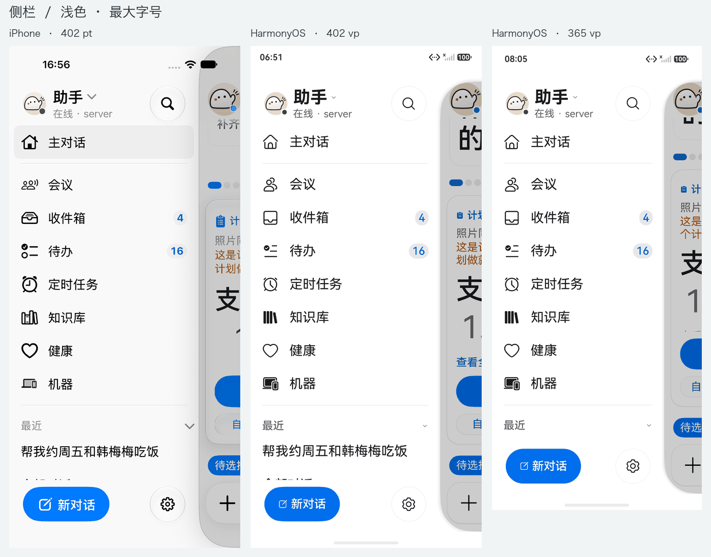

# 侧栏 · Navigation drawer

[返回全部页面 · All pages](../README.md)

在侧栏查找主对话、工作空间和设置入口。

Three independent native captures, left to right: iPhone 402 pt, HarmonyOS 402 vp, HarmonyOS 365 vp. The complete screen, including system bars, is visible.

[Download all original screenshots and accessibility trees for this page](../originals/drawer.zip?raw=1) · [Source and capture method](../SOURCES.md)

Original archive SHA-256: 2e0bf676228e2c69fa86c48faf9036c4835ccf0d83e6694dd0b30a2225a72127

## 浅色 · 标准字号

| Device | Pixels | Captured at | PNG digest | Hierarchy digest |
| --- | --- | --- | --- | --- |
| iPhone 402 pt | 1206 × 2622 | 2026-11-23T08:48:31.209+00:00 | b384e10c61f2df8e | 5892466921b1a172 |
| HarmonyOS 402 vp | 1206 × 2622 | 2026-11-23T18:51:35+08:00 | 4e7770d87aca5922 | ec069be53fd66660 |
| HarmonyOS 365 vp | 1280 × 2832 | 2026-11-23T20:05:28+08:00 | adfbaa0816c0f6f3 | 1d921c3f6e7e376f |

## 深色 · 标准字号

| Device | Pixels | Captured at | PNG digest | Hierarchy digest |
| --- | --- | --- | --- | --- |
| iPhone 402 pt | 1206 × 2622 | 2026-11-23T08:52:19.483+00:00 | 2945e3a00b326cdd | f935a0fce704e134 |
| HarmonyOS 402 vp | 1206 × 2622 | 2026-11-23T18:51:40+08:00 | 7152230807489819 | 327ec256049441ad |
| HarmonyOS 365 vp | 1280 × 2832 | 2026-11-23T20:05:33+08:00 | c1917fda563b006d | bbc3dc68e64b448e |

## 浅色 · 最大字号

| Device | Pixels | Captured at | PNG digest | Hierarchy digest |
| --- | --- | --- | --- | --- |
| iPhone 402 pt | 1206 × 2622 | 2026-11-23T08:56:06.187+00:00 | 522eb339f20f8b61 | 36198f34f9921af1 |
| HarmonyOS 402 vp | 1206 × 2622 | 2026-11-23T18:51:45+08:00 | 0d7467a1a7df2e54 | 9633e2d5d9b352ef |
| HarmonyOS 365 vp | 1280 × 2832 | 2026-11-23T20:05:39+08:00 | ae2bfc6b0cff1391 | 462df21a4820ccb7 |

Full 64-character digests and ZIP entry paths are under this page in the [manifest](../manifest.json).

[← 机器监控读数](machine-monitor.md)
[切换助手 →](assistant-menu.md)
