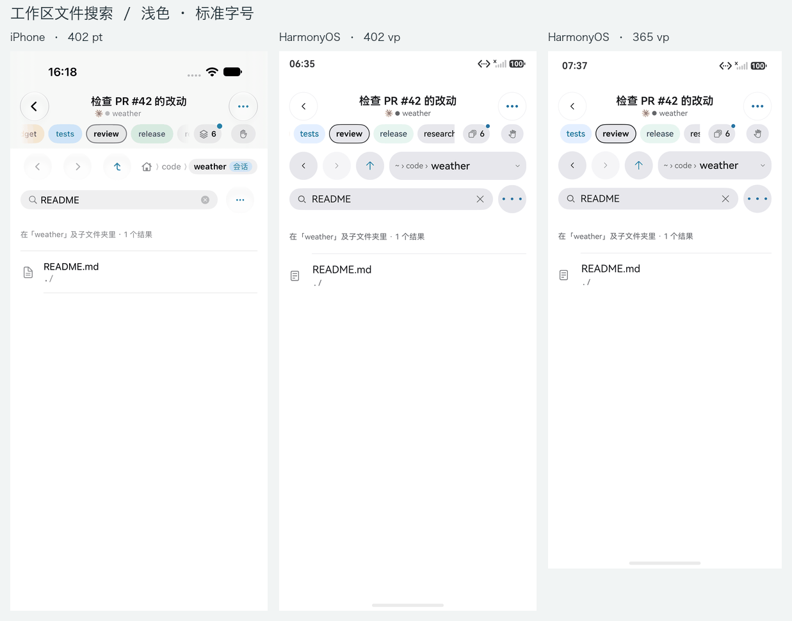
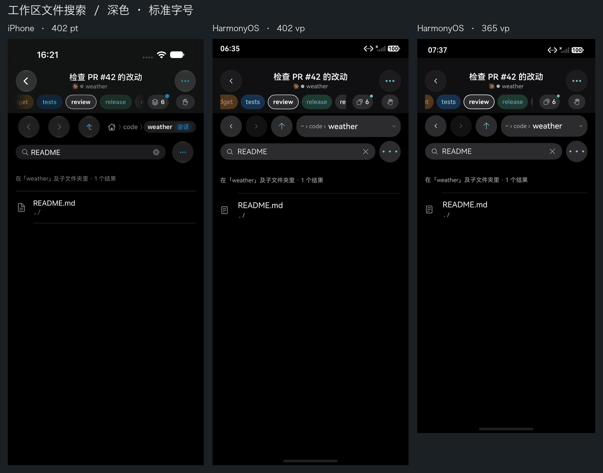
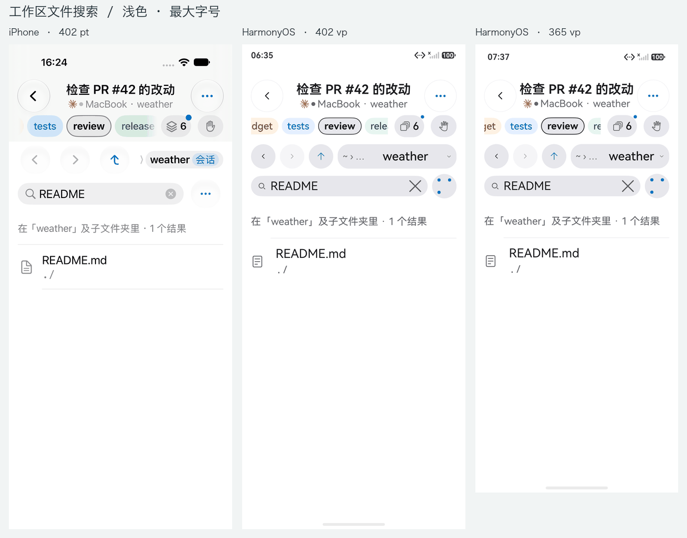

# 工作区文件搜索 · Find a file

[返回全部页面 · All pages](../README.md)

在当前工作目录及子目录搜索 README。

Three independent native captures, left to right: iPhone 402 pt, HarmonyOS 402 vp, HarmonyOS 365 vp. The complete screen, including system bars, is visible.

[Download all original screenshots and accessibility trees for this page](../originals/file-search.zip?raw=1) · [Source and capture method](../SOURCES.md)

Original archive SHA-256: 1a75d1ac261b2cf881905abbd60a2b466d7b1bac0c89d984702b77657cc504f8

## 浅色 · 标准字号

| Device | Pixels | Captured at | PNG digest | Hierarchy digest |
| --- | --- | --- | --- | --- |
| iPhone 402 pt | 1206 × 2622 | 2026-11-23T08:18:53.162+00:00 | 856d0d1722f0f167 | f6b2f6d80eb7280b |
| HarmonyOS 402 vp | 1206 × 2622 | 2026-11-23T18:35:11+08:00 | 11093fec8889aa5e | 6735fb1680871459 |
| HarmonyOS 365 vp | 1280 × 2832 | 2026-11-23T19:37:46+08:00 | 134a77bafc4520a1 | df1c3b512efc060e |

## 深色 · 标准字号

| Device | Pixels | Captured at | PNG digest | Hierarchy digest |
| --- | --- | --- | --- | --- |
| iPhone 402 pt | 1206 × 2622 | 2026-11-23T08:21:56.021+00:00 | 921c0ea699bcd076 | fe412af35946f8de |
| HarmonyOS 402 vp | 1206 × 2622 | 2026-11-23T18:35:15+08:00 | 3ad77164bd8777e6 | accfcc54e43cb645 |
| HarmonyOS 365 vp | 1280 × 2832 | 2026-11-23T19:37:49+08:00 | 3d052d366f3e9b22 | 82ff2ad0cfca4071 |

## 浅色 · 最大字号

| Device | Pixels | Captured at | PNG digest | Hierarchy digest |
| --- | --- | --- | --- | --- |
| iPhone 402 pt | 1206 × 2622 | 2026-11-23T08:24:40.342+00:00 | a892691a8962525f | f8da6cd5208dd66c |
| HarmonyOS 402 vp | 1206 × 2622 | 2026-11-23T18:35:19+08:00 | 7daa7dc3b8bc48cf | f36727398ced0037 |
| HarmonyOS 365 vp | 1280 × 2832 | 2026-11-23T19:37:53+08:00 | 25528e4d2466e7e2 | 895ed361f480ff39 |

Full 64-character digests and ZIP entry paths are under this page in the [manifest](../manifest.json).

[← 文件](files.md)
[Git 工作区 →](git.md)
