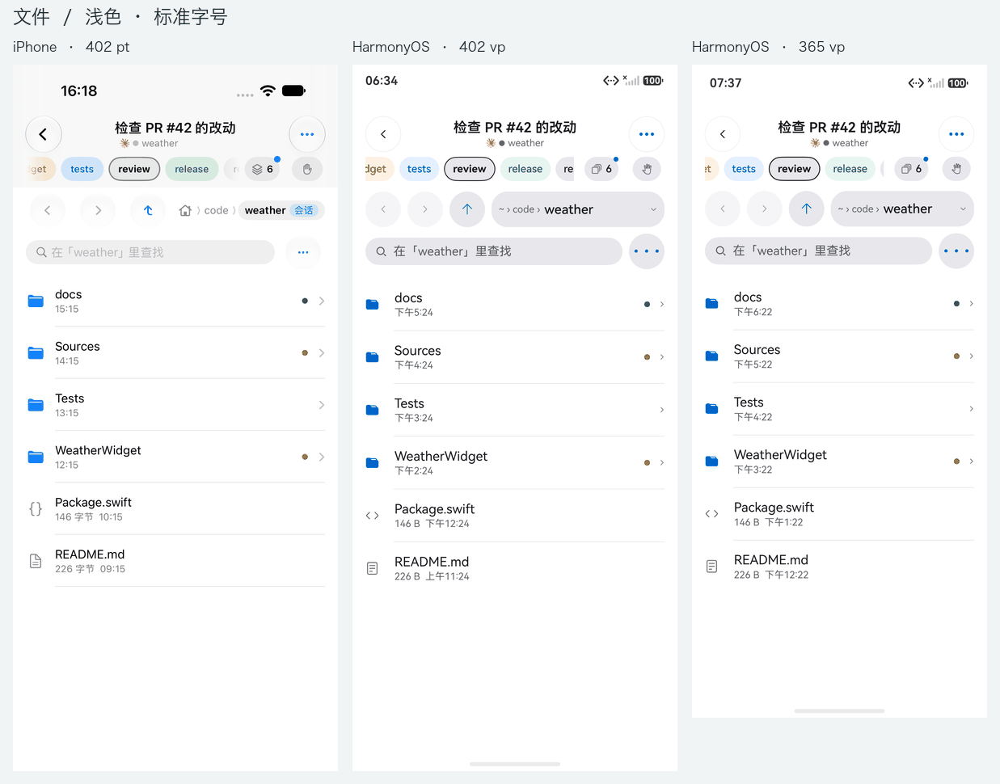
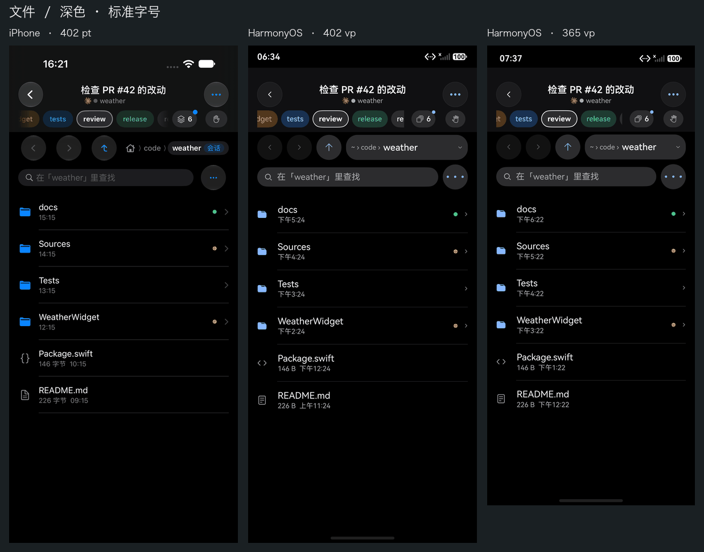
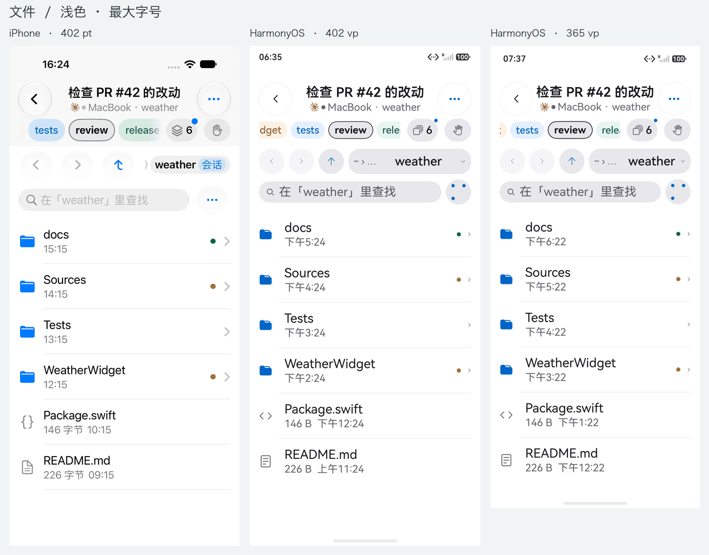

# 文件 · Workspace files

[返回全部页面 · All pages](../README.md)

浏览 weather 目录的文件与文件夹。
Open Files from the More menu of the PR #42 conversation. Its title, space and sibling tabs stay visible.

Three independent native captures, left to right: iPhone 402 pt, HarmonyOS 402 vp, HarmonyOS 365 vp. The complete screen, including system bars, is visible.

[Download all original screenshots and accessibility trees for this page](../originals/files.zip?raw=1) · [Source and capture method](../SOURCES.md)

Original archive SHA-256: 3563e9da2d0c93859992a27786b31fdb6d881e79f1f19bc4521889ece4e12617

## 浅色 · 标准字号

| Device | Pixels | Captured at | PNG digest | Hierarchy digest |
| --- | --- | --- | --- | --- |
| iPhone 402 pt | 1206 × 2622 | 2026-11-23T08:18:44.114+00:00 | f6d2bfb26781d9bd | 0541c992d34519d5 |
| HarmonyOS 402 vp | 1206 × 2622 | 2026-11-23T18:34:52+08:00 | 08e56da038068960 | 906fe8faf761bf1d |
| HarmonyOS 365 vp | 1280 × 2832 | 2026-11-23T19:37:25+08:00 | a2654d9244e5ef6a | 9347fabe8f818509 |

## 深色 · 标准字号

| Device | Pixels | Captured at | PNG digest | Hierarchy digest |
| --- | --- | --- | --- | --- |
| iPhone 402 pt | 1206 × 2622 | 2026-11-23T08:21:47.202+00:00 | 6076f27a9f0cd98f | 8d9cff9bef517030 |
| HarmonyOS 402 vp | 1206 × 2622 | 2026-11-23T18:34:56+08:00 | a9f12fc44ad0280a | 1b7d2267e16ef1ba |
| HarmonyOS 365 vp | 1280 × 2832 | 2026-11-23T19:37:30+08:00 | 3d82a36ab4bc8591 | cd69d1ab692dc363 |

## 浅色 · 最大字号

| Device | Pixels | Captured at | PNG digest | Hierarchy digest |
| --- | --- | --- | --- | --- |
| iPhone 402 pt | 1206 × 2622 | 2026-11-23T08:24:31.666+00:00 | 8f18af26a2d8166e | b338cd346ec1803e |
| HarmonyOS 402 vp | 1206 × 2622 | 2026-11-23T18:35:00+08:00 | 98f11b1a7d73ab8e | 66361a29a92fd8fa |
| HarmonyOS 365 vp | 1280 × 2832 | 2026-11-23T19:37:35+08:00 | 364109803767bb01 | 17d87156ce7aacaf |

Full 64-character digests and ZIP entry paths are under this page in the [manifest](../manifest.json).

[← 回看会话记录](reading-history.md)
[工作区文件搜索 →](file-search.md)
