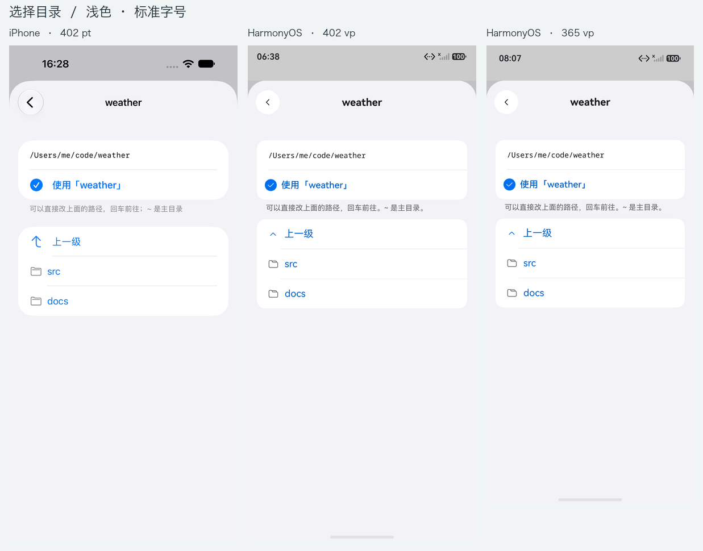
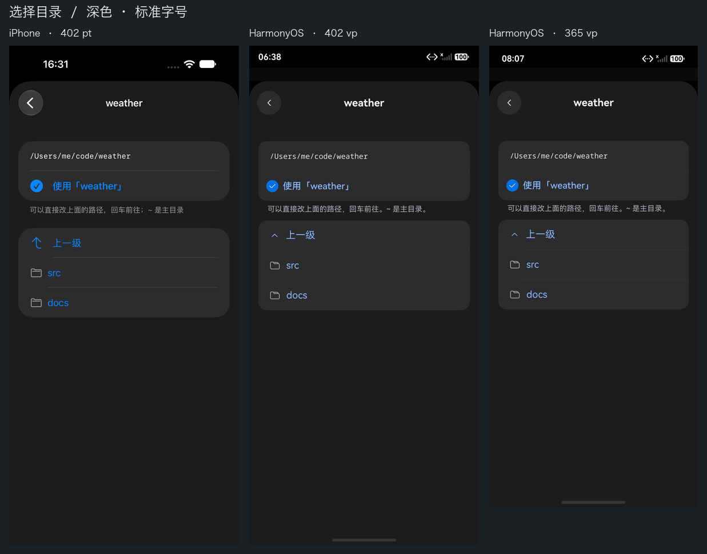
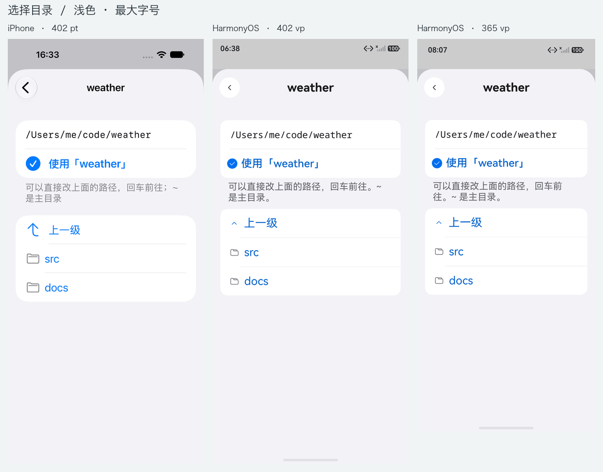

# 选择目录 · Choose a working directory

[返回全部页面 · All pages](../README.md)

浏览目录，并将所选目录交给新会话。
Open the weather directory picker and compare the parent, children and the action to use that directory.

Three independent native captures, left to right: iPhone 402 pt, HarmonyOS 402 vp, HarmonyOS 365 vp. The complete screen, including system bars, is visible.

[Download all original screenshots and accessibility trees for this page](../originals/folder-browser.zip?raw=1) · [Source and capture method](../SOURCES.md)

Original archive SHA-256: 875e98a432899ed90c8dd48aa4af36582475fd748bfc58102308778d96250722

## 浅色 · 标准字号

| Device | Pixels | Captured at | PNG digest | Hierarchy digest |
| --- | --- | --- | --- | --- |
| iPhone 402 pt | 1206 × 2622 | 2026-11-23T08:28:49.373+00:00 | 9ee9d94b65a8c922 | 6f7515bd12a78438 |
| HarmonyOS 402 vp | 1206 × 2622 | 2026-11-23T18:38:19+08:00 | eb14982a6e5b92ae | 9eeac24a1d1d0a06 |
| HarmonyOS 365 vp | 1280 × 2832 | 2026-11-23T20:07:26+08:00 | 6e83ec06bded51c1 | 9535aa3e0b51ca38 |

## 深色 · 标准字号

| Device | Pixels | Captured at | PNG digest | Hierarchy digest |
| --- | --- | --- | --- | --- |
| iPhone 402 pt | 1206 × 2622 | 2026-11-23T08:31:17.792+00:00 | 21789bd832cefdd3 | 4e16ceafce57421f |
| HarmonyOS 402 vp | 1206 × 2622 | 2026-11-23T18:38:23+08:00 | f4a79067cf94e503 | ec981f0abd826a14 |
| HarmonyOS 365 vp | 1280 × 2832 | 2026-11-23T20:07:30+08:00 | 90d600fc2518a369 | a26b823df8f2dee9 |

## 浅色 · 最大字号

| Device | Pixels | Captured at | PNG digest | Hierarchy digest |
| --- | --- | --- | --- | --- |
| iPhone 402 pt | 1206 × 2622 | 2026-11-23T08:33:53.781+00:00 | 5aebe0933363104e | 58f01d47158566f7 |
| HarmonyOS 402 vp | 1206 × 2622 | 2026-11-23T18:38:28+08:00 | 515feeddc025ee9e | 991a8006033185fb |
| HarmonyOS 365 vp | 1280 × 2832 | 2026-11-23T20:07:34+08:00 | 1c049124cfb62491 | 690425d4ded53ebd |

Full 64-character digests and ZIP entry paths are under this page in the [manifest](../manifest.json).

[← 新建 Agent](new-agent.md)
[选择模型 →](models.md)
