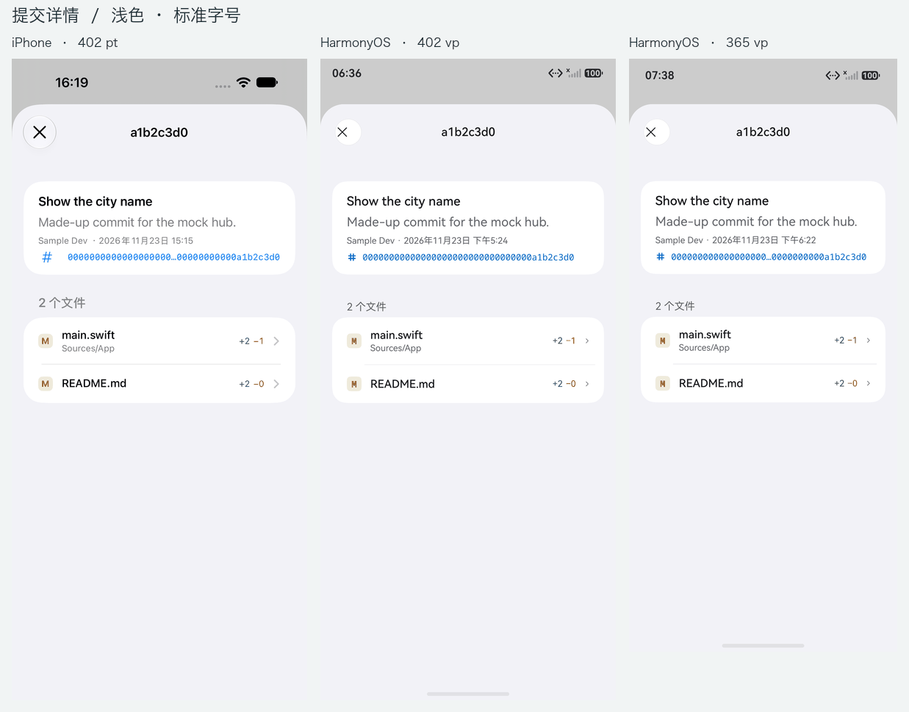
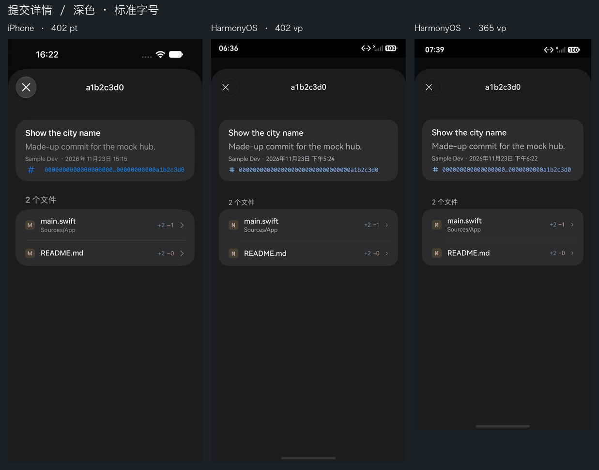
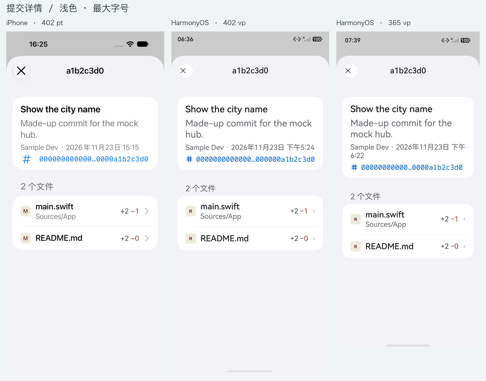

# 提交详情 · Commit details

[返回全部页面 · All pages](../README.md)

查看 Show the city name 提交、作者、短哈希和改动文件。

Three independent native captures, left to right: iPhone 402 pt, HarmonyOS 402 vp, HarmonyOS 365 vp. The complete screen, including system bars, is visible.

[Download all original screenshots and accessibility trees for this page](../originals/git-commit.zip?raw=1) · [Source and capture method](../SOURCES.md)

Original archive SHA-256: b2872d5f7c099c4fdbd99c53671340dfa80bf0472ae9aa3a713a145b446560c6

## 浅色 · 标准字号

| Device | Pixels | Captured at | PNG digest | Hierarchy digest |
| --- | --- | --- | --- | --- |
| iPhone 402 pt | 1206 × 2622 | 2026-11-23T08:19:24.506+00:00 | 130262b8d3e1a1be | 1dff280559b217c3 |
| HarmonyOS 402 vp | 1206 × 2622 | 2026-11-23T18:36:25+08:00 | d55acf2683d616c0 | 3490e7a61a76233d |
| HarmonyOS 365 vp | 1280 × 2832 | 2026-11-23T19:38:57+08:00 | 1baf8c245995651c | 7d6406c2766068e7 |

## 深色 · 标准字号

| Device | Pixels | Captured at | PNG digest | Hierarchy digest |
| --- | --- | --- | --- | --- |
| iPhone 402 pt | 1206 × 2622 | 2026-11-23T08:22:26.408+00:00 | 5f576521f784f020 | 28ab81521ec9eaad |
| HarmonyOS 402 vp | 1206 × 2622 | 2026-11-23T18:36:29+08:00 | baed968148ecdd55 | 5ad0a99ca3ef4dfa |
| HarmonyOS 365 vp | 1280 × 2832 | 2026-11-23T19:39:00+08:00 | 1d30ee29c1074f79 | 167bd3ad2994702a |

## 浅色 · 最大字号

| Device | Pixels | Captured at | PNG digest | Hierarchy digest |
| --- | --- | --- | --- | --- |
| iPhone 402 pt | 1206 × 2622 | 2026-11-23T08:25:09.712+00:00 | ac43b780d2fde266 | b73454ccf1f78af7 |
| HarmonyOS 402 vp | 1206 × 2622 | 2026-11-23T18:36:33+08:00 | db8429e87a09aa31 | 3e2cb5d63d5f98bf |
| HarmonyOS 365 vp | 1280 × 2832 | 2026-11-23T19:39:05+08:00 | 9b934ce67e25294f | 2e46f0823e78205b |

Full 64-character digests and ZIP entry paths are under this page in the [manifest](../manifest.json).

[← Git 工作区](git.md)
[Git 差异 →](git-diff.md)
