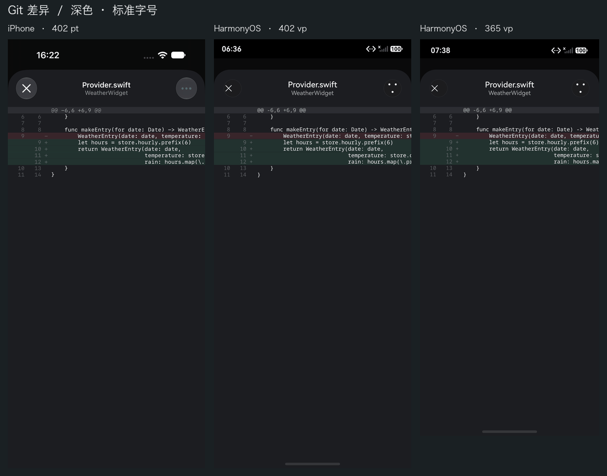
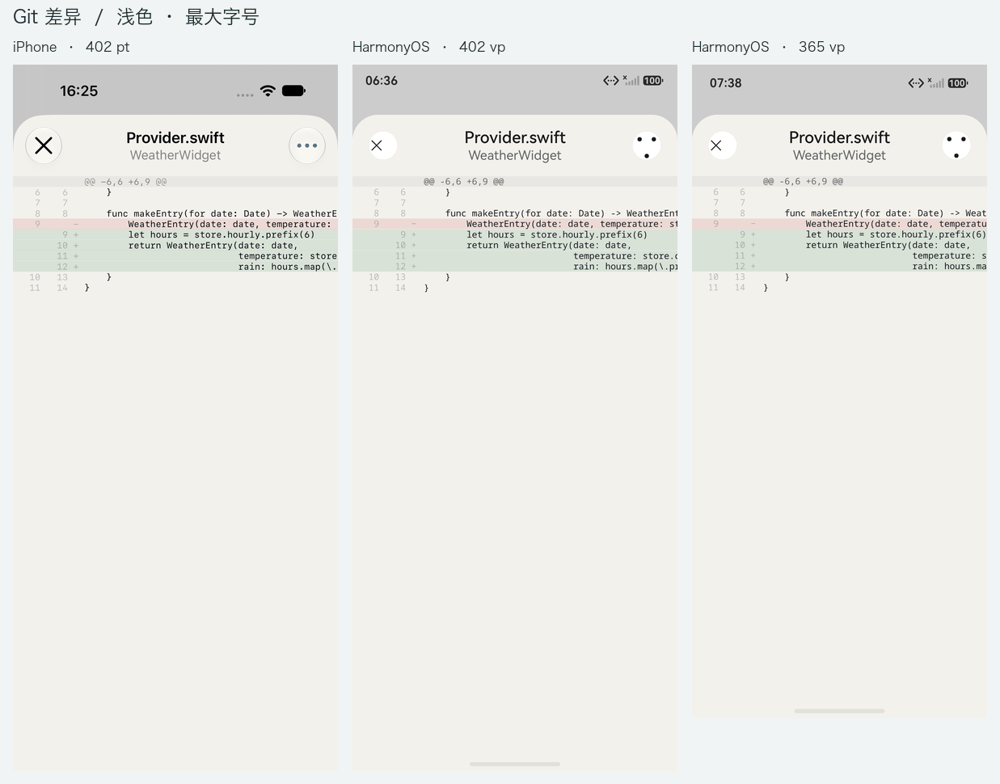

# Git 差异 · File diff

[返回全部页面 · All pages](../README.md)

读取 Provider.swift 的逐行差异。

Three independent native captures, left to right: iPhone 402 pt, HarmonyOS 402 vp, HarmonyOS 365 vp. The complete screen, including system bars, is visible.

[Download all original screenshots and accessibility trees for this page](../originals/git-diff.zip?raw=1) · [Source and capture method](../SOURCES.md)

Original archive SHA-256: ea77df8ad8058b59c2cc43eb21efbd47c2135640ca46c66ba93310c2990ec58f

## 浅色 · 标准字号

| Device | Pixels | Captured at | PNG digest | Hierarchy digest |
| --- | --- | --- | --- | --- |
| iPhone 402 pt | 1206 × 2622 | 2026-11-23T08:19:40.070+00:00 | bf544ddf7547f29a | 62c16aa149a3c15c |
| HarmonyOS 402 vp | 1206 × 2622 | 2026-11-23T18:36:02+08:00 | 99b4bbdbac5451da | f9ef9f610f967f9d |
| HarmonyOS 365 vp | 1280 × 2832 | 2026-11-23T19:38:36+08:00 | 23e8da77fac88f3c | 1c2027444b1e8cbe |

## 深色 · 标准字号

| Device | Pixels | Captured at | PNG digest | Hierarchy digest |
| --- | --- | --- | --- | --- |
| iPhone 402 pt | 1206 × 2622 | 2026-11-23T08:22:41.327+00:00 | 73b58538e23e54c1 | 5a7fc6b90bdc34f4 |
| HarmonyOS 402 vp | 1206 × 2622 | 2026-11-23T18:36:06+08:00 | fbe2e78dd31ac3e4 | 29246c2fa89f677d |
| HarmonyOS 365 vp | 1280 × 2832 | 2026-11-23T19:38:40+08:00 | 35407d01aba42862 | 0325410904e89f38 |

## 浅色 · 最大字号

| Device | Pixels | Captured at | PNG digest | Hierarchy digest |
| --- | --- | --- | --- | --- |
| iPhone 402 pt | 1206 × 2622 | 2026-11-23T08:25:24.958+00:00 | 35e711057fc70a5d | 1ddd7ed7705280fc |
| HarmonyOS 402 vp | 1206 × 2622 | 2026-11-23T18:36:10+08:00 | 2e186316347a3cc1 | 53d8f0e69d0af133 |
| HarmonyOS 365 vp | 1280 × 2832 | 2026-11-23T19:38:44+08:00 | f38066ba1d2a65d1 | b00cbfa39949ee61 |

Full 64-character digests and ZIP entry paths are under this page in the [manifest](../manifest.json).

[← 提交详情](git-commit.md)
[机器总览 →](machines.md)
