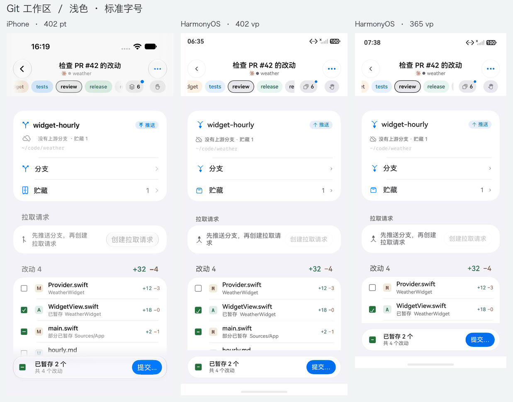
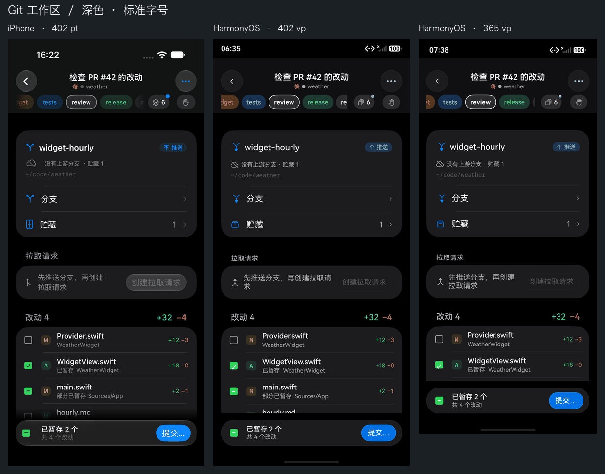
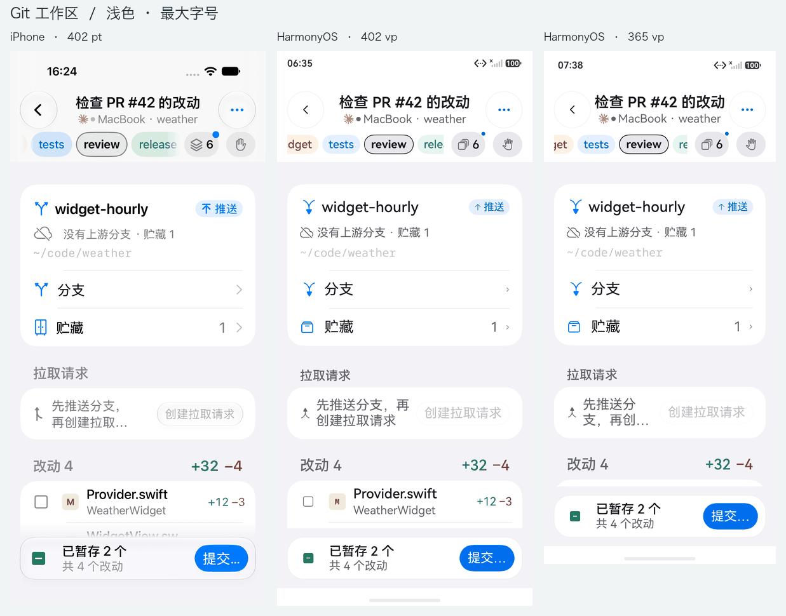

# Git 工作区 · Git workspace

[返回全部页面 · All pages](../README.md)

查看分支、改动文件及暂存状态。
Open Git from the PR #42 conversation menu and inspect its branch, stash, pull request and changes.

Three independent native captures, left to right: iPhone 402 pt, HarmonyOS 402 vp, HarmonyOS 365 vp. The complete screen, including system bars, is visible.

[Download all original screenshots and accessibility trees for this page](../originals/git.zip?raw=1) · [Source and capture method](../SOURCES.md)

Original archive SHA-256: 59ad0e82d01c292e70aa0cb305dbb395bdd9e369e84e03e10a184a372e926b84

## 浅色 · 标准字号

| Device | Pixels | Captured at | PNG digest | Hierarchy digest |
| --- | --- | --- | --- | --- |
| iPhone 402 pt | 1206 × 2622 | 2026-11-23T08:19:03.988+00:00 | ffb9092ae60e5afd | f265e8dfc01e76f7 |
| HarmonyOS 402 vp | 1206 × 2622 | 2026-11-23T18:35:36+08:00 | 50d77d0da01e37c2 | 24399a396068a8f7 |
| HarmonyOS 365 vp | 1280 × 2832 | 2026-11-23T19:38:11+08:00 | 43aef00f0f59ba2c | 3e7ca58d8830d931 |

## 深色 · 标准字号

| Device | Pixels | Captured at | PNG digest | Hierarchy digest |
| --- | --- | --- | --- | --- |
| iPhone 402 pt | 1206 × 2622 | 2026-11-23T08:22:06.369+00:00 | 0b70c127cf1219a6 | d9f2ceb13476b5fd |
| HarmonyOS 402 vp | 1206 × 2622 | 2026-11-23T18:35:39+08:00 | 54b9effb4faec992 | d87cc8c0ef1d3670 |
| HarmonyOS 365 vp | 1280 × 2832 | 2026-11-23T19:38:15+08:00 | c6c49749c7585ac5 | 16b5e35561a28f34 |

## 浅色 · 最大字号

| Device | Pixels | Captured at | PNG digest | Hierarchy digest |
| --- | --- | --- | --- | --- |
| iPhone 402 pt | 1206 × 2622 | 2026-11-23T08:24:50.504+00:00 | c7c8bceb2b247b9c | fded88db004c055a |
| HarmonyOS 402 vp | 1206 × 2622 | 2026-11-23T18:35:44+08:00 | e52b56c670dc0d42 | e5c55fe986a47ef9 |
| HarmonyOS 365 vp | 1280 × 2832 | 2026-11-23T19:38:19+08:00 | 778c26049d9ae96b | 77fa244fff633766 |

Full 64-character digests and ZIP entry paths are under this page in the [manifest](../manifest.json).

[← 工作区文件搜索](file-search.md)
[提交详情 →](git-commit.md)
