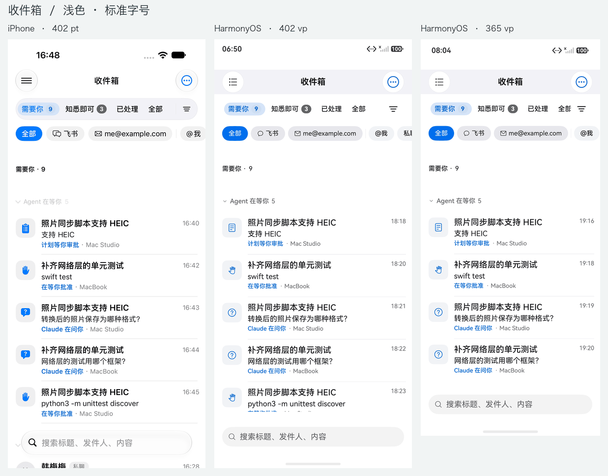
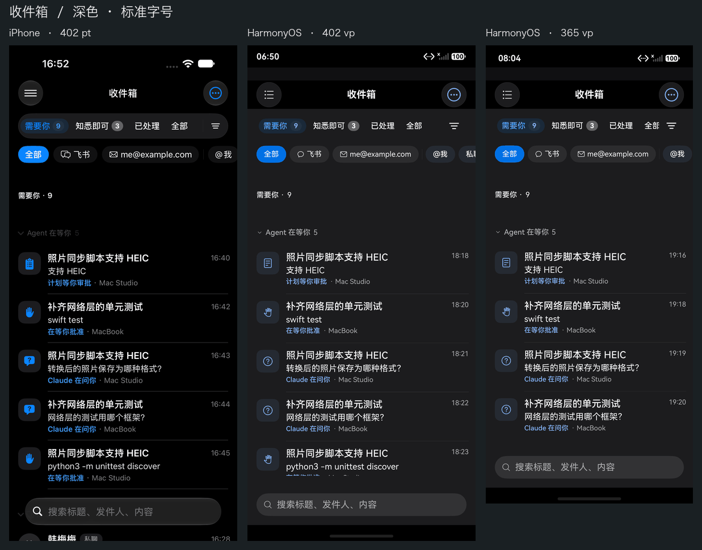
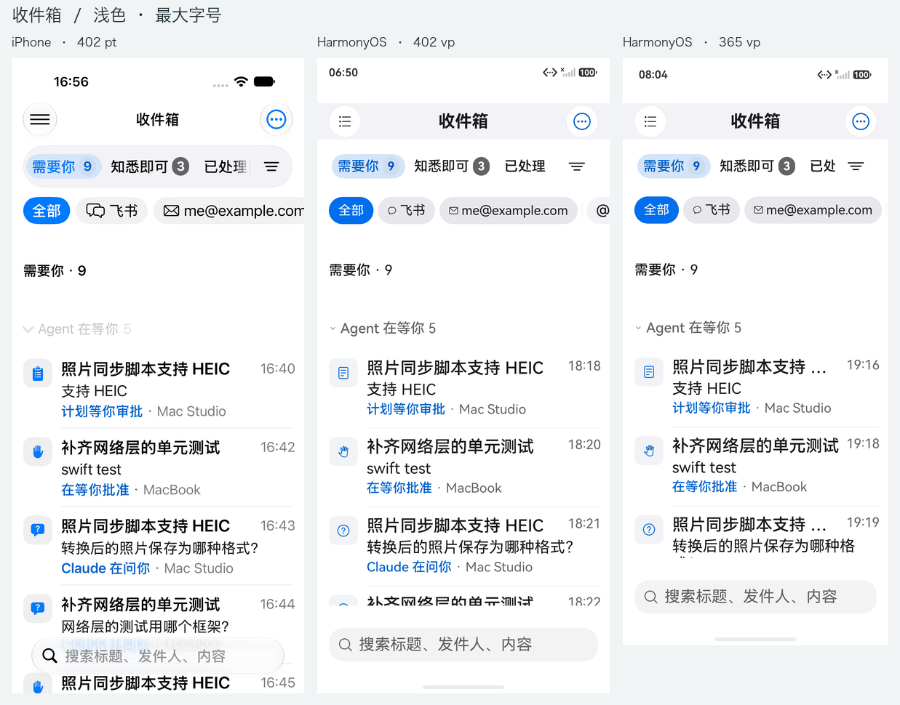

# 收件箱 · Inbox

[返回全部页面 · All pages](../README.md)

查看收件箱的分类、筛选和待处理事项。

Three independent native captures, left to right: iPhone 402 pt, HarmonyOS 402 vp, HarmonyOS 365 vp. The complete screen, including system bars, is visible.

[Download all original screenshots and accessibility trees for this page](../originals/inbox.zip?raw=1) · [Source and capture method](../SOURCES.md)

Original archive SHA-256: d6935be925150d31f668ba230b488f1ea3d886eecd8c96a66a3dc53b1a8fd396

## 浅色 · 标准字号

| Device | Pixels | Captured at | PNG digest | Hierarchy digest |
| --- | --- | --- | --- | --- |
| iPhone 402 pt | 1206 × 2622 | 2026-11-23T08:48:46.185+00:00 | 1631dd8e0ed2abe1 | 8e9ab18dbdba6db9 |
| HarmonyOS 402 vp | 1206 × 2622 | 2026-11-23T18:50:18+08:00 | 474aa06c2f62573a | c8b0d5ac8fb2b292 |
| HarmonyOS 365 vp | 1280 × 2832 | 2026-11-23T20:04:07+08:00 | 975fa4b082480b8c | 759b81fae64275d4 |

## 深色 · 标准字号

| Device | Pixels | Captured at | PNG digest | Hierarchy digest |
| --- | --- | --- | --- | --- |
| iPhone 402 pt | 1206 × 2622 | 2026-11-23T08:52:33.647+00:00 | a8a8c89de96c61c1 | 7e440ccd6004e32b |
| HarmonyOS 402 vp | 1206 × 2622 | 2026-11-23T18:50:22+08:00 | 471f0bfb0a4901be | 17fc8a968133af25 |
| HarmonyOS 365 vp | 1280 × 2832 | 2026-11-23T20:04:11+08:00 | f8da226e37e0196f | 609e2b128ed643c2 |

## 浅色 · 最大字号

| Device | Pixels | Captured at | PNG digest | Hierarchy digest |
| --- | --- | --- | --- | --- |
| iPhone 402 pt | 1206 × 2622 | 2026-11-23T08:56:21.154+00:00 | b7e108c74865a32e | 5d14ef51f3f6faf0 |
| HarmonyOS 402 vp | 1206 × 2622 | 2026-11-23T18:50:26+08:00 | 7560bfb172f6c026 | 3245a54391315ac2 |
| HarmonyOS 365 vp | 1280 × 2832 | 2026-11-23T20:04:15+08:00 | fe6841b306cf7fdf | 02f779f2510175ac |

Full 64-character digests and ZIP entry paths are under this page in the [manifest](../manifest.json).

[← 搜索会话内容](search.md)
[待办 →](todo.md)
