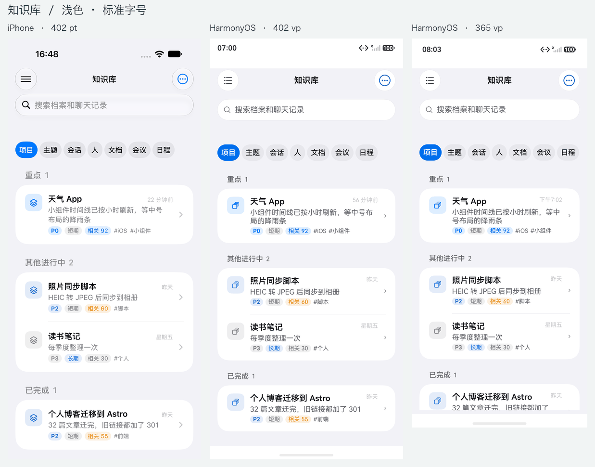
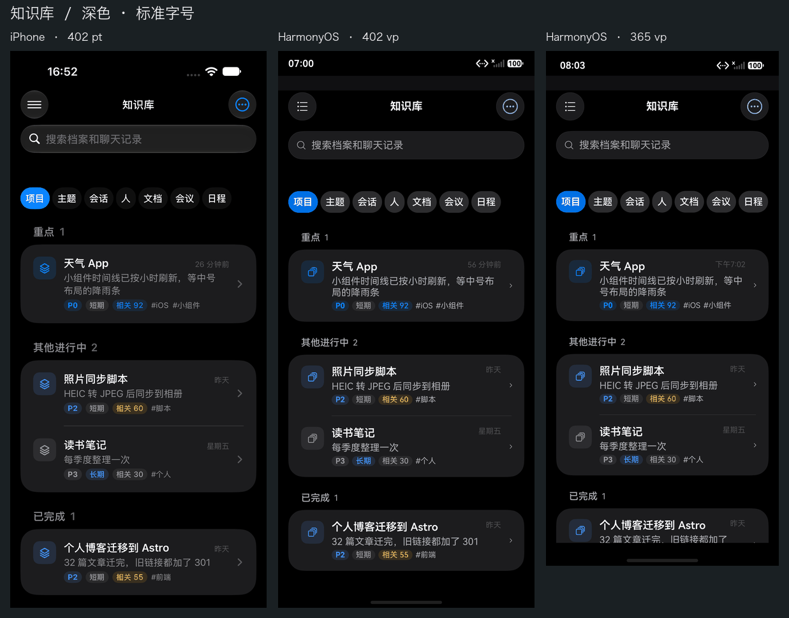
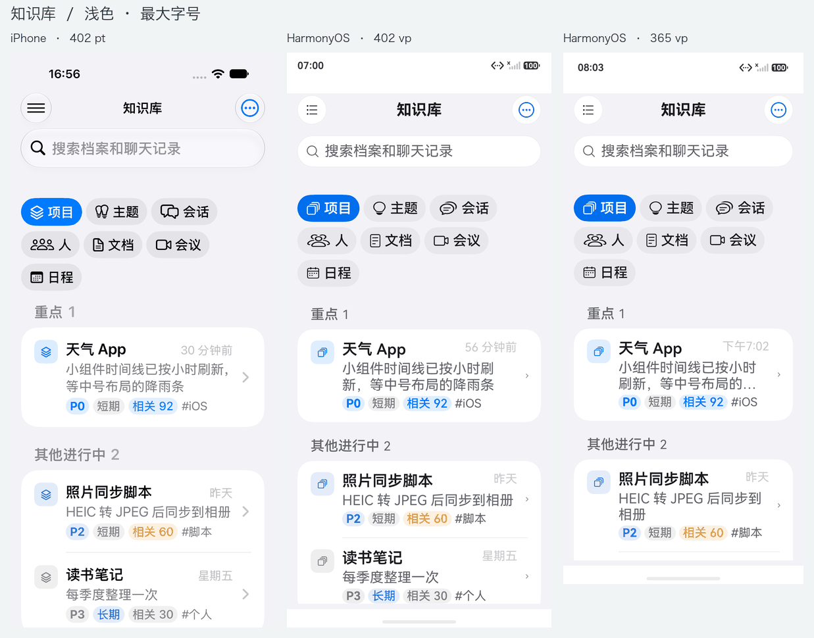

# 知识库 · Knowledge

[返回全部页面 · All pages](../README.md)

浏览知识库的分类和条目。
Compare the same projects across Focus, Other Active and Completed, including priority and state.

Three independent native captures, left to right: iPhone 402 pt, HarmonyOS 402 vp, HarmonyOS 365 vp. The complete screen, including system bars, is visible.

[Download all original screenshots and accessibility trees for this page](../originals/knowledge.zip?raw=1) · [Source and capture method](../SOURCES.md)

Original archive SHA-256: 6b2a1071c390afda407cbdbef8e5291e17941101ac347eea3df484257a602f76

## 浅色 · 标准字号

| Device | Pixels | Captured at | PNG digest | Hierarchy digest |
| --- | --- | --- | --- | --- |
| iPhone 402 pt | 1206 × 2622 | 2026-11-23T08:48:57.660+00:00 | 2c4fb21bea1560ff | 5335072615986497 |
| HarmonyOS 402 vp | 1206 × 2622 | 2026-11-23T19:00:33+08:00 | 510390bfc3c528ac | 9b00f27ec74418e2 |
| HarmonyOS 365 vp | 1280 × 2832 | 2026-11-23T20:03:28+08:00 | 4e308114153d9c5a | bf539db943eaabd7 |

## 深色 · 标准字号

| Device | Pixels | Captured at | PNG digest | Hierarchy digest |
| --- | --- | --- | --- | --- |
| iPhone 402 pt | 1206 × 2622 | 2026-11-23T08:52:44.881+00:00 | 4c5c9727d5225e53 | 5cbaff37ff82d58e |
| HarmonyOS 402 vp | 1206 × 2622 | 2026-11-23T19:00:37+08:00 | e6f70fe7ea0bb3f9 | 7c41d0724e2a7f31 |
| HarmonyOS 365 vp | 1280 × 2832 | 2026-11-23T20:03:32+08:00 | c3f523c074e85479 | 82c084cd9263dfe2 |

## 浅色 · 最大字号

| Device | Pixels | Captured at | PNG digest | Hierarchy digest |
| --- | --- | --- | --- | --- |
| iPhone 402 pt | 1206 × 2622 | 2026-11-23T08:56:32.294+00:00 | 742cf562d37a9fa2 | a6b9b8c8795683ed |
| HarmonyOS 402 vp | 1206 × 2622 | 2026-11-23T19:00:41+08:00 | ef20038bb0927210 | cdb8564f0e174103 |
| HarmonyOS 365 vp | 1280 × 2832 | 2026-11-23T20:03:37+08:00 | bf92ad822830c641 | f035ef209b87bfcc |

Full 64-character digests and ZIP entry paths are under this page in the [manifest](../manifest.json).

[← 今日待办与排序](todo-due.md)
[会议 →](meetings.md)
