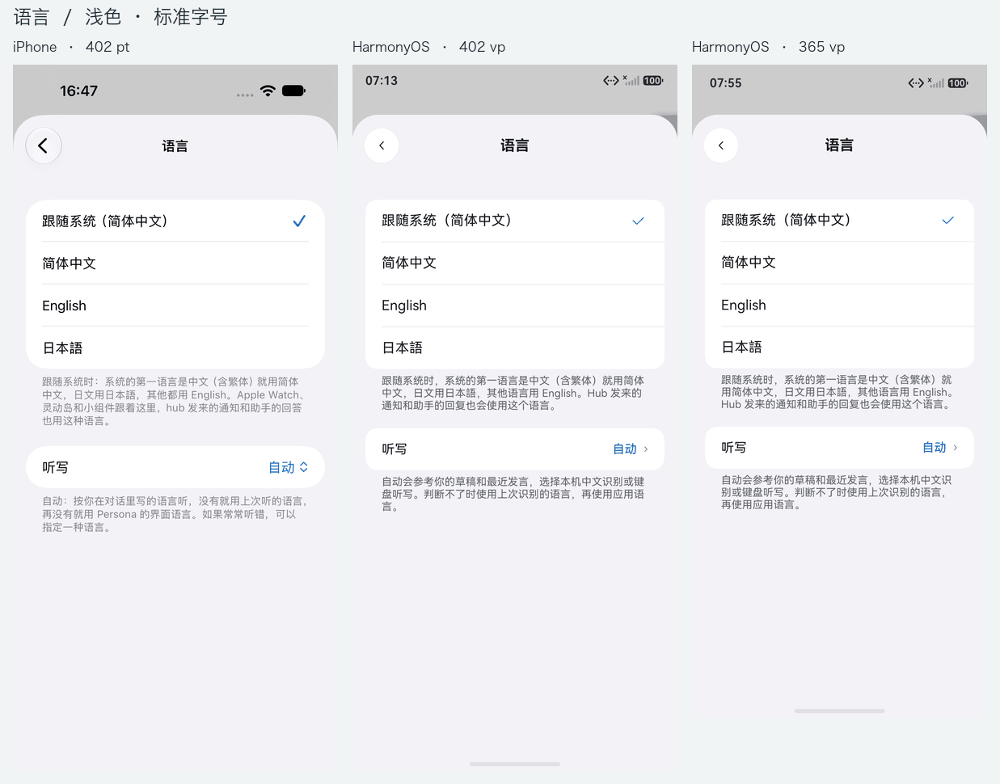
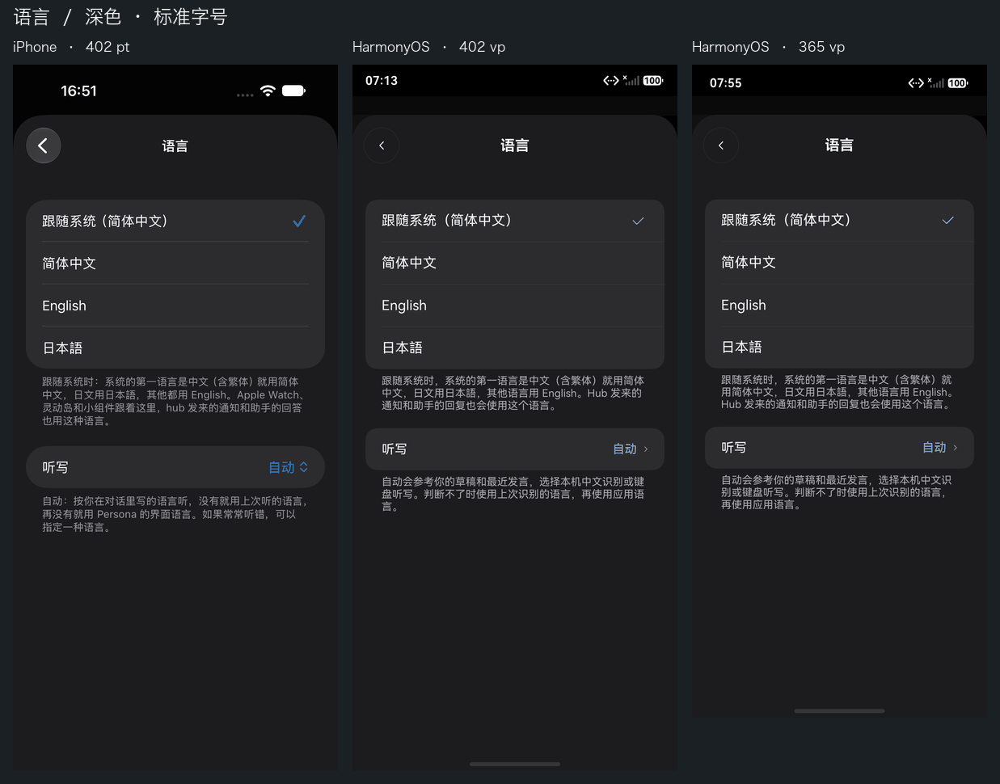
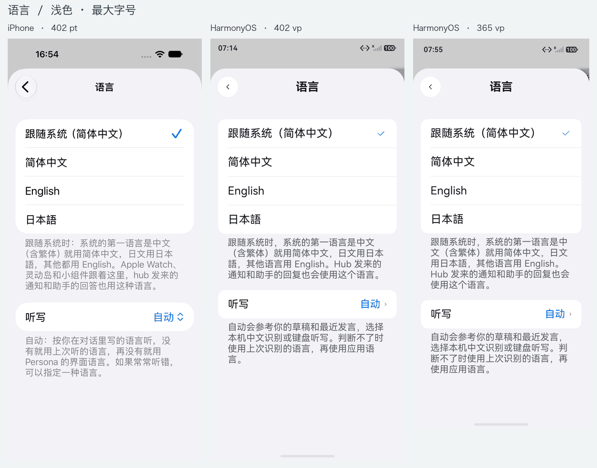

# 语言 · Language settings

[返回全部页面 · All pages](../README.md)

查看可选应用语言和当前语言设置。
Open Language in Settings. Automatic dictation follows the conversation language and the device’s available input methods.

Three independent native captures, left to right: iPhone 402 pt, HarmonyOS 402 vp, HarmonyOS 365 vp. The complete screen, including system bars, is visible.

[Download all original screenshots and accessibility trees for this page](../originals/language.zip?raw=1) · [Source and capture method](../SOURCES.md)

Original archive SHA-256: 3bb7e4eaf38d8dfccd6a5cf59462fbc4c0b35ba4fba90e24932bd1ad7caba01d

## 浅色 · 标准字号

| Device | Pixels | Captured at | PNG digest | Hierarchy digest |
| --- | --- | --- | --- | --- |
| iPhone 402 pt | 1206 × 2622 | 2026-11-23T08:47:29.065+00:00 | 56df40f94a5a0c5f | f85cfd221e65535b |
| HarmonyOS 402 vp | 1206 × 2622 | 2026-11-23T19:13:52+08:00 | 20db047a40e2aac7 | 47948cbd24d6181e |
| HarmonyOS 365 vp | 1280 × 2832 | 2026-11-23T19:55:36+08:00 | d83200dbe513eee2 | 1c873e1f675504a8 |

## 深色 · 标准字号

| Device | Pixels | Captured at | PNG digest | Hierarchy digest |
| --- | --- | --- | --- | --- |
| iPhone 402 pt | 1206 × 2622 | 2026-11-23T08:51:16.001+00:00 | e45f6d71329cee3c | 6f1fddc84d9cde17 |
| HarmonyOS 402 vp | 1206 × 2622 | 2026-11-23T19:13:56+08:00 | 47e6cea1af3ae22f | 0e836249a96a7eb4 |
| HarmonyOS 365 vp | 1280 × 2832 | 2026-11-23T19:55:39+08:00 | 314d6eac383f4094 | 28d482f91d71e64a |

## 浅色 · 最大字号

| Device | Pixels | Captured at | PNG digest | Hierarchy digest |
| --- | --- | --- | --- | --- |
| iPhone 402 pt | 1206 × 2622 | 2026-11-23T08:54:59.540+00:00 | 0ead91d807d69986 | c72204006c9e33c3 |
| HarmonyOS 402 vp | 1206 × 2622 | 2026-11-23T19:14:00+08:00 | 3eac4bd7dbbc907e | 41b012e170f31c33 |
| HarmonyOS 365 vp | 1280 × 2832 | 2026-11-23T19:55:43+08:00 | 2a396405a1aedf64 | 27a3dd721293aa58 |

Full 64-character digests and ZIP entry paths are under this page in the [manifest](../manifest.json).

[← 返回设置搜索结果](settings-search-restored.md)
[Agent 偏好 →](agent-preferences.md)
