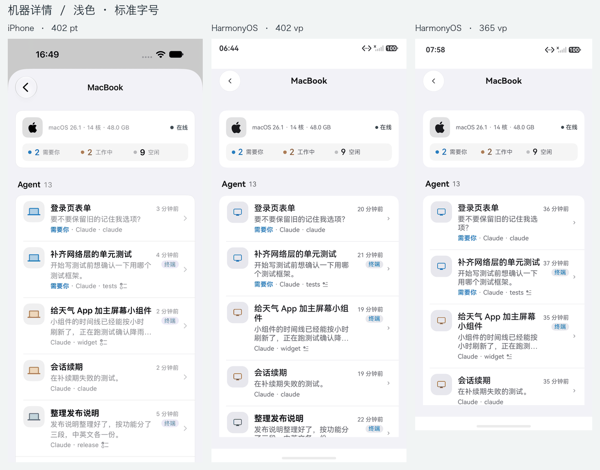
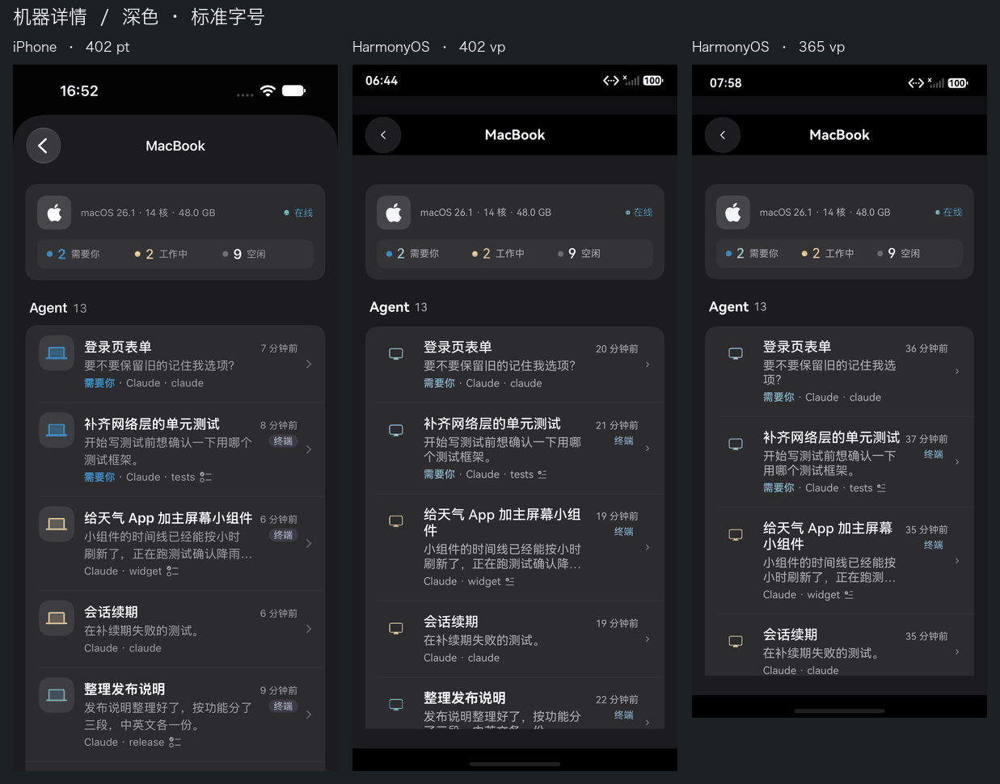
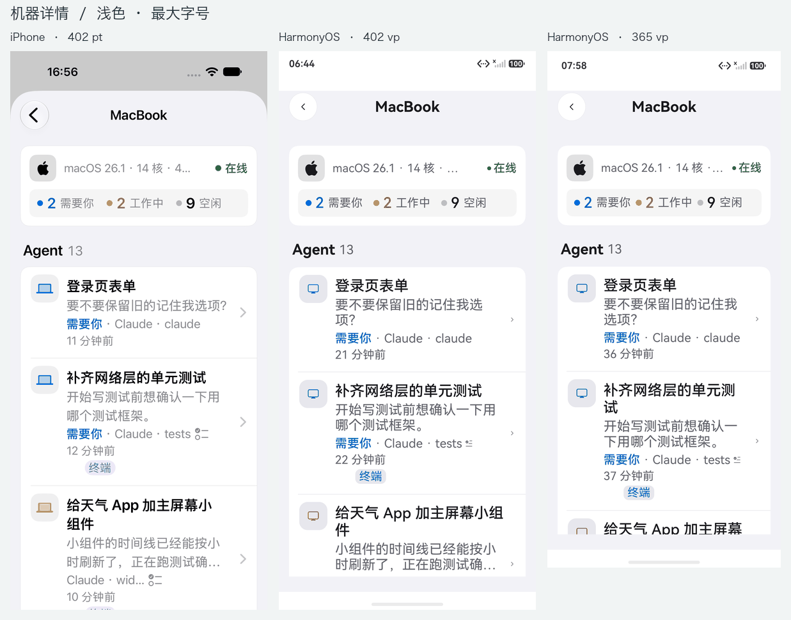

# 机器详情 · Machine details

[返回全部页面 · All pages](../README.md)

进入同一台测试 MacBook 的详情。
Open the fixture MacBook from the machine directory and inspect its agents.

Three independent native captures, left to right: iPhone 402 pt, HarmonyOS 402 vp, HarmonyOS 365 vp. The complete screen, including system bars, is visible.

[Download all original screenshots and accessibility trees for this page](../originals/machine-detail.zip?raw=1) · [Source and capture method](../SOURCES.md)

Original archive SHA-256: afcc033276eaf0f166a5256e9b06463c07d6bb25f6ffe976b420415587ef5d06

## 浅色 · 标准字号

| Device | Pixels | Captured at | PNG digest | Hierarchy digest |
| --- | --- | --- | --- | --- |
| iPhone 402 pt | 1206 × 2622 | 2026-11-23T08:49:10.384+00:00 | 64f0fd56196ccd19 | a0085b12849474f5 |
| HarmonyOS 402 vp | 1206 × 2622 | 2026-11-23T18:44:07+08:00 | 4db79c3307e34fbd | 1e8508b02b14dd97 |
| HarmonyOS 365 vp | 1280 × 2832 | 2026-11-23T19:58:12+08:00 | bdc859cba7ba5618 | 77ce91ab0f682790 |

## 深色 · 标准字号

| Device | Pixels | Captured at | PNG digest | Hierarchy digest |
| --- | --- | --- | --- | --- |
| iPhone 402 pt | 1206 × 2622 | 2026-11-23T08:52:57.008+00:00 | 9a329dd99dae27b5 | ab11323105bc023a |
| HarmonyOS 402 vp | 1206 × 2622 | 2026-11-23T18:44:10+08:00 | a1ea433d2057fe6b | fab14ccef9ff3ff4 |
| HarmonyOS 365 vp | 1280 × 2832 | 2026-11-23T19:58:16+08:00 | 9bed456bbd572e32 | e71cb97efc3cd2df |

## 浅色 · 最大字号

| Device | Pixels | Captured at | PNG digest | Hierarchy digest |
| --- | --- | --- | --- | --- |
| iPhone 402 pt | 1206 × 2622 | 2026-11-23T08:56:44.434+00:00 | d04a29ea3f950e12 | 31251048f2ad4543 |
| HarmonyOS 402 vp | 1206 × 2622 | 2026-11-23T18:44:15+08:00 | 8f756c563c983c5c | 9a9176f705fac036 |
| HarmonyOS 365 vp | 1280 × 2832 | 2026-11-23T19:58:20+08:00 | d7fc15df35f8be1a | b66b4b134b5cd828 |

Full 64-character digests and ZIP entry paths are under this page in the [manifest](../manifest.json).

[← 机器总览](machines.md)
[机器监控读数 →](machine-monitor.md)
