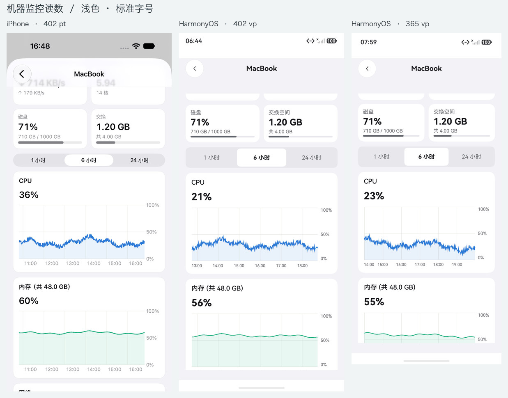
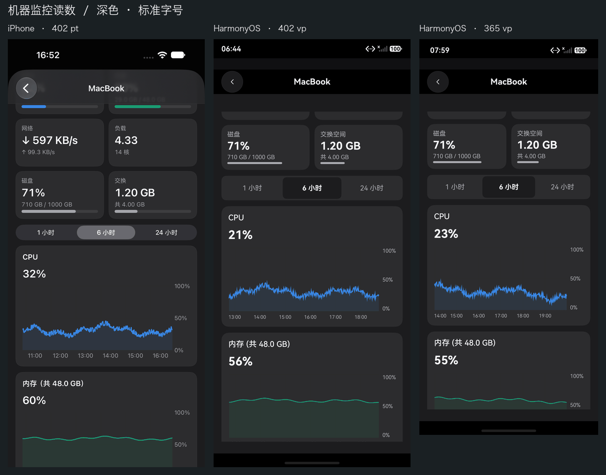
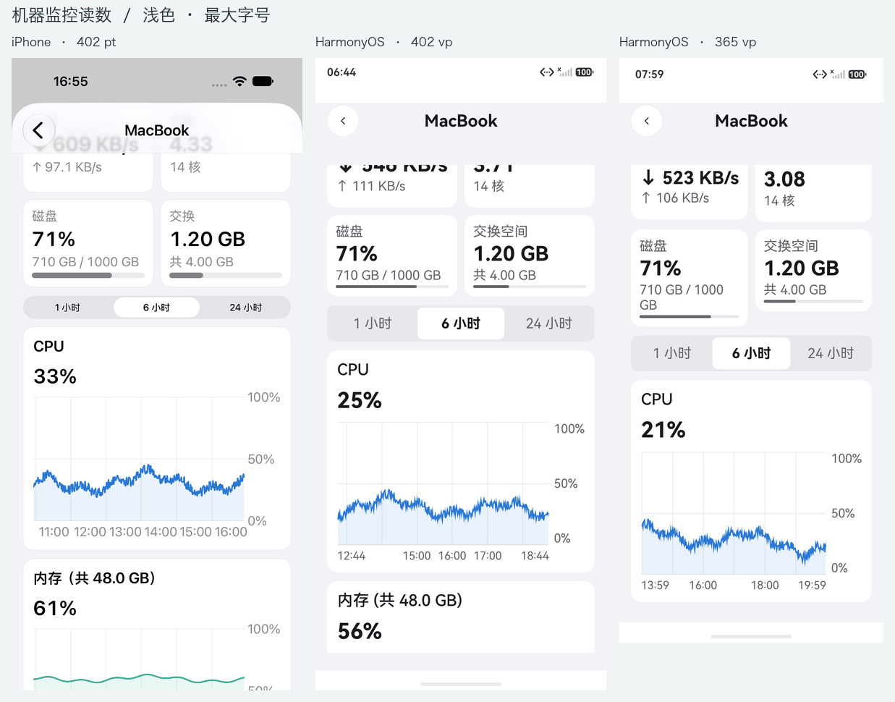

# 机器监控读数 · Machine metrics

[返回全部页面 · All pages](../README.md)

查看 MacBook 的 CPU 历史曲线及所选时间范围。
Inspect six hours of CPU history on the fixture MacBook. Each local Hub has its own sampling time and values.

Three independent native captures, left to right: iPhone 402 pt, HarmonyOS 402 vp, HarmonyOS 365 vp. The complete screen, including system bars, is visible.

[Download all original screenshots and accessibility trees for this page](../originals/machine-monitor.zip?raw=1) · [Source and capture method](../SOURCES.md)

Original archive SHA-256: c6ef000fee4a27715cabff413c4747eec3a059cb033ee3f0f52f68d520b2c773

## 浅色 · 标准字号

| Device | Pixels | Captured at | PNG digest | Hierarchy digest |
| --- | --- | --- | --- | --- |
| iPhone 402 pt | 1206 × 2622 | 2026-11-23T08:48:19.389+00:00 | 090dfd018836cdfd | c999308785ee2745 |
| HarmonyOS 402 vp | 1206 × 2622 | 2026-11-23T18:44:39+08:00 | cd94adbb025575fd | aa97ee7d105e1ed0 |
| HarmonyOS 365 vp | 1280 × 2832 | 2026-11-23T19:59:17+08:00 | f118c56710e2009b | 7dcd9cd6a90be801 |

## 深色 · 标准字号

| Device | Pixels | Captured at | PNG digest | Hierarchy digest |
| --- | --- | --- | --- | --- |
| iPhone 402 pt | 1206 × 2622 | 2026-11-23T08:52:08.332+00:00 | 964cd5e4f7cd03e9 | 17b34284dc46b023 |
| HarmonyOS 402 vp | 1206 × 2622 | 2026-11-23T18:44:43+08:00 | 162b6ce80823b308 | fddffe9227c8d393 |
| HarmonyOS 365 vp | 1280 × 2832 | 2026-11-23T19:59:22+08:00 | c04bac6f3be81b7f | 1fa14203c7882fd5 |

## 浅色 · 最大字号

| Device | Pixels | Captured at | PNG digest | Hierarchy digest |
| --- | --- | --- | --- | --- |
| iPhone 402 pt | 1206 × 2622 | 2026-11-23T08:55:55.172+00:00 | 5ee8153d9819d7a0 | 3756d08abea99040 |
| HarmonyOS 402 vp | 1206 × 2622 | 2026-11-23T18:44:56+08:00 | 769bb9472dca32e9 | e8b0dae87ca45606 |
| HarmonyOS 365 vp | 1280 × 2832 | 2026-11-23T19:59:41+08:00 | cafeeab369fe6121 | b412a7d27d28e29e |

Full 64-character digests and ZIP entry paths are under this page in the [manifest](../manifest.json).

[← 机器详情](machine-detail.md)
[侧栏 →](drawer.md)
