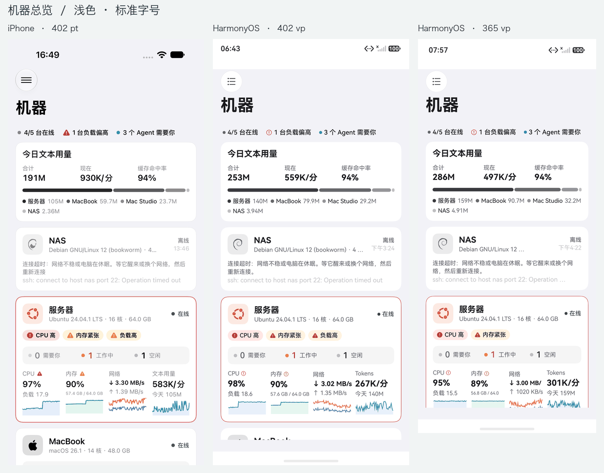
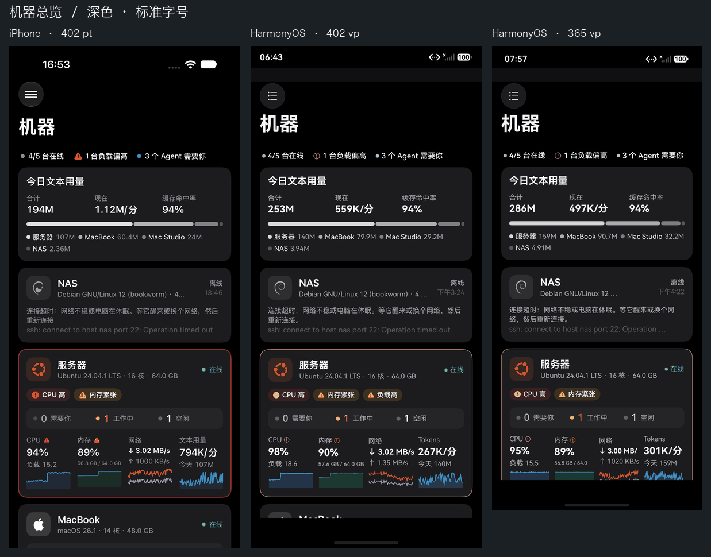
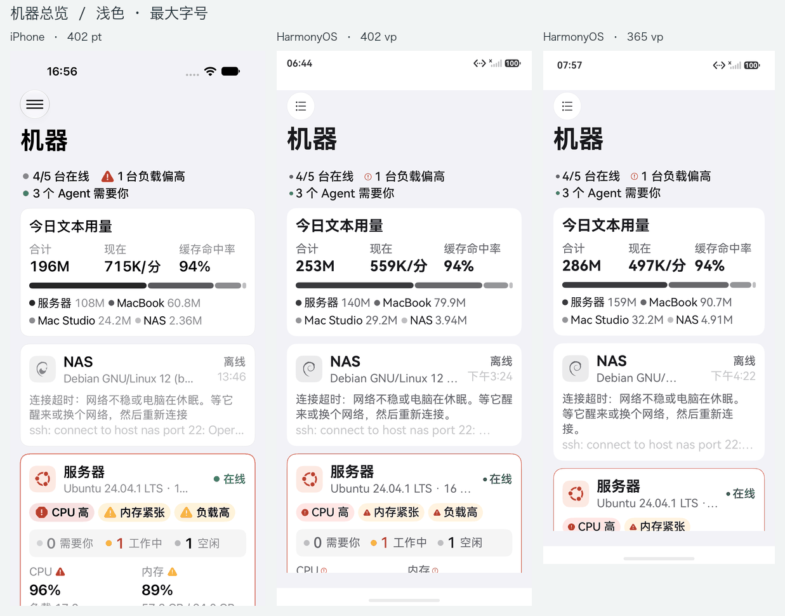

# 机器总览 · Machines

[返回全部页面 · All pages](../README.md)

比较机器的在线状态、负载与使用量。

Three independent native captures, left to right: iPhone 402 pt, HarmonyOS 402 vp, HarmonyOS 365 vp. The complete screen, including system bars, is visible.

[Download all original screenshots and accessibility trees for this page](../originals/machines.zip?raw=1) · [Source and capture method](../SOURCES.md)

Original archive SHA-256: c726b97ea20deae63876432d7cde7349d9ccff3408f1b66860e761dcf9fb7afd

## 浅色 · 标准字号

| Device | Pixels | Captured at | PNG digest | Hierarchy digest |
| --- | --- | --- | --- | --- |
| iPhone 402 pt | 1206 × 2622 | 2026-11-23T08:49:22.173+00:00 | e91b3da9d56b8583 | 7a47767d34d167af |
| HarmonyOS 402 vp | 1206 × 2622 | 2026-11-23T18:43:54+08:00 | 881f6dcbaccba937 | 844fb6bf2f5cd96a |
| HarmonyOS 365 vp | 1280 × 2832 | 2026-11-23T19:57:40+08:00 | 5fa86944a4ea14a7 | 95b50cf3c538d33b |

## 深色 · 标准字号

| Device | Pixels | Captured at | PNG digest | Hierarchy digest |
| --- | --- | --- | --- | --- |
| iPhone 402 pt | 1206 × 2622 | 2026-11-23T08:53:08.357+00:00 | 11e86184adb70e17 | a828559bd324e0bc |
| HarmonyOS 402 vp | 1206 × 2622 | 2026-11-23T18:43:58+08:00 | 9cb4fbf694ed132f | 508486fbe20ac097 |
| HarmonyOS 365 vp | 1280 × 2832 | 2026-11-23T19:57:44+08:00 | 53bbe57ca8686328 | 28359b808fb0fc18 |

## 浅色 · 最大字号

| Device | Pixels | Captured at | PNG digest | Hierarchy digest |
| --- | --- | --- | --- | --- |
| iPhone 402 pt | 1206 × 2622 | 2026-11-23T08:56:55.831+00:00 | f88fa90cff5dc431 | e104818f63773c83 |
| HarmonyOS 402 vp | 1206 × 2622 | 2026-11-23T18:44:02+08:00 | a0959a93a235389a | 0acbea3a65eb59b9 |
| HarmonyOS 365 vp | 1280 × 2832 | 2026-11-23T19:58:01+08:00 | eb74c61e5071f39e | fd8421501f001ef9 |

Full 64-character digests and ZIP entry paths are under this page in the [manifest](../manifest.json).

[← Git 差异](git-diff.md)
[机器详情 →](machine-detail.md)
