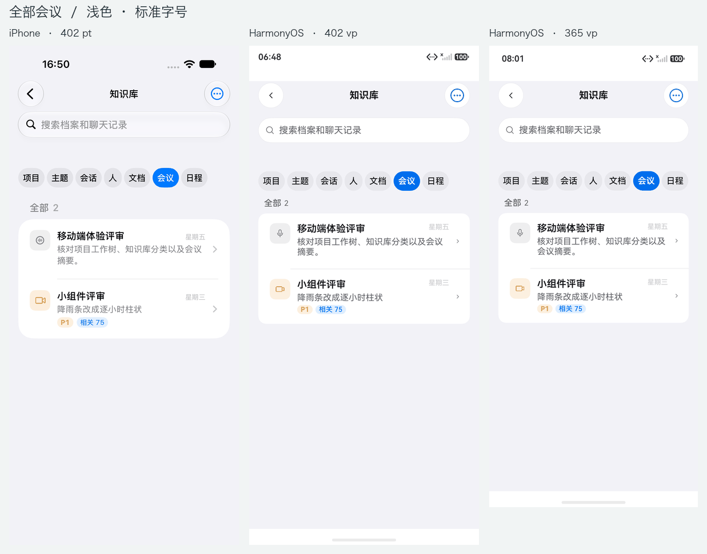
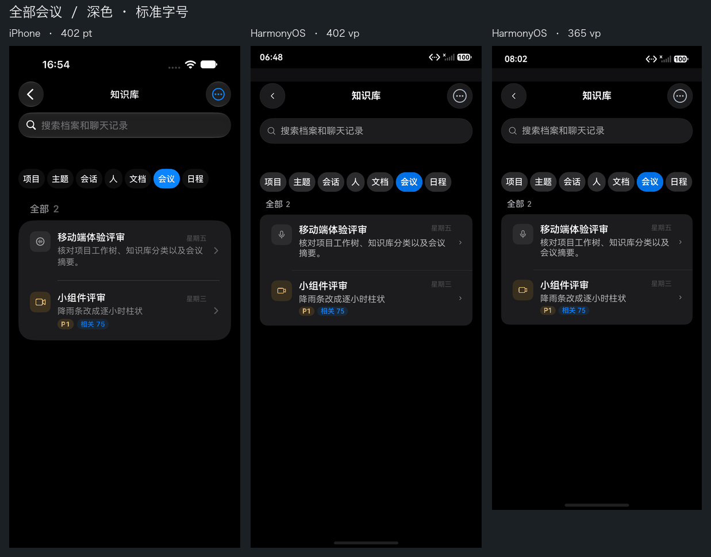
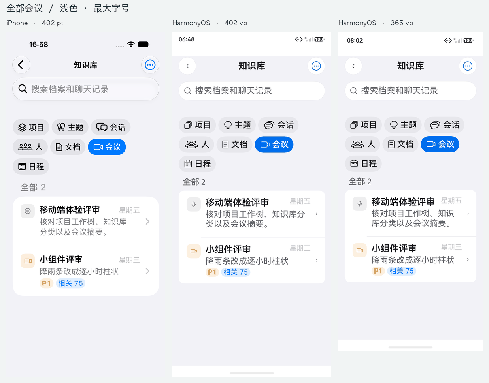

# 全部会议 · All meetings

[返回全部页面 · All pages](../README.md)

打开会议记录列表，找到移动端体验评审。

Three independent native captures, left to right: iPhone 402 pt, HarmonyOS 402 vp, HarmonyOS 365 vp. The complete screen, including system bars, is visible.

[Download all original screenshots and accessibility trees for this page](../originals/meeting-list.zip?raw=1) · [Source and capture method](../SOURCES.md)

Original archive SHA-256: 0d3684189d60e48514e40c7f371ce727d9387a2d0dc65155c269f8384b29ff8c

## 浅色 · 标准字号

| Device | Pixels | Captured at | PNG digest | Hierarchy digest |
| --- | --- | --- | --- | --- |
| iPhone 402 pt | 1206 × 2622 | 2026-11-23T08:50:28.909+00:00 | daf9419ac16253c9 | 1097dccc0589ddfd |
| HarmonyOS 402 vp | 1206 × 2622 | 2026-11-23T18:48:03+08:00 | 9aa44fcae54160a9 | fead81db9a80b159 |
| HarmonyOS 365 vp | 1280 × 2832 | 2026-11-23T20:01:57+08:00 | 0fedb7be49b8de0e | 31302d4a26a3b4d0 |

## 深色 · 标准字号

| Device | Pixels | Captured at | PNG digest | Hierarchy digest |
| --- | --- | --- | --- | --- |
| iPhone 402 pt | 1206 × 2622 | 2026-11-23T08:54:13.362+00:00 | 1b7a7daa08bd6bdc | 3958123ab18d6ba6 |
| HarmonyOS 402 vp | 1206 × 2622 | 2026-11-23T18:48:07+08:00 | c13b277e1f5fb7b1 | b8371c2d69044574 |
| HarmonyOS 365 vp | 1280 × 2832 | 2026-11-23T20:02:01+08:00 | 993ac15581585a06 | 9a8caae5699258fe |

## 浅色 · 最大字号

| Device | Pixels | Captured at | PNG digest | Hierarchy digest |
| --- | --- | --- | --- | --- |
| iPhone 402 pt | 1206 × 2622 | 2026-11-23T08:58:01.470+00:00 | 17bf95d1616c5a21 | 2ccf7bea3d0e736d |
| HarmonyOS 402 vp | 1206 × 2622 | 2026-11-23T18:48:11+08:00 | 260b7a820e8d4b9b | 45239bab40ce712b |
| HarmonyOS 365 vp | 1280 × 2832 | 2026-11-23T20:02:06+08:00 | dacc20e8a9f6713e | 8fc52a53ce5bdc52 |

Full 64-character digests and ZIP entry paths are under this page in the [manifest](../manifest.json).

[← 会议](meetings.md)
[会议详情 →](meeting-detail.md)
