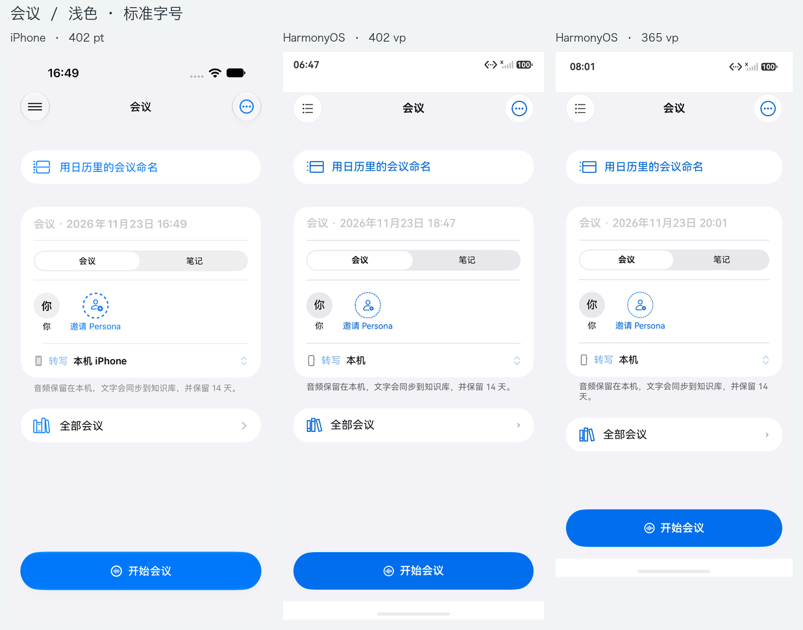
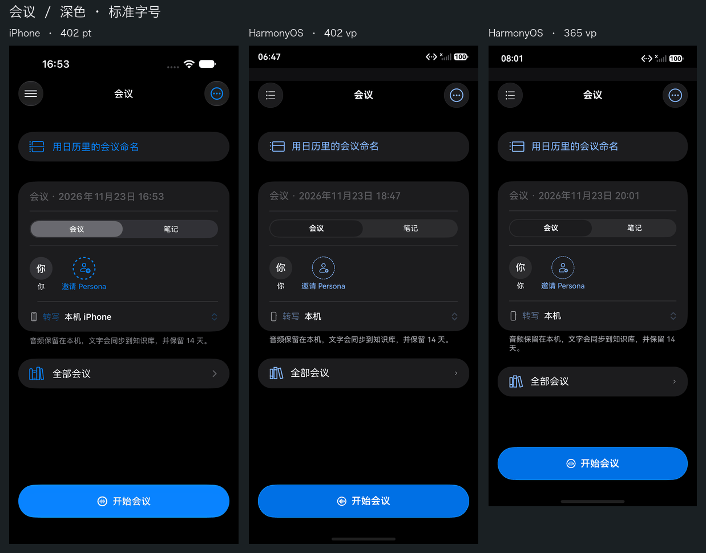
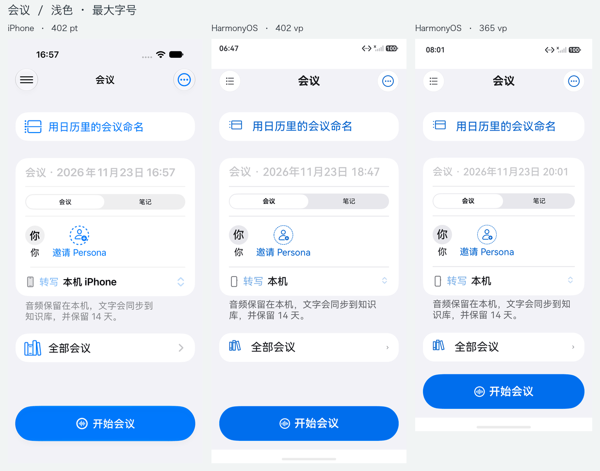

# 会议 · Meetings

[返回全部页面 · All pages](../README.md)

查看会议首页、录制入口及全部会议入口。
Compare the meeting and note setup, calendar naming, assistant invitation and start action.

Three independent native captures, left to right: iPhone 402 pt, HarmonyOS 402 vp, HarmonyOS 365 vp. The complete screen, including system bars, is visible.

[Download all original screenshots and accessibility trees for this page](../originals/meetings.zip?raw=1) · [Source and capture method](../SOURCES.md)

Original archive SHA-256: 408bc6d16ebdd94695b411c939d0bd1779095e1cc157e821ea2b0654595a0abe

## 浅色 · 标准字号

| Device | Pixels | Captured at | PNG digest | Hierarchy digest |
| --- | --- | --- | --- | --- |
| iPhone 402 pt | 1206 × 2622 | 2026-11-23T08:49:33.720+00:00 | 3e49f7d7a701b818 | a867653399dbb670 |
| HarmonyOS 402 vp | 1206 × 2622 | 2026-11-23T18:47:50+08:00 | 69a9e1691d8443b1 | 1b17b00ce4ef2884 |
| HarmonyOS 365 vp | 1280 × 2832 | 2026-11-23T20:01:44+08:00 | a63503bd3e84ad8f | 01c9b8e24c1174f5 |

## 深色 · 标准字号

| Device | Pixels | Captured at | PNG digest | Hierarchy digest |
| --- | --- | --- | --- | --- |
| iPhone 402 pt | 1206 × 2622 | 2026-11-23T08:53:19.318+00:00 | cfff87f04847c742 | 5f3953e48f0242ac |
| HarmonyOS 402 vp | 1206 × 2622 | 2026-11-23T18:47:54+08:00 | 8395df3f3922f9e7 | 6c6b16c018801c6b |
| HarmonyOS 365 vp | 1280 × 2832 | 2026-11-23T20:01:48+08:00 | 0155fa885781de57 | 4b30abae983a7b28 |

## 浅色 · 最大字号

| Device | Pixels | Captured at | PNG digest | Hierarchy digest |
| --- | --- | --- | --- | --- |
| iPhone 402 pt | 1206 × 2622 | 2026-11-23T08:57:07.301+00:00 | 4f1051ff0e8b7f2c | 816ec59ead3194de |
| HarmonyOS 402 vp | 1206 × 2622 | 2026-11-23T18:47:58+08:00 | ab1b06290f5dc05b | bc26673d6b7d11ff |
| HarmonyOS 365 vp | 1280 × 2832 | 2026-11-23T20:01:52+08:00 | 4e4a55f66a87a089 | 1a2899157769ed47 |

Full 64-character digests and ZIP entry paths are under this page in the [manifest](../manifest.json).

[← 知识库](knowledge.md)
[全部会议 →](meeting-list.md)
