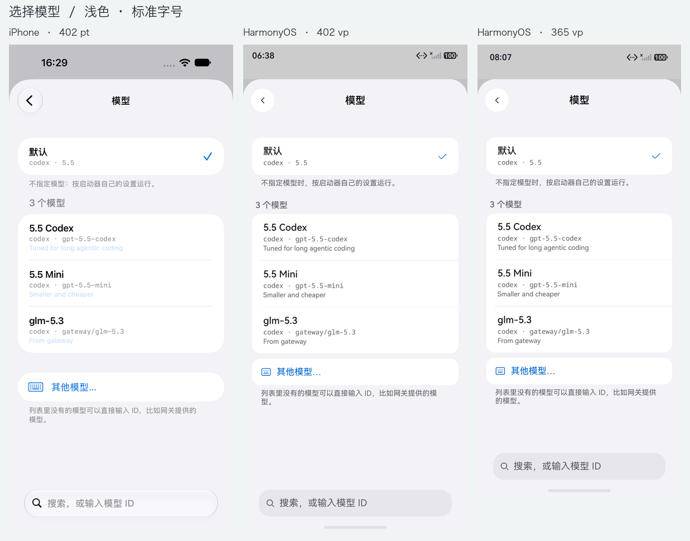
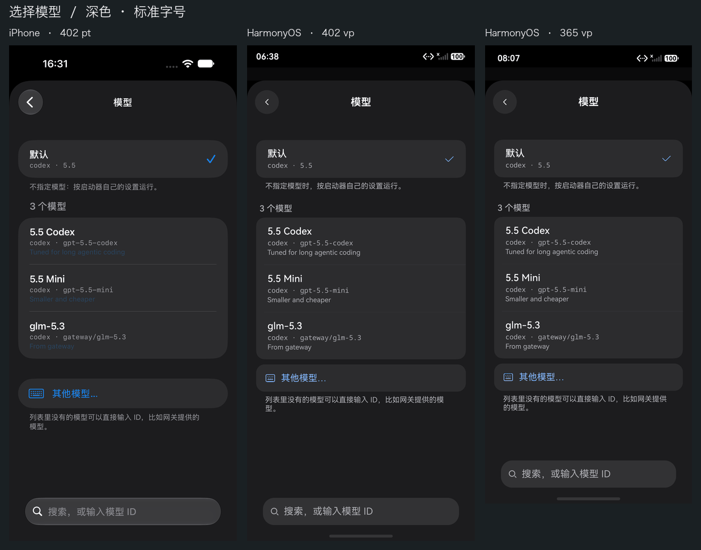
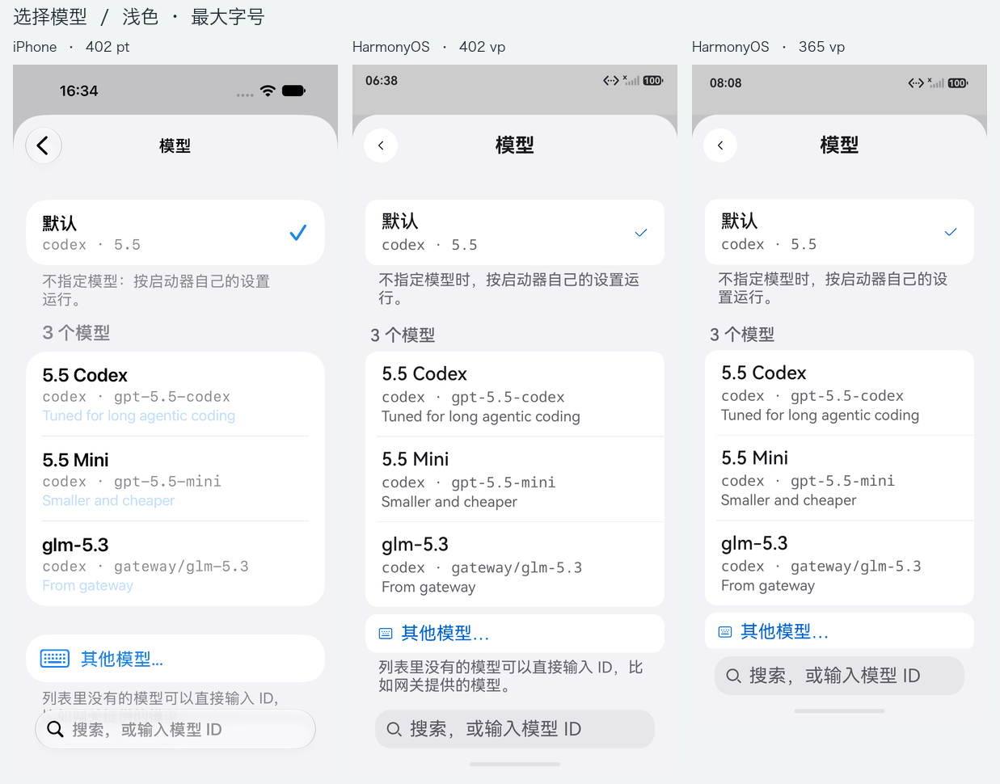

# 选择模型 · Choose a model

[返回全部页面 · All pages](../README.md)

打开所选启动器提供的模型列表。

Three independent native captures, left to right: iPhone 402 pt, HarmonyOS 402 vp, HarmonyOS 365 vp. The complete screen, including system bars, is visible.

[Download all original screenshots and accessibility trees for this page](../originals/models.zip?raw=1) · [Source and capture method](../SOURCES.md)

Original archive SHA-256: fe47c3ca1805d8e5eeb48e13185470a9570e3f2bb5684db668a6eb3755cfc9f9

## 浅色 · 标准字号

| Device | Pixels | Captured at | PNG digest | Hierarchy digest |
| --- | --- | --- | --- | --- |
| iPhone 402 pt | 1206 × 2622 | 2026-11-23T08:29:09.770+00:00 | 9370daf1b88b69d6 | 8980519c9fdcd3a9 |
| HarmonyOS 402 vp | 1206 × 2622 | 2026-11-23T18:38:48+08:00 | ec9f18c7681566c9 | ff4dfc7808cde72c |
| HarmonyOS 365 vp | 1280 × 2832 | 2026-11-23T20:07:53+08:00 | 455f2fc8882b533c | 9fa069b590086aa0 |

## 深色 · 标准字号

| Device | Pixels | Captured at | PNG digest | Hierarchy digest |
| --- | --- | --- | --- | --- |
| iPhone 402 pt | 1206 × 2622 | 2026-11-23T08:31:38.744+00:00 | fb1d19261e72a526 | e9af5d72b8b5f048 |
| HarmonyOS 402 vp | 1206 × 2622 | 2026-11-23T18:38:52+08:00 | 7d477d1fa1aec991 | 613f308b82ee98ee |
| HarmonyOS 365 vp | 1280 × 2832 | 2026-11-23T20:07:57+08:00 | 9ffcc91790c6c9b9 | ed677a3c19f0542b |

## 浅色 · 最大字号

| Device | Pixels | Captured at | PNG digest | Hierarchy digest |
| --- | --- | --- | --- | --- |
| iPhone 402 pt | 1206 × 2622 | 2026-11-23T08:34:16.110+00:00 | 82624ba3983e7159 | aafd37ae69f4fa0d |
| HarmonyOS 402 vp | 1206 × 2622 | 2026-11-23T18:38:56+08:00 | 764d85b2a2b41e6e | aab6512ac3f81598 |
| HarmonyOS 365 vp | 1280 × 2832 | 2026-11-23T20:08:01+08:00 | 6df048fd9ef39973 | 33aa6a24069aef74 |

Full 64-character digests and ZIP entry paths are under this page in the [manifest](../manifest.json).

[← 选择目录](folder-browser.md)
[提交 Agent 配置 →](start-ready.md)
