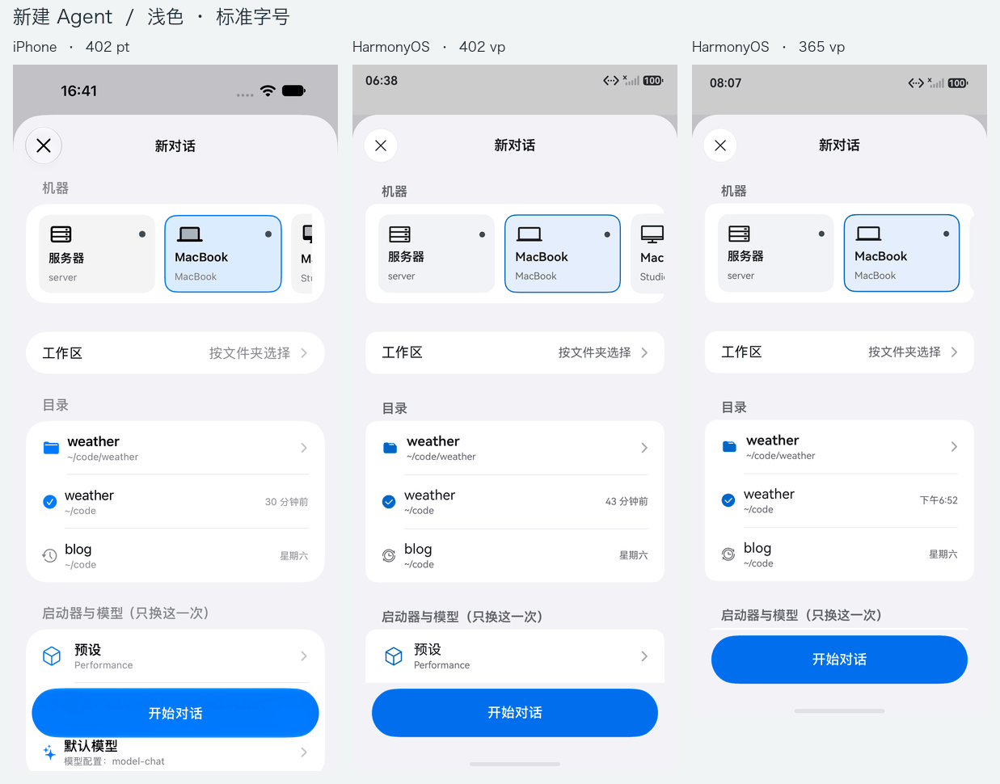
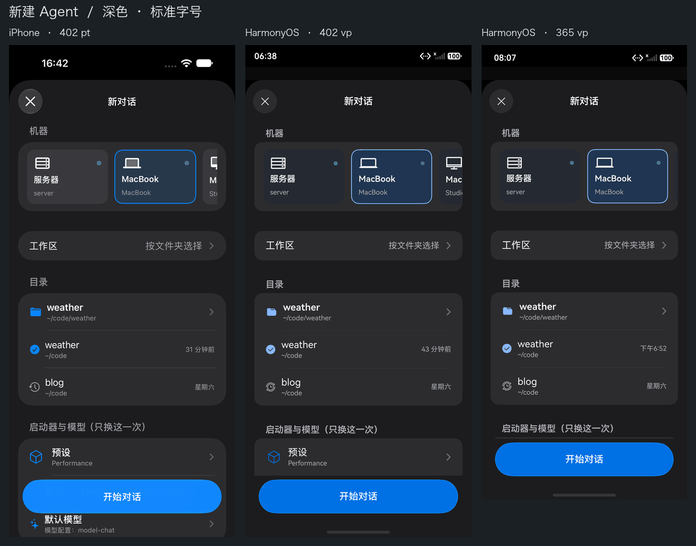
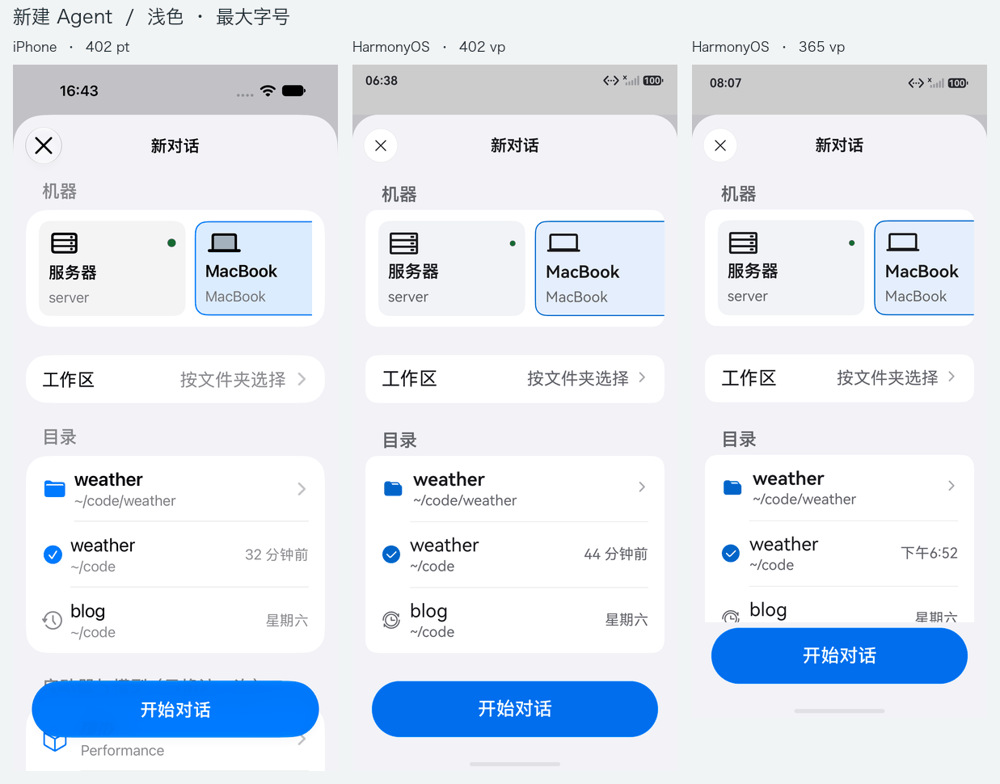

# 新建 Agent · New agent

[返回全部页面 · All pages](../README.md)

在启动表单选择机器、工作目录和启动器。
Compare the machine, directory, launcher and default model in the start form.

Three independent native captures, left to right: iPhone 402 pt, HarmonyOS 402 vp, HarmonyOS 365 vp. The complete screen, including system bars, is visible.

[Download all original screenshots and accessibility trees for this page](../originals/new-agent.zip?raw=1) · [Source and capture method](../SOURCES.md)

Original archive SHA-256: 6d257d1b4018c11ce53fcb37a334f61951f5b3445249bac851baf4d8e5498add

## 浅色 · 标准字号

| Device | Pixels | Captured at | PNG digest | Hierarchy digest |
| --- | --- | --- | --- | --- |
| iPhone 402 pt | 1206 × 2622 | 2026-11-23T08:41:32.971+00:00 | 7e303f91820dedbd | 67c6ad0753f28187 |
| HarmonyOS 402 vp | 1206 × 2622 | 2026-11-23T18:38:05+08:00 | 7a3845d2ef7ed2b6 | fb6bea94b973e301 |
| HarmonyOS 365 vp | 1280 × 2832 | 2026-11-23T20:07:13+08:00 | 867e3eafb4fda0a3 | 83cfd793fc3ecfed |

## 深色 · 标准字号

| Device | Pixels | Captured at | PNG digest | Hierarchy digest |
| --- | --- | --- | --- | --- |
| iPhone 402 pt | 1206 × 2622 | 2026-11-23T08:42:23.190+00:00 | ea0dbd7a1abdc59e | 4329ca97a375deb7 |
| HarmonyOS 402 vp | 1206 × 2622 | 2026-11-23T18:38:09+08:00 | f5d42d27058b8c19 | 569bba48b987cdcd |
| HarmonyOS 365 vp | 1280 × 2832 | 2026-11-23T20:07:17+08:00 | b0db3ec177ece588 | be307df9bd04ce8e |

## 浅色 · 最大字号

| Device | Pixels | Captured at | PNG digest | Hierarchy digest |
| --- | --- | --- | --- | --- |
| iPhone 402 pt | 1206 × 2622 | 2026-11-23T08:43:09.600+00:00 | ea55fb8c83e7c085 | f9b331f4441ef0d5 |
| HarmonyOS 402 vp | 1206 × 2622 | 2026-11-23T18:38:14+08:00 | 847d001f0f4ce054 | 73270ee8983643e7 |
| HarmonyOS 365 vp | 1280 × 2832 | 2026-11-23T20:07:21+08:00 | e7d307baf6dd51ef | 0b308c15f0ef00a8 |

Full 64-character digests and ZIP entry paths are under this page in the [manifest](../manifest.json).

[← 工作树详情](worktree.md)
[选择目录 →](folder-browser.md)
