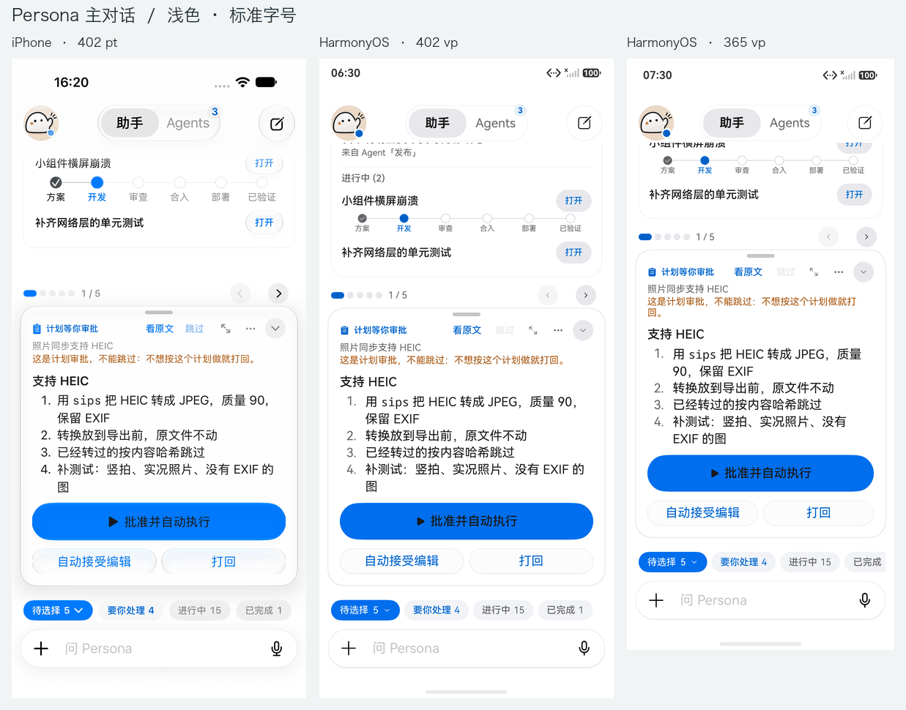
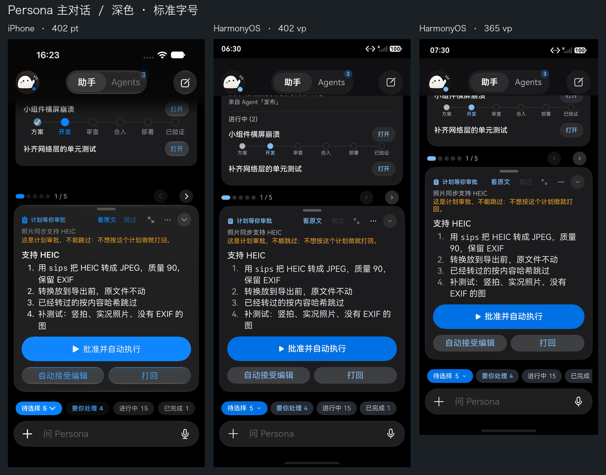
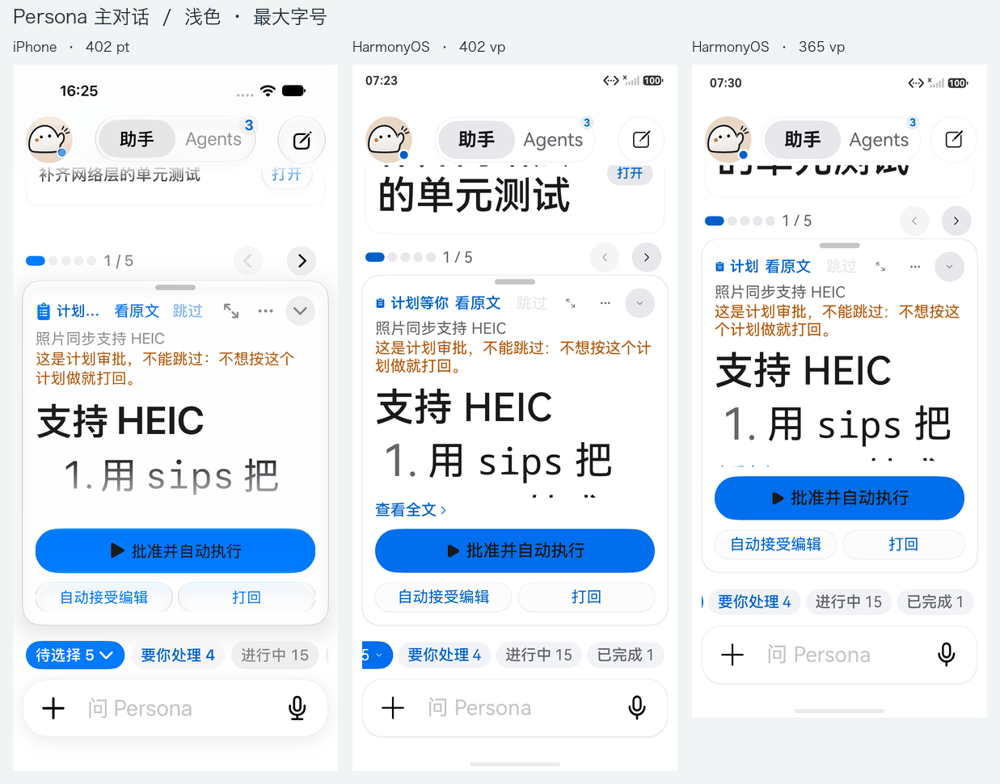

# Persona 主对话 · Main assistant conversation

[返回全部页面 · All pages](../README.md)

查看主助手的消息、任务卡和输入区。
Compare the assistant briefing, its progress links, the pending Agent plan and the composer.

Three independent native captures, left to right: iPhone 402 pt, HarmonyOS 402 vp, HarmonyOS 365 vp. The complete screen, including system bars, is visible.

[Download all original screenshots and accessibility trees for this page](../originals/persona.zip?raw=1) · [Source and capture method](../SOURCES.md)

Original archive SHA-256: 31fb70cc0f76064fdff7539abf0962df74eeadacfd31b3e7f5bffb04dbee7892

## 浅色 · 标准字号

| Device | Pixels | Captured at | PNG digest | Hierarchy digest |
| --- | --- | --- | --- | --- |
| iPhone 402 pt | 1206 × 2622 | 2026-11-23T08:20:06.281+00:00 | 5f07976f6eed6336 | be128a2e18c882d3 |
| HarmonyOS 402 vp | 1206 × 2622 | 2026-11-23T18:30:16+08:00 | 74a836bde9b53aae | b15577aa51f2e323 |
| HarmonyOS 365 vp | 1280 × 2832 | 2026-11-23T19:30:06+08:00 | f9f4548a59129c90 | b34902b0015b9980 |

## 深色 · 标准字号

| Device | Pixels | Captured at | PNG digest | Hierarchy digest |
| --- | --- | --- | --- | --- |
| iPhone 402 pt | 1206 × 2622 | 2026-11-23T08:23:06.295+00:00 | 6c52f1463376691c | 735052b48f98b329 |
| HarmonyOS 402 vp | 1206 × 2622 | 2026-11-23T18:30:20+08:00 | 2e06fa90602a7aeb | 100c95e8efab8914 |
| HarmonyOS 365 vp | 1280 × 2832 | 2026-11-23T19:30:10+08:00 | a6b2a50ec3234a61 | 08bf7bbfbf3163e9 |

## 浅色 · 最大字号

| Device | Pixels | Captured at | PNG digest | Hierarchy digest |
| --- | --- | --- | --- | --- |
| iPhone 402 pt | 1206 × 2622 | 2026-11-23T08:25:49.291+00:00 | e316384d665280e9 | 4ac62b4cd12b618f |
| HarmonyOS 402 vp | 1206 × 2622 | 2026-11-23T19:23:11+08:00 | ffe152fabe7af791 | 1bdcbf40da84c9be |
| HarmonyOS 365 vp | 1280 × 2832 | 2026-11-23T19:30:45+08:00 | 47a02ee47ac79246 | b6f2d8dc2bd9a4bb |

Full 64-character digests and ZIP entry paths are under this page in the [manifest](../manifest.json).

[← 会话小结详情](recap-detail.md)
[展开会话输入框 →](composer.md)
