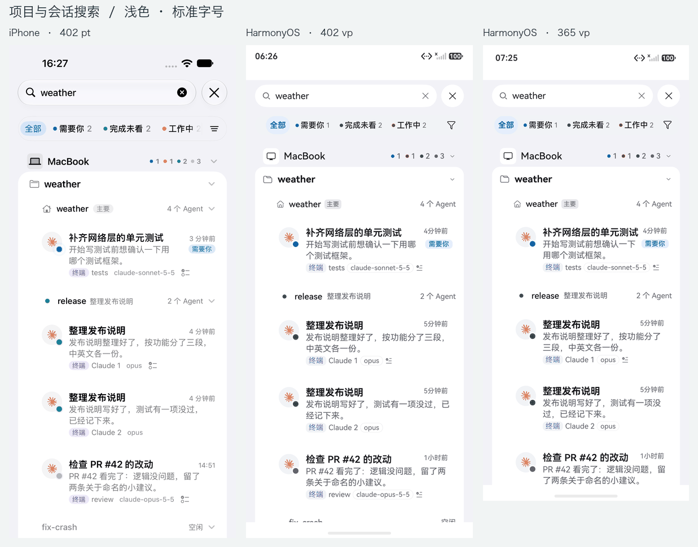
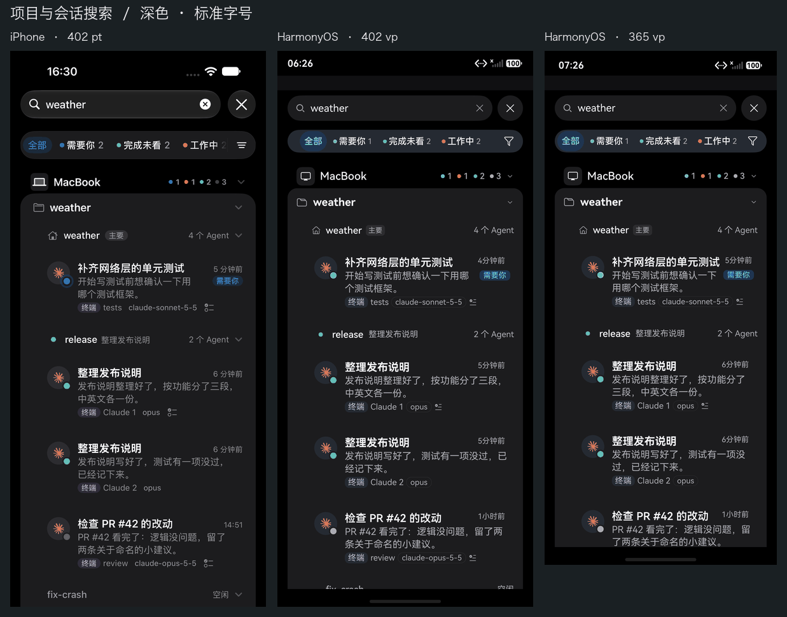
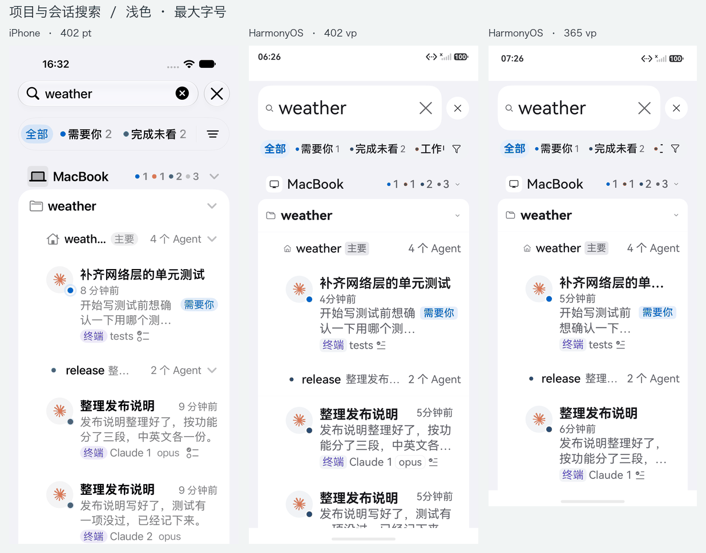

# 项目与会话搜索 · Search projects and sessions

[返回全部页面 · All pages](../README.md)

按仓库或会话关键词筛选项目，再读取匹配项。
Search for weather in the repository outline and compare its activity filters and matching rows.

Three independent native captures, left to right: iPhone 402 pt, HarmonyOS 402 vp, HarmonyOS 365 vp. The complete screen, including system bars, is visible.

[Download all original screenshots and accessibility trees for this page](../originals/project-search.zip?raw=1) · [Source and capture method](../SOURCES.md)

Original archive SHA-256: 0d2f73a8fbaf86bbd8bd91a2b6f5c4fb8391b30196246b5cf67c31c27603e520

## 浅色 · 标准字号

| Device | Pixels | Captured at | PNG digest | Hierarchy digest |
| --- | --- | --- | --- | --- |
| iPhone 402 pt | 1206 × 2622 | 2026-11-23T08:27:54.772+00:00 | b9f1ea22b2bec616 | 6a6d4c693899713a |
| HarmonyOS 402 vp | 1206 × 2622 | 2026-11-23T18:26:51+08:00 | df394b380ce0c26d | 674e9819de5975c4 |
| HarmonyOS 365 vp | 1280 × 2832 | 2026-11-23T19:25:45+08:00 | c3f0a58dc78d78fc | ff4c112ecc931bbc |

## 深色 · 标准字号

| Device | Pixels | Captured at | PNG digest | Hierarchy digest |
| --- | --- | --- | --- | --- |
| iPhone 402 pt | 1206 × 2622 | 2026-11-23T08:30:22.521+00:00 | 15ae932be6268014 | e509d79fadcebec1 |
| HarmonyOS 402 vp | 1206 × 2622 | 2026-11-23T18:26:55+08:00 | d8dd0298f19d81bf | 4a1a0df436fd0d61 |
| HarmonyOS 365 vp | 1280 × 2832 | 2026-11-23T19:26:13+08:00 | 8d2198103ad690a5 | 32b2739cb23f2113 |

## 浅色 · 最大字号

| Device | Pixels | Captured at | PNG digest | Hierarchy digest |
| --- | --- | --- | --- | --- |
| iPhone 402 pt | 1206 × 2622 | 2026-11-23T08:32:54.582+00:00 | 6e08056e6f176892 | 7fa23809e90dfe8a |
| HarmonyOS 402 vp | 1206 × 2622 | 2026-11-23T18:26:59+08:00 | 96a2d86d5f68a83f | b838219b96c40f98 |
| HarmonyOS 365 vp | 1280 × 2832 | 2026-11-23T19:26:25+08:00 | 60b8a8a3774bb736 | e3f2893f3a6d4f29 |

Full 64-character digests and ZIP entry paths are under this page in the [manifest](../manifest.json).

[← 折叠 release 标签](release-collapsed.md)
[仓库详情 →](project.md)
