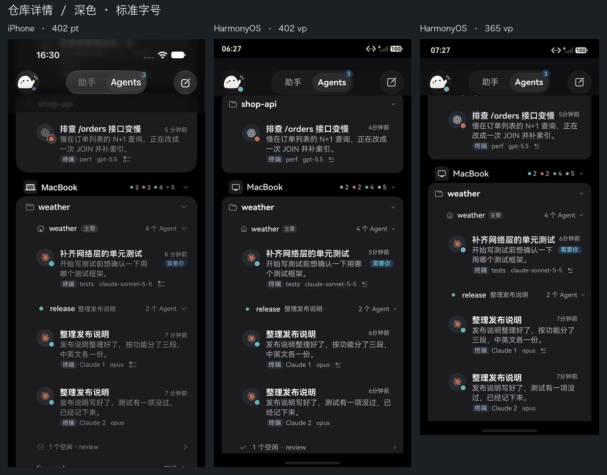

# 仓库详情 · Repository details

[返回全部页面 · All pages](../README.md)

查看 weather 仓库包含的工作树和会话。
Expand weather in place and inspect the worktrees and sessions inside this repository.

Three independent native captures, left to right: iPhone 402 pt, HarmonyOS 402 vp, HarmonyOS 365 vp. The complete screen, including system bars, is visible.

[Download all original screenshots and accessibility trees for this page](../originals/project.zip?raw=1) · [Source and capture method](../SOURCES.md)

Original archive SHA-256: e68dd0c41f176f532d14b31d4f89a2708bb0be27cef27175aacfb02ad0f56bac

## 浅色 · 标准字号

| Device | Pixels | Captured at | PNG digest | Hierarchy digest |
| --- | --- | --- | --- | --- |
| iPhone 402 pt | 1206 × 2622 | 2026-11-23T08:28:10.252+00:00 | 1c982019c69e2ddd | 15c6c348aabaec1b |
| HarmonyOS 402 vp | 1206 × 2622 | 2026-11-23T18:27:19+08:00 | 906232828feb2122 | de2cdcac250d6a73 |
| HarmonyOS 365 vp | 1280 × 2832 | 2026-11-23T19:27:01+08:00 | c0f962fe21191db2 | 6893b6f8f39efeab |

## 深色 · 标准字号

| Device | Pixels | Captured at | PNG digest | Hierarchy digest |
| --- | --- | --- | --- | --- |
| iPhone 402 pt | 1206 × 2622 | 2026-11-23T08:30:38.100+00:00 | e04b28cb3248604b | 0bf0d82e8ababf23 |
| HarmonyOS 402 vp | 1206 × 2622 | 2026-11-23T18:27:25+08:00 | 03def6568ae50ac0 | cbc6a00fbd117d06 |
| HarmonyOS 365 vp | 1280 × 2832 | 2026-11-23T19:27:07+08:00 | f888af62a1ebb658 | 5079eebe94c98ab8 |

## 浅色 · 最大字号

| Device | Pixels | Captured at | PNG digest | Hierarchy digest |
| --- | --- | --- | --- | --- |
| iPhone 402 pt | 1206 × 2622 | 2026-11-23T08:33:13.732+00:00 | cc82d518b8436828 | ccd530c3c51c52ad |
| HarmonyOS 402 vp | 1206 × 2622 | 2026-11-23T18:27:50+08:00 | a8330c5cc7c23b32 | a61fa2ff1d5adfab |
| HarmonyOS 365 vp | 1280 × 2832 | 2026-11-23T19:27:17+08:00 | d32443d4370ac0ee | 2cbee87f06cb0e0a |

Full 64-character digests and ZIP entry paths are under this page in the [manifest](../manifest.json).

[← 项目与会话搜索](project-search.md)
[工作树详情 →](worktree.md)
