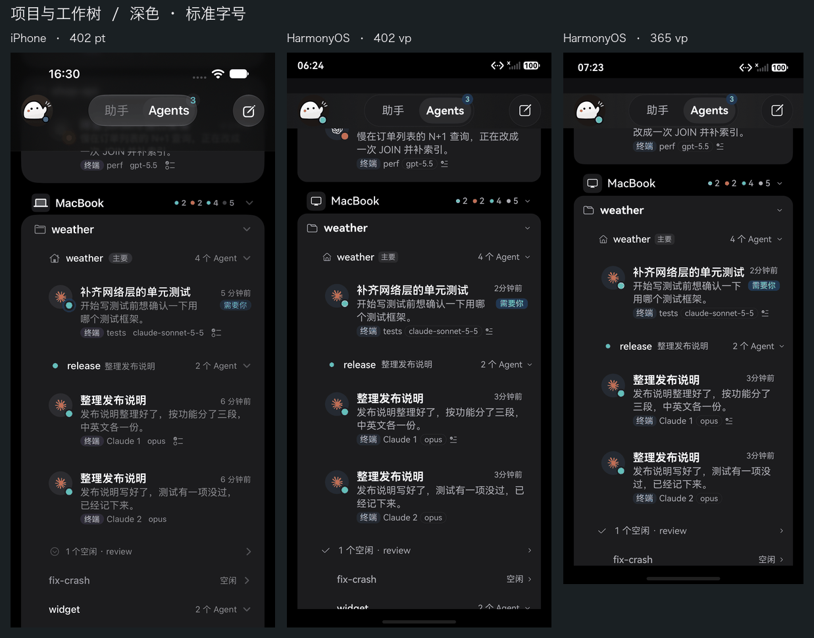

# 项目与工作树 · Project tree

[返回全部页面 · All pages](../README.md)

查看 weather 仓库、工作树和各自的 Agent。
Open the repository grouping in Agents and expand the same machine.

Three independent native captures, left to right: iPhone 402 pt, HarmonyOS 402 vp, HarmonyOS 365 vp. The complete screen, including system bars, is visible.

[Download all original screenshots and accessibility trees for this page](../originals/projects.zip?raw=1) · [Source and capture method](../SOURCES.md)

Original archive SHA-256: 83e786154c9da278c047af4daab76c9d4cc9ffd1649df0c81e1d687717c4660f

## 浅色 · 标准字号

| Device | Pixels | Captured at | PNG digest | Hierarchy digest |
| --- | --- | --- | --- | --- |
| iPhone 402 pt | 1206 × 2622 | 2026-11-23T08:27:37.158+00:00 | 09e15599f0d5a711 | 3cef99bf39cdb5e8 |
| HarmonyOS 402 vp | 1206 × 2622 | 2026-11-23T18:24:45+08:00 | 46709c72474dabe5 | b4180c5a54e2ae26 |
| HarmonyOS 365 vp | 1280 × 2832 | 2026-11-23T19:23:04+08:00 | fef4d862ce4433fb | 12b4befc79c9a90a |

## 深色 · 标准字号

| Device | Pixels | Captured at | PNG digest | Hierarchy digest |
| --- | --- | --- | --- | --- |
| iPhone 402 pt | 1206 × 2622 | 2026-11-23T08:30:04.526+00:00 | c5fd46ae19121f6e | cb867fd24825b390 |
| HarmonyOS 402 vp | 1206 × 2622 | 2026-11-23T18:24:49+08:00 | 341645b98aebe0df | e0ddf5475959f35e |
| HarmonyOS 365 vp | 1280 × 2832 | 2026-11-23T19:23:09+08:00 | d2927a96914f30d2 | de56c3f1c456812c |

## 浅色 · 最大字号

| Device | Pixels | Captured at | PNG digest | Hierarchy digest |
| --- | --- | --- | --- | --- |
| iPhone 402 pt | 1206 × 2622 | 2026-11-23T08:32:38.423+00:00 | a48d12dfb58ed6d8 | 86fe79dcad0bf3dd |
| HarmonyOS 402 vp | 1206 × 2622 | 2026-11-23T18:25:10+08:00 | 3326bcec5c6f7382 | 3545df82dc1534e2 |
| HarmonyOS 365 vp | 1280 × 2832 | 2026-11-23T19:23:19+08:00 | bd38cceb62b3d0cc | 36c5479296409e71 |

Full 64-character digests and ZIP entry paths are under this page in the [manifest](../manifest.json).

[折叠 release 标签 →](release-collapsed.md)
