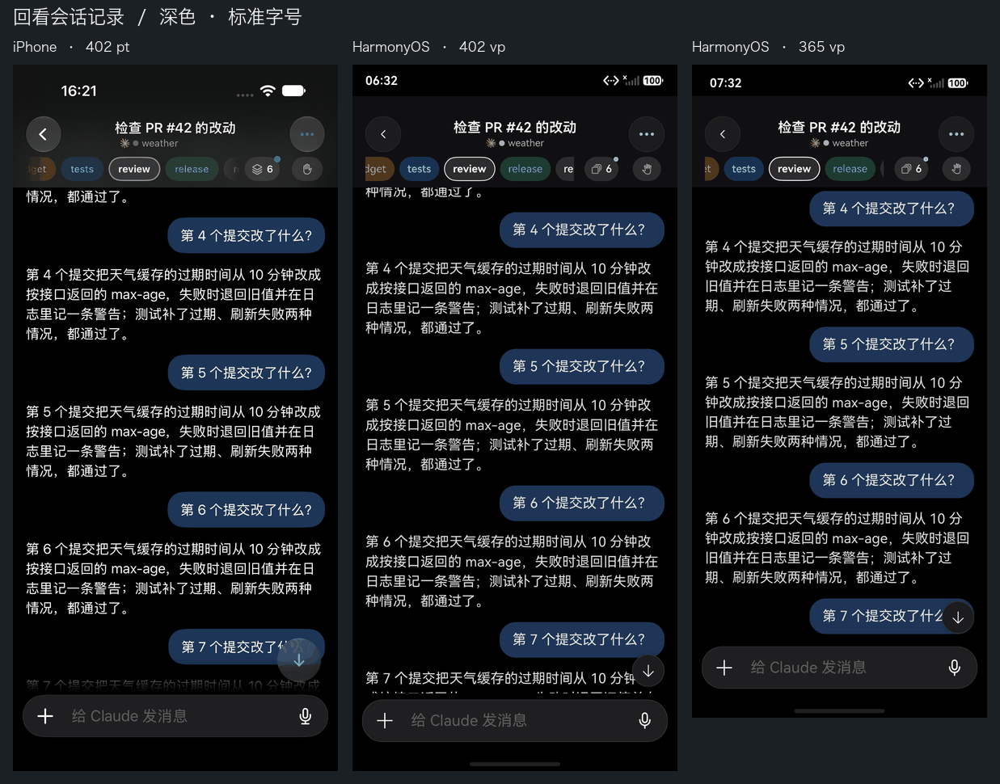

# 回看会话记录 · Read earlier messages

[返回全部页面 · All pages](../README.md)

回到较早的消息，再通过向下箭头跳至最新内容。

Three independent native captures, left to right: iPhone 402 pt, HarmonyOS 402 vp, HarmonyOS 365 vp. The complete screen, including system bars, is visible.

[Download all original screenshots and accessibility trees for this page](../originals/reading-history.zip?raw=1) · [Source and capture method](../SOURCES.md)

Original archive SHA-256: 8262d6ad4ecaa0b6b525629f6b4b93eecea1b63c3ebff844365538103f98be9d

## 浅色 · 标准字号

| Device | Pixels | Captured at | PNG digest | Hierarchy digest |
| --- | --- | --- | --- | --- |
| iPhone 402 pt | 1206 × 2622 | 2026-11-23T08:18:32.593+00:00 | 78224b66874f701e | 40cd6ecbe2b6dc5b |
| HarmonyOS 402 vp | 1206 × 2622 | 2026-11-23T18:32:22+08:00 | da8c6c834d863c2d | fa290a281da710bb |
| HarmonyOS 365 vp | 1280 × 2832 | 2026-11-23T19:32:36+08:00 | 9bbd1829278888d4 | 7984b5fd152167d1 |

## 深色 · 标准字号

| Device | Pixels | Captured at | PNG digest | Hierarchy digest |
| --- | --- | --- | --- | --- |
| iPhone 402 pt | 1206 × 2622 | 2026-11-23T08:21:34.995+00:00 | 189c7411c782da7b | aa2cacfc668494f8 |
| HarmonyOS 402 vp | 1206 × 2622 | 2026-11-23T18:32:30+08:00 | 04aba8c3df5dd8b1 | be09453d922fa2de |
| HarmonyOS 365 vp | 1280 × 2832 | 2026-11-23T19:32:43+08:00 | d522b32e075e1660 | 199d96c6658b0e6d |

## 浅色 · 最大字号

| Device | Pixels | Captured at | PNG digest | Hierarchy digest |
| --- | --- | --- | --- | --- |
| iPhone 402 pt | 1206 × 2622 | 2026-11-23T08:24:19.833+00:00 | e5a75fbe1b8b4221 | 9d9e9a2aa3f0c678 |
| HarmonyOS 402 vp | 1206 × 2622 | 2026-11-23T18:34:11+08:00 | 640862513c3052aa | bfd17219149db490 |
| HarmonyOS 365 vp | 1280 × 2832 | 2026-11-23T19:35:20+08:00 | f78c4f58705b92d2 | 3d23e69915995871 |

Full 64-character digests and ZIP entry paths are under this page in the [manifest](../manifest.json).

[← 展开会话输入框](composer.md)
[文件 →](files.md)
