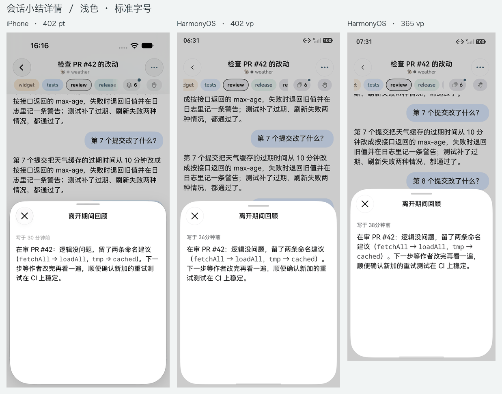
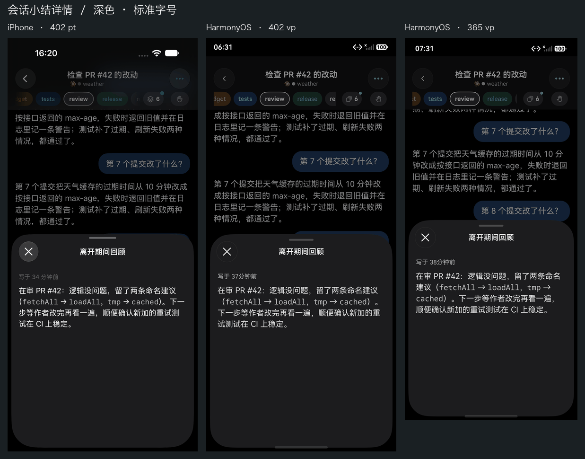
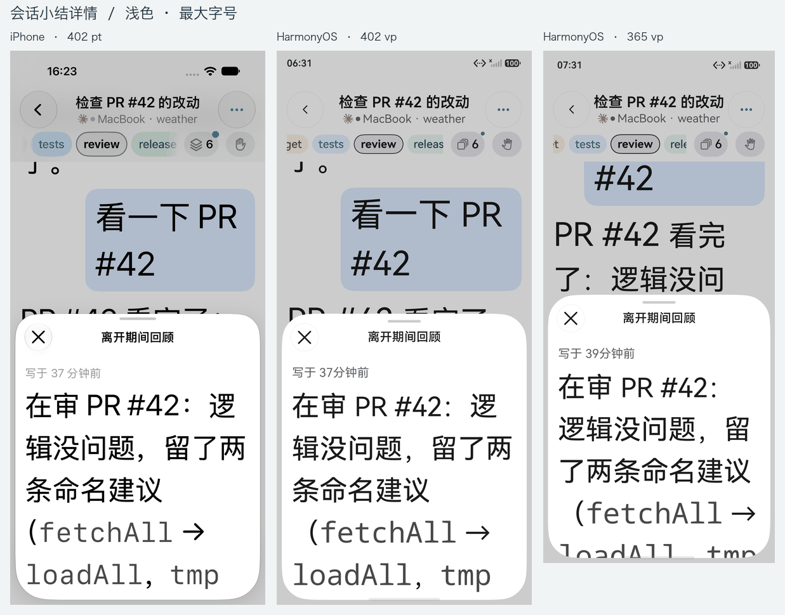

# 会话小结详情 · Conversation recap

[返回全部页面 · All pages](../README.md)

从「离开期间回顾」标记打开完整回顾。

Three independent native captures, left to right: iPhone 402 pt, HarmonyOS 402 vp, HarmonyOS 365 vp. The complete screen, including system bars, is visible.

[Download all original screenshots and accessibility trees for this page](../originals/recap-detail.zip?raw=1) · [Source and capture method](../SOURCES.md)

Original archive SHA-256: a0006b57e02f4e36b44700c84a8bd82c9dfe0b7b5cf76bab09b9b1b997833bb1

## 浅色 · 标准字号

| Device | Pixels | Captured at | PNG digest | Hierarchy digest |
| --- | --- | --- | --- | --- |
| iPhone 402 pt | 1206 × 2622 | 2026-11-23T08:16:46.143+00:00 | 4c416297e43a430f | 66a3ceca14112f4b |
| HarmonyOS 402 vp | 1206 × 2622 | 2026-11-23T18:31:10+08:00 | 2dedc09a5d8e86f5 | a669be8d53faec90 |
| HarmonyOS 365 vp | 1280 × 2832 | 2026-11-23T19:31:18+08:00 | b2077adcd9c0ff1f | 1428e2d5178e2243 |

## 深色 · 标准字号

| Device | Pixels | Captured at | PNG digest | Hierarchy digest |
| --- | --- | --- | --- | --- |
| iPhone 402 pt | 1206 × 2622 | 2026-11-23T08:20:29.223+00:00 | 0f243b438a3d558f | 59286e500e080796 |
| HarmonyOS 402 vp | 1206 × 2622 | 2026-11-23T18:31:13+08:00 | b122c37409c01fb9 | a412604ae608afa8 |
| HarmonyOS 365 vp | 1280 × 2832 | 2026-11-23T19:31:22+08:00 | 406b882927fbdb23 | 3416a337aa94003e |

## 浅色 · 最大字号

| Device | Pixels | Captured at | PNG digest | Hierarchy digest |
| --- | --- | --- | --- | --- |
| iPhone 402 pt | 1206 × 2622 | 2026-11-23T08:23:28.421+00:00 | 91f102d9d9d38477 | bbca930ee21ee6e1 |
| HarmonyOS 402 vp | 1206 × 2622 | 2026-11-23T18:31:17+08:00 | adabdd301fb0856d | 8a3114bced975238 |
| HarmonyOS 365 vp | 1280 × 2832 | 2026-11-23T19:31:26+08:00 | e297707915578544 | 2059a8c5e9af2686 |

Full 64-character digests and ZIP entry paths are under this page in the [manifest](../manifest.json).

[← Agent 会话](agent-chat.md)
[Persona 主对话 →](persona.md)
