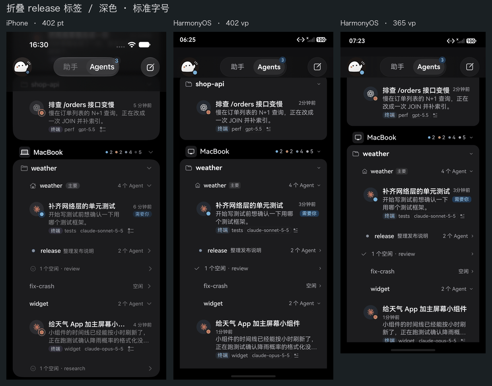

# 折叠 release 标签 · Collapse a terminal tab

[返回全部页面 · All pages](../README.md)

折叠 weather 下的 release 标签，查看分组和折叠状态。
Collapse the release terminal group in the weather project tree.

Three independent native captures, left to right: iPhone 402 pt, HarmonyOS 402 vp, HarmonyOS 365 vp. The complete screen, including system bars, is visible.

[Download all original screenshots and accessibility trees for this page](../originals/release-collapsed.zip?raw=1) · [Source and capture method](../SOURCES.md)

Original archive SHA-256: 4a672ff790008e7713eaf739d2150f726269610c72304d1e213f524782a71cd0

## 浅色 · 标准字号

| Device | Pixels | Captured at | PNG digest | Hierarchy digest |
| --- | --- | --- | --- | --- |
| iPhone 402 pt | 1206 × 2622 | 2026-11-23T08:28:14.370+00:00 | 152e3cbe74c9a068 | 377dc2f7b57eb543 |
| HarmonyOS 402 vp | 1206 × 2622 | 2026-11-23T18:25:22+08:00 | 86e03dfee5f60f60 | fff61a1904778d29 |
| HarmonyOS 365 vp | 1280 × 2832 | 2026-11-23T19:23:35+08:00 | 655be63cb2cb256e | 750c30c8bbfdfc37 |

## 深色 · 标准字号

| Device | Pixels | Captured at | PNG digest | Hierarchy digest |
| --- | --- | --- | --- | --- |
| iPhone 402 pt | 1206 × 2622 | 2026-11-23T08:30:42.312+00:00 | f5b36d2378859df2 | b3c8ef5dfd2da38f |
| HarmonyOS 402 vp | 1206 × 2622 | 2026-11-23T18:25:27+08:00 | 81a38acaba0dc36c | 8dc2e4b5d5d8cad4 |
| HarmonyOS 365 vp | 1280 × 2832 | 2026-11-23T19:23:42+08:00 | 02d656e9e23769f4 | c323148463f0d6ba |

## 浅色 · 最大字号

| Device | Pixels | Captured at | PNG digest | Hierarchy digest |
| --- | --- | --- | --- | --- |
| iPhone 402 pt | 1206 × 2622 | 2026-11-23T08:33:17.767+00:00 | 839e44b19666bbdb | db558fa8f757364d |
| HarmonyOS 402 vp | 1206 × 2622 | 2026-11-23T18:25:35+08:00 | e66b917d473e34b0 | 6f16432c7e43ce2c |
| HarmonyOS 365 vp | 1280 × 2832 | 2026-11-23T19:23:50+08:00 | 9843e3ebd725e758 | 2edbae6f2b00dd9e |

Full 64-character digests and ZIP entry paths are under this page in the [manifest](../manifest.json).

[← 项目与工作树](projects.md)
[项目与会话搜索 →](project-search.md)
