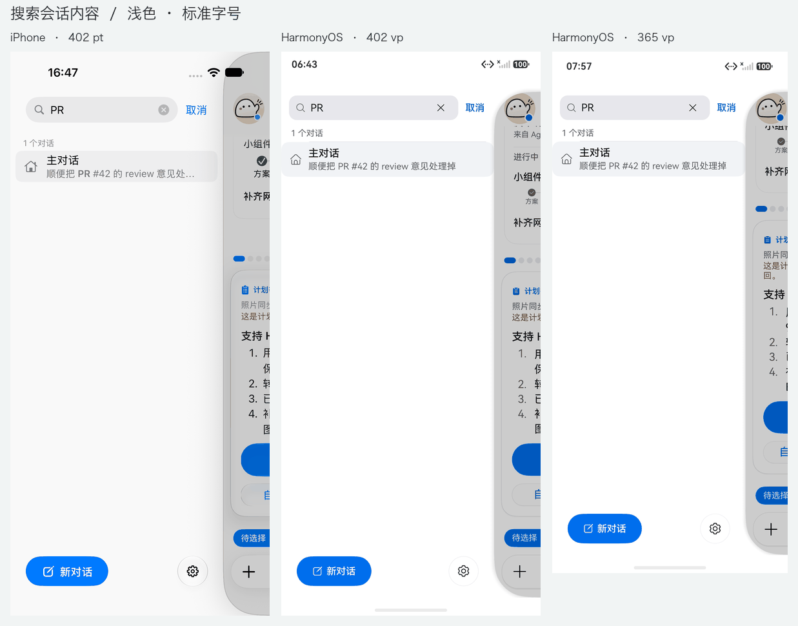
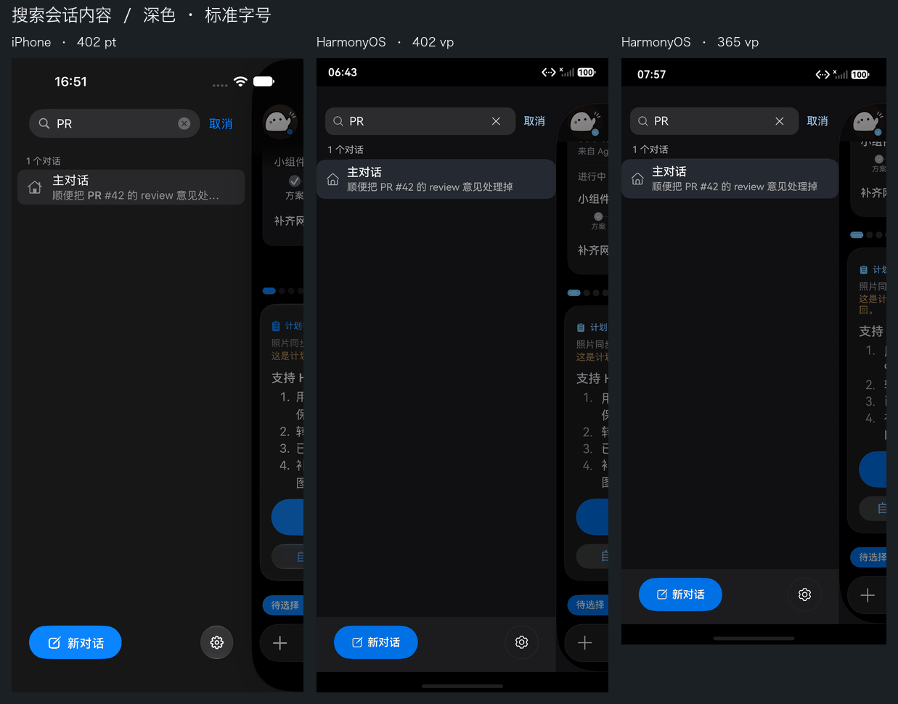
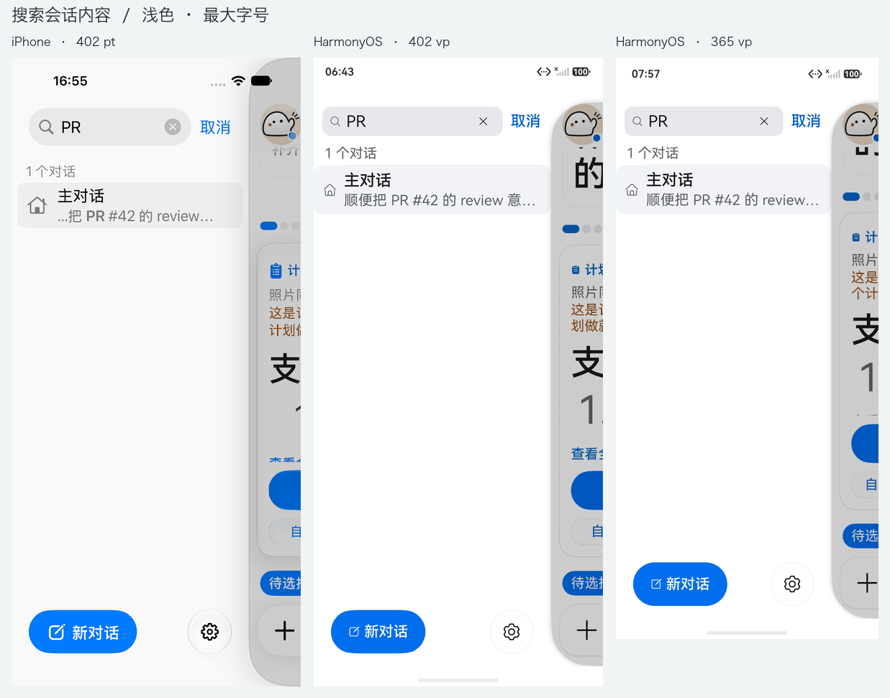

# 搜索会话内容 · Search conversations

[返回全部页面 · All pages](../README.md)

用 PR 搜索会话内容并查看匹配结果。

Three independent native captures, left to right: iPhone 402 pt, HarmonyOS 402 vp, HarmonyOS 365 vp. The complete screen, including system bars, is visible.

[Download all original screenshots and accessibility trees for this page](../originals/search.zip?raw=1) · [Source and capture method](../SOURCES.md)

Original archive SHA-256: eee8afa22543962d26ef8877a591eb0f4bfe1aa1037cf799b02c5e6623101f00

## 浅色 · 标准字号

| Device | Pixels | Captured at | PNG digest | Hierarchy digest |
| --- | --- | --- | --- | --- |
| iPhone 402 pt | 1206 × 2622 | 2026-11-23T08:47:55.763+00:00 | a0ddfaa848b8f876 | 013077bf90761dd4 |
| HarmonyOS 402 vp | 1206 × 2622 | 2026-11-23T18:43:33+08:00 | 9bbe3f19c5951cf4 | c7406de6649a7cc1 |
| HarmonyOS 365 vp | 1280 × 2832 | 2026-11-23T19:57:10+08:00 | fee09aa283081fec | ed1286e4cb48d166 |

## 深色 · 标准字号

| Device | Pixels | Captured at | PNG digest | Hierarchy digest |
| --- | --- | --- | --- | --- |
| iPhone 402 pt | 1206 × 2622 | 2026-11-23T08:51:44.637+00:00 | 1629d198ed622b85 | 88c204cddf60b5a7 |
| HarmonyOS 402 vp | 1206 × 2622 | 2026-11-23T18:43:36+08:00 | 6ba929f7d0e64af6 | 4c62e288d3e576ea |
| HarmonyOS 365 vp | 1280 × 2832 | 2026-11-23T19:57:14+08:00 | 45f688fa29d13666 | 98a0f465f96e5c98 |

## 浅色 · 最大字号

| Device | Pixels | Captured at | PNG digest | Hierarchy digest |
| --- | --- | --- | --- | --- |
| iPhone 402 pt | 1206 × 2622 | 2026-11-23T08:55:28.996+00:00 | a8bdb15f361d41ef | bb8f2a69838f78c4 |
| HarmonyOS 402 vp | 1206 × 2622 | 2026-11-23T18:43:41+08:00 | 77fb266078658b58 | 83b965ab23689da2 |
| HarmonyOS 365 vp | 1280 × 2832 | 2026-11-23T19:57:21+08:00 | 59d2843d14274c91 | fd769bdf02ade8f9 |

Full 64-character digests and ZIP entry paths are under this page in the [manifest](../manifest.json).

[← Agent 偏好](agent-preferences.md)
[收件箱 →](inbox.md)
