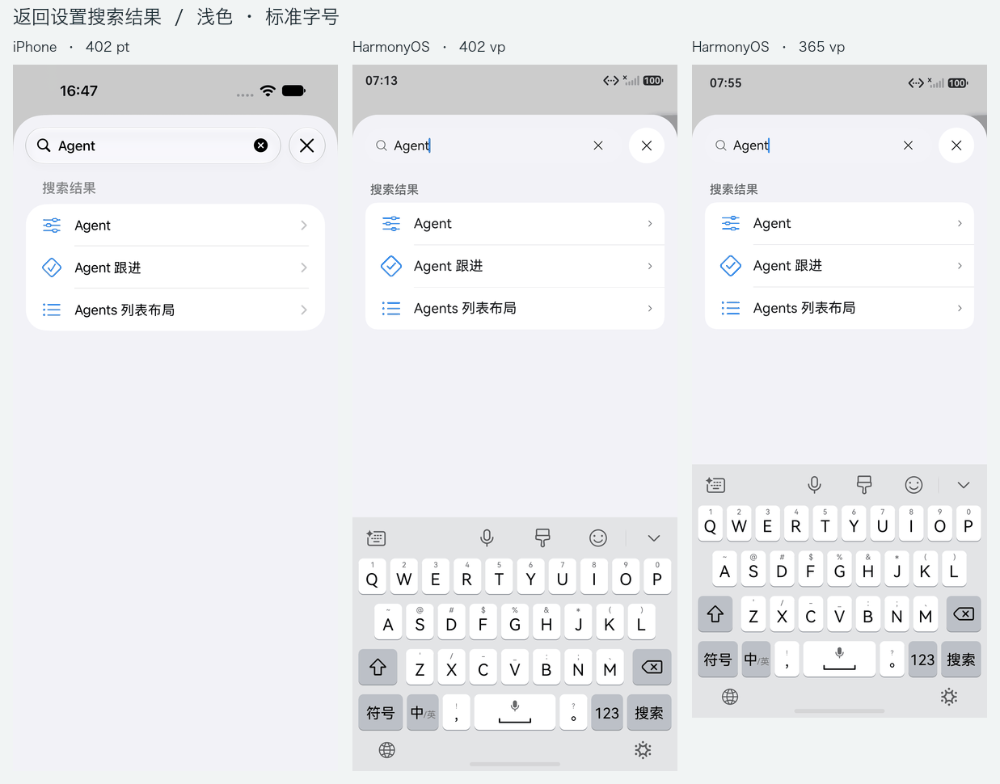
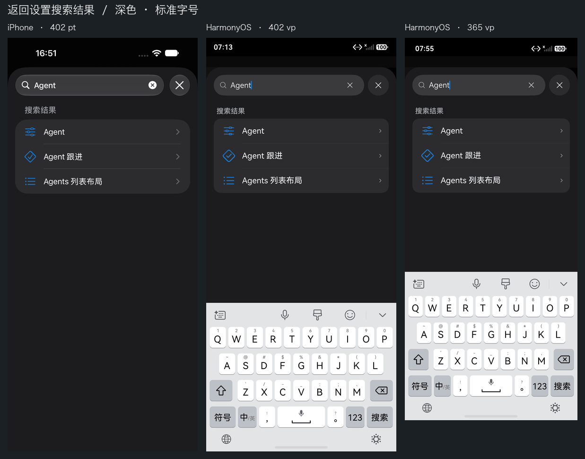
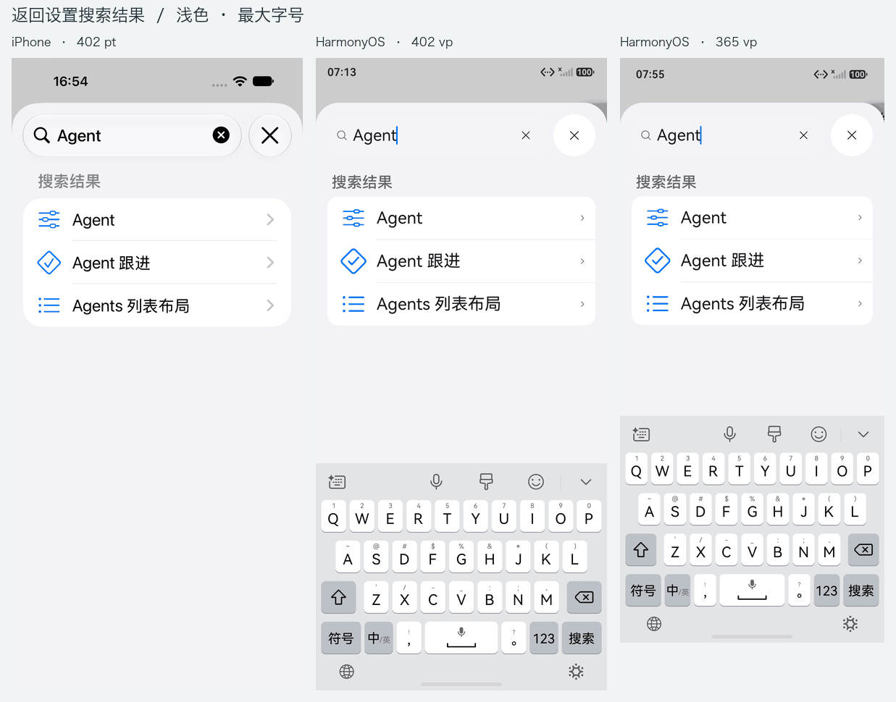

# 返回设置搜索结果 · Restore settings search

[返回全部页面 · All pages](../README.md)

搜索 Agent，打开偏好项，再返回已保留的搜索结果。

Three independent native captures, left to right: iPhone 402 pt, HarmonyOS 402 vp, HarmonyOS 365 vp. The complete screen, including system bars, is visible.

[Download all original screenshots and accessibility trees for this page](../originals/settings-search-restored.zip?raw=1) · [Source and capture method](../SOURCES.md)

Original archive SHA-256: 4f8eb3586e200010db73bb592628011bb943e809d92d2500456d2e6e55ef5b0e

## 浅色 · 标准字号

| Device | Pixels | Captured at | PNG digest | Hierarchy digest |
| --- | --- | --- | --- | --- |
| iPhone 402 pt | 1206 × 2622 | 2026-11-23T08:47:13.623+00:00 | 007f1f0dc0e38d0f | 9b52df0dff687c03 |
| HarmonyOS 402 vp | 1206 × 2622 | 2026-11-23T19:13:22+08:00 | c51ccdf5bc108f7a | 9158a5924a83d010 |
| HarmonyOS 365 vp | 1280 × 2832 | 2026-11-23T19:55:03+08:00 | 250bb331c05e8447 | baea9c2092a27f7d |

## 深色 · 标准字号

| Device | Pixels | Captured at | PNG digest | Hierarchy digest |
| --- | --- | --- | --- | --- |
| iPhone 402 pt | 1206 × 2622 | 2026-11-23T08:51:00.604+00:00 | 60fa18908d55b6ca | ea115d42c6560fc4 |
| HarmonyOS 402 vp | 1206 × 2622 | 2026-11-23T19:13:26+08:00 | bccfe8fd5090bc2f | 8dc665eedf01dd90 |
| HarmonyOS 365 vp | 1280 × 2832 | 2026-11-23T19:55:07+08:00 | 9ef14ee0ecb9df88 | e2b6c015143fb330 |

## 浅色 · 最大字号

| Device | Pixels | Captured at | PNG digest | Hierarchy digest |
| --- | --- | --- | --- | --- |
| iPhone 402 pt | 1206 × 2622 | 2026-11-23T08:54:44.339+00:00 | 329719413cf28b2c | 0e40cd98c6f9dc52 |
| HarmonyOS 402 vp | 1206 × 2622 | 2026-11-23T19:13:30+08:00 | 64b18026d7309d95 | be0bcee15d2f6746 |
| HarmonyOS 365 vp | 1280 × 2832 | 2026-11-23T19:55:11+08:00 | b6e9e59f6e03bdf4 | 7772efcbcb2a0c1e |

Full 64-character digests and ZIP entry paths are under this page in the [manifest](../manifest.json).

[← 设置](settings.md)
[语言 →](language.md)
