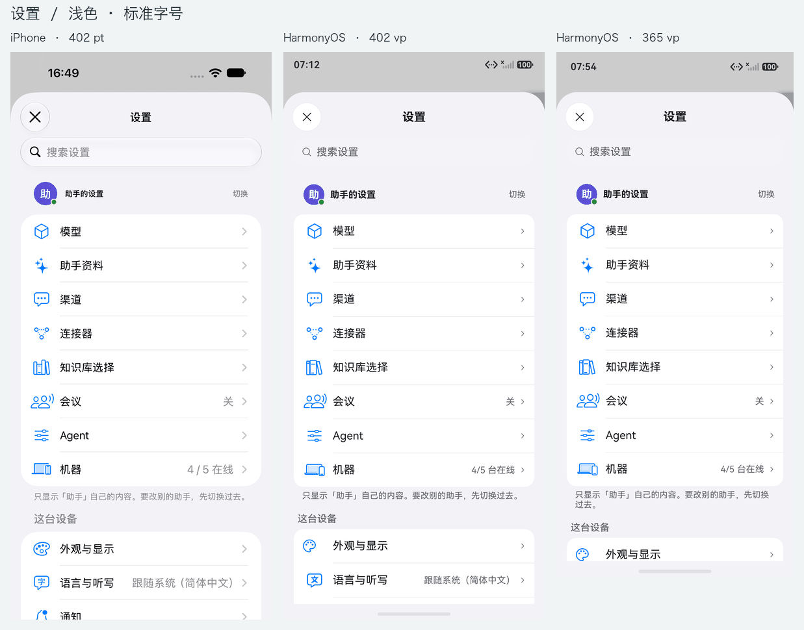
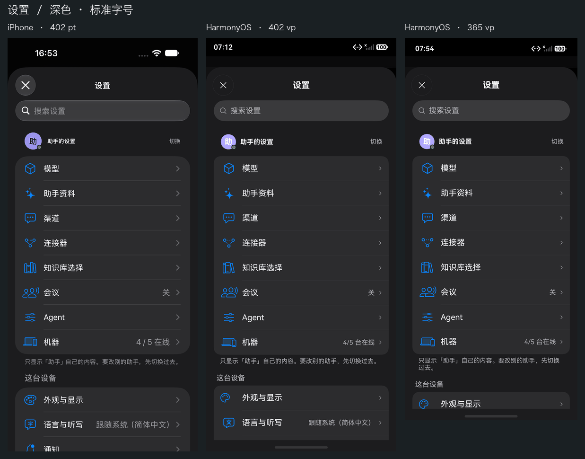
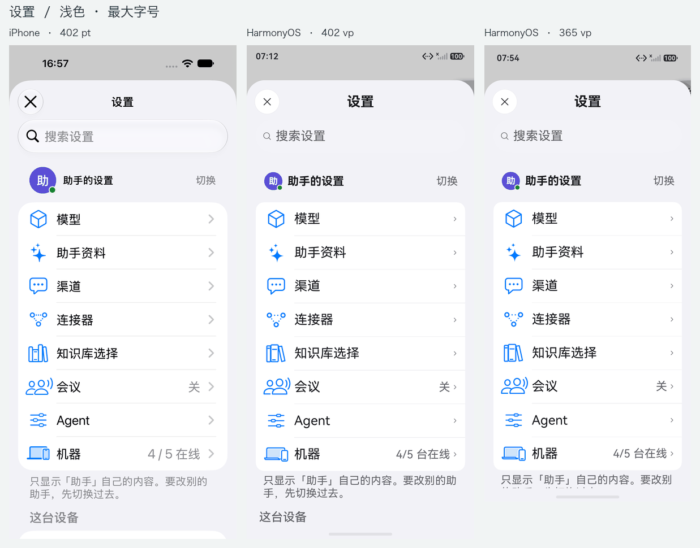

# 设置 · Settings

[返回全部页面 · All pages](../README.md)

查看设置分组和搜索入口。

Three independent native captures, left to right: iPhone 402 pt, HarmonyOS 402 vp, HarmonyOS 365 vp. The complete screen, including system bars, is visible.

[Download all original screenshots and accessibility trees for this page](../originals/settings.zip?raw=1) · [Source and capture method](../SOURCES.md)

Original archive SHA-256: 42cea659dee6f37f6fe2010e56403ef2e8f0bd665e541fd7e9fad3eb990fc0d5

## 浅色 · 标准字号

| Device | Pixels | Captured at | PNG digest | Hierarchy digest |
| --- | --- | --- | --- | --- |
| iPhone 402 pt | 1206 × 2622 | 2026-11-23T08:49:45.112+00:00 | e0186113e4bb019f | 504f4af7ffa8f18f |
| HarmonyOS 402 vp | 1206 × 2622 | 2026-11-23T19:12:19+08:00 | 4c5082c10a6b18d2 | 3a4ff06e83e58369 |
| HarmonyOS 365 vp | 1280 × 2832 | 2026-11-23T19:54:03+08:00 | 3fb48183e63696be | c25e6a716e06fff3 |

## 深色 · 标准字号

| Device | Pixels | Captured at | PNG digest | Hierarchy digest |
| --- | --- | --- | --- | --- |
| iPhone 402 pt | 1206 × 2622 | 2026-11-23T08:53:30.513+00:00 | 2132b252ab2c3789 | 7ebede71e111d8e1 |
| HarmonyOS 402 vp | 1206 × 2622 | 2026-11-23T19:12:23+08:00 | 3fc9eee6ea5dd41d | 4e6d5bf5fa131576 |
| HarmonyOS 365 vp | 1280 × 2832 | 2026-11-23T19:54:07+08:00 | d26174e15b90f30f | 569b69a532626db0 |

## 浅色 · 最大字号

| Device | Pixels | Captured at | PNG digest | Hierarchy digest |
| --- | --- | --- | --- | --- |
| iPhone 402 pt | 1206 × 2622 | 2026-11-23T08:57:18.528+00:00 | f40948d36281e4bc | 5509afb24162bfcd |
| HarmonyOS 402 vp | 1206 × 2622 | 2026-11-23T19:12:28+08:00 | 22b11a5408d99ad7 | 9951476284fe0958 |
| HarmonyOS 365 vp | 1280 × 2832 | 2026-11-23T19:54:11+08:00 | cb14b8db98242358 | c2814e388c472bc2 |

Full 64-character digests and ZIP entry paths are under this page in the [manifest](../manifest.json).

[← 切换助手](assistant-menu.md)
[返回设置搜索结果 →](settings-search-restored.md)
