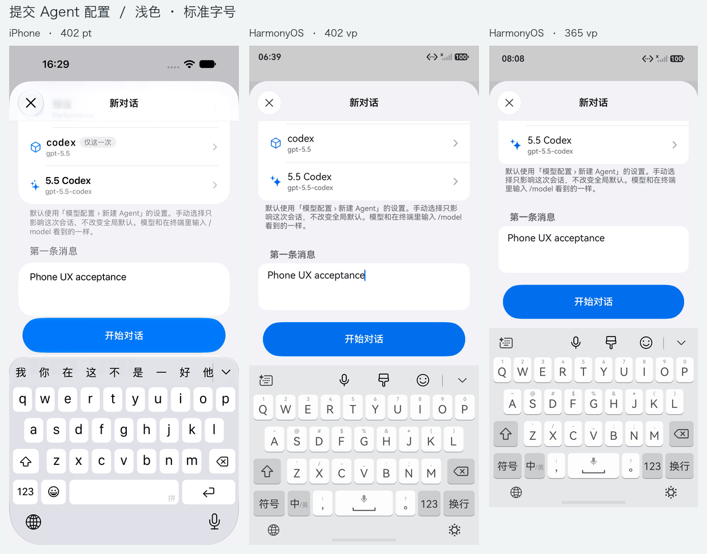
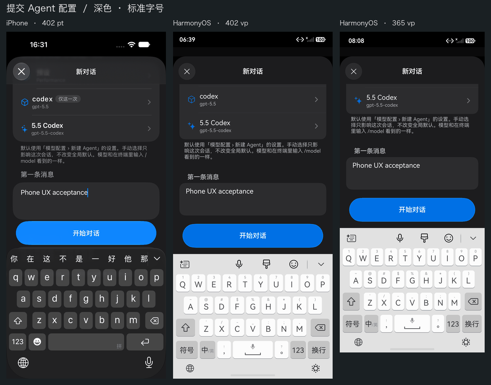
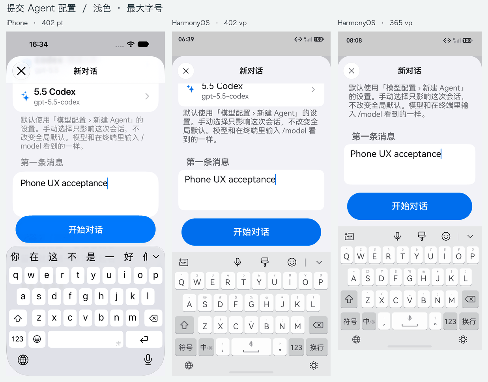

# 提交 Agent 配置 · Agent ready to start

[返回全部页面 · All pages](../README.md)

核对工作目录、启动器、模型和首条提示。
Enter the first message and inspect the start action above the keyboard.

Three independent native captures, left to right: iPhone 402 pt, HarmonyOS 402 vp, HarmonyOS 365 vp. The complete screen, including system bars, is visible.

[Download all original screenshots and accessibility trees for this page](../originals/start-ready.zip?raw=1) · [Source and capture method](../SOURCES.md)

Original archive SHA-256: fa24b387c9990c6c0e299e99f1a5c5f48aefb3b4aed88a6c1e0b1e6bd0ff3954

## 浅色 · 标准字号

| Device | Pixels | Captured at | PNG digest | Hierarchy digest |
| --- | --- | --- | --- | --- |
| iPhone 402 pt | 1206 × 2622 | 2026-11-23T08:29:19.191+00:00 | 02a288972652f19f | 7c01a5c1f72bdc5e |
| HarmonyOS 402 vp | 1206 × 2622 | 2026-11-23T18:39:22+08:00 | e255d2e3901708cc | 0b535112b1ec4917 |
| HarmonyOS 365 vp | 1280 × 2832 | 2026-11-23T20:08:25+08:00 | 78e78b59d625ce63 | d9c3546abf1bba29 |

## 深色 · 标准字号

| Device | Pixels | Captured at | PNG digest | Hierarchy digest |
| --- | --- | --- | --- | --- |
| iPhone 402 pt | 1206 × 2622 | 2026-11-23T08:31:47.962+00:00 | 598d3657a64fbfd8 | c678b96904a410c0 |
| HarmonyOS 402 vp | 1206 × 2622 | 2026-11-23T18:39:37+08:00 | 585e8e287aeb0b0a | 7ae3326b44f8fc11 |
| HarmonyOS 365 vp | 1280 × 2832 | 2026-11-23T20:08:40+08:00 | 22c47d2de02e03bd | b42bddd7f053e9e0 |

## 浅色 · 最大字号

| Device | Pixels | Captured at | PNG digest | Hierarchy digest |
| --- | --- | --- | --- | --- |
| iPhone 402 pt | 1206 × 2622 | 2026-11-23T08:34:27.128+00:00 | d6a23f680f289b72 | ba706f6a69bd31af |
| HarmonyOS 402 vp | 1206 × 2622 | 2026-11-23T18:39:54+08:00 | a72dd83b367b6ad2 | e3311371e622226c |
| HarmonyOS 365 vp | 1280 × 2832 | 2026-11-23T20:08:55+08:00 | 4c58fa9765bbdf7e | a3966fdcb743aff8 |

Full 64-character digests and ZIP entry paths are under this page in the [manifest](../manifest.json).

[← 选择模型](models.md)
[Agents 列表 →](agents.md)
