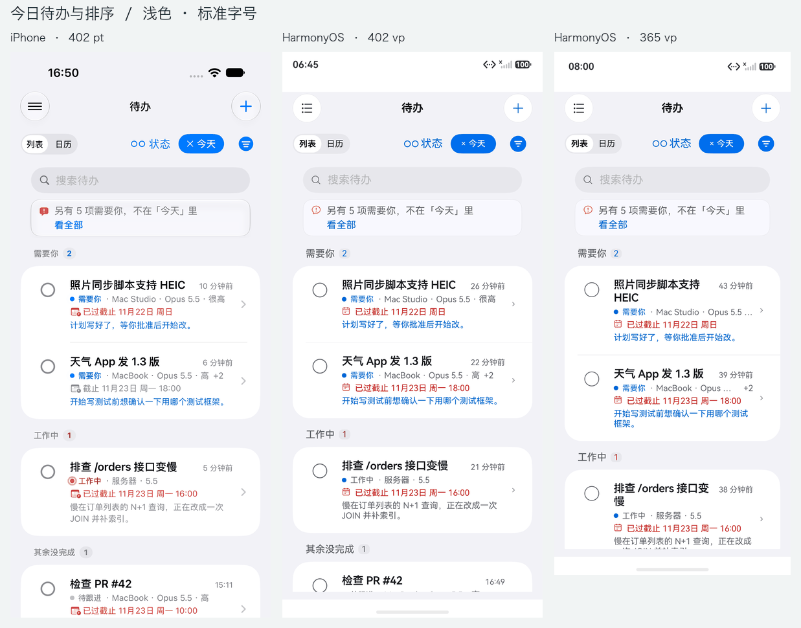
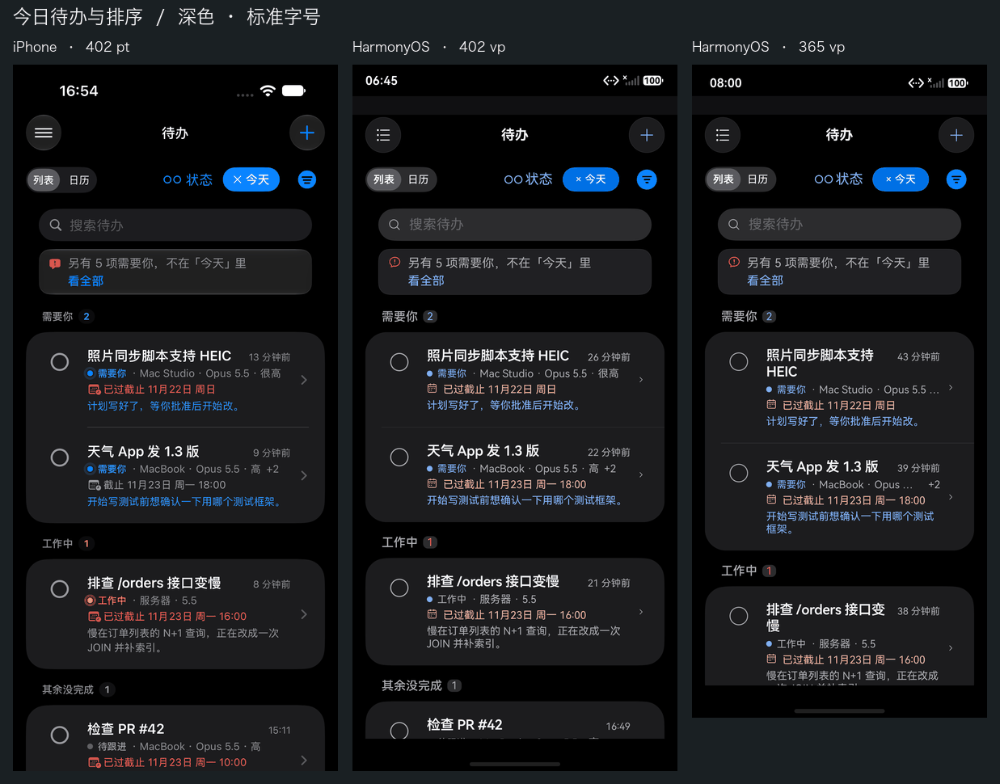
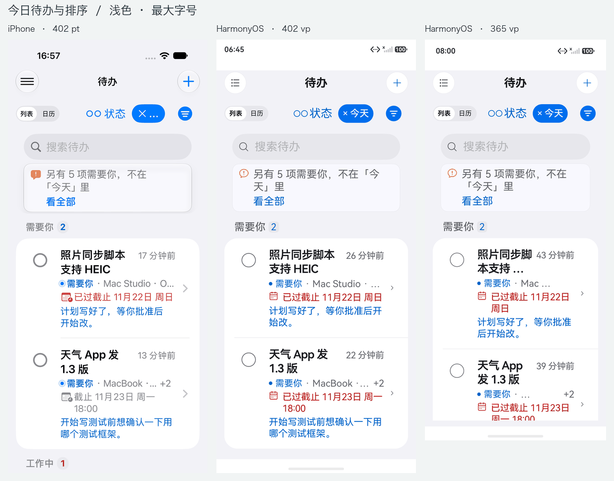

# 今日待办与排序 · Due today and priority

[返回全部页面 · All pages](../README.md)

筛选今天的待办，并查看优先级排序。

Three independent native captures, left to right: iPhone 402 pt, HarmonyOS 402 vp, HarmonyOS 365 vp. The complete screen, including system bars, is visible.

[Download all original screenshots and accessibility trees for this page](../originals/todo-due.zip?raw=1) · [Source and capture method](../SOURCES.md)

Original archive SHA-256: 02cf6704e55adee0ad314557a379b19cd3aca2f337e03039626dd6c27fcc7307

## 浅色 · 标准字号

| Device | Pixels | Captured at | PNG digest | Hierarchy digest |
| --- | --- | --- | --- | --- |
| iPhone 402 pt | 1206 × 2622 | 2026-11-23T08:50:17.945+00:00 | d00a5b62035655fd | 60eae15827915000 |
| HarmonyOS 402 vp | 1206 × 2622 | 2026-11-23T18:45:32+08:00 | a2cb267023895ea5 | 8d9ab34c516cf4ff |
| HarmonyOS 365 vp | 1280 × 2832 | 2026-11-23T20:00:40+08:00 | 00dc511afebf4260 | 5993aeeb5da32c73 |

## 深色 · 标准字号

| Device | Pixels | Captured at | PNG digest | Hierarchy digest |
| --- | --- | --- | --- | --- |
| iPhone 402 pt | 1206 × 2622 | 2026-11-23T08:54:02.526+00:00 | e548eb510222c729 | 3ee42edcca328cb9 |
| HarmonyOS 402 vp | 1206 × 2622 | 2026-11-23T18:45:35+08:00 | 4697da9672a5e784 | 152517af18cdc8ed |
| HarmonyOS 365 vp | 1280 × 2832 | 2026-11-23T20:00:44+08:00 | a752edceae36c9af | 15e16757998cd5bf |

## 浅色 · 最大字号

| Device | Pixels | Captured at | PNG digest | Hierarchy digest |
| --- | --- | --- | --- | --- |
| iPhone 402 pt | 1206 × 2622 | 2026-11-23T08:57:50.450+00:00 | 6354340216738f8d | cfe3f1869a53477e |
| HarmonyOS 402 vp | 1206 × 2622 | 2026-11-23T18:45:39+08:00 | 9da2304310237a33 | 34270fdf6aea616f |
| HarmonyOS 365 vp | 1280 × 2832 | 2026-11-23T20:00:49+08:00 | de73516468c66dee | f4bbdbf25412c701 |

Full 64-character digests and ZIP entry paths are under this page in the [manifest](../manifest.json).

[← 待办](todo.md)
[知识库 →](knowledge.md)
