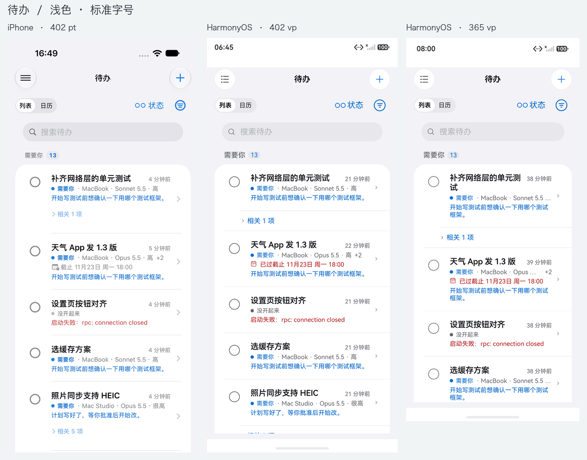
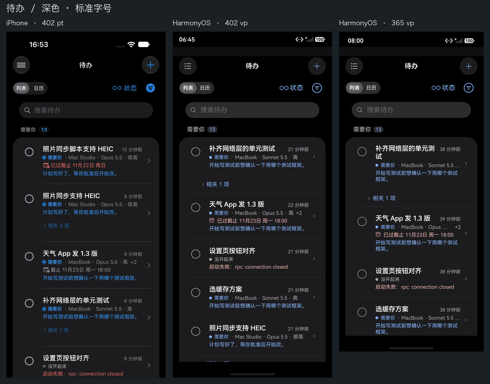
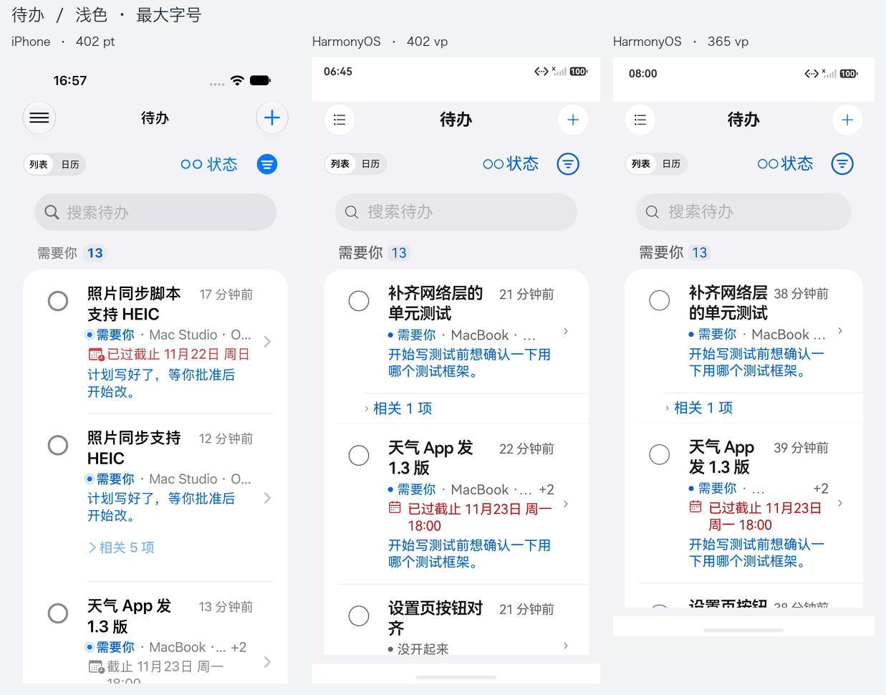

# 待办 · To-dos

[返回全部页面 · All pages](../README.md)

浏览待办清单及其状态。

Three independent native captures, left to right: iPhone 402 pt, HarmonyOS 402 vp, HarmonyOS 365 vp. The complete screen, including system bars, is visible.

[Download all original screenshots and accessibility trees for this page](../originals/todo.zip?raw=1) · [Source and capture method](../SOURCES.md)

Original archive SHA-256: bf6f9b2b55cc1861803cc4516ebbf0ddbbc6eb58e6c76d782c2f51507534036e

## 浅色 · 标准字号

| Device | Pixels | Captured at | PNG digest | Hierarchy digest |
| --- | --- | --- | --- | --- |
| iPhone 402 pt | 1206 × 2622 | 2026-11-23T08:49:57.010+00:00 | 0dfc7e2f5fad20c6 | a9b1b8ba3040508e |
| HarmonyOS 402 vp | 1206 × 2622 | 2026-11-23T18:45:13+08:00 | c9304ab2c8c66954 | 895764ffdd96cdc8 |
| HarmonyOS 365 vp | 1280 × 2832 | 2026-11-23T20:00:20+08:00 | 7677acc3b912dc7b | c733b24552261947 |

## 深色 · 标准字号

| Device | Pixels | Captured at | PNG digest | Hierarchy digest |
| --- | --- | --- | --- | --- |
| iPhone 402 pt | 1206 × 2622 | 2026-11-23T08:53:42.357+00:00 | f7e07ac85339c948 | 04b8d4827cd00c54 |
| HarmonyOS 402 vp | 1206 × 2622 | 2026-11-23T18:45:17+08:00 | edf815840bc79beb | 1a3fd0a18dfabdf3 |
| HarmonyOS 365 vp | 1280 × 2832 | 2026-11-23T20:00:24+08:00 | 2e7175f200e31c8d | 78d834e24a238a14 |

## 浅色 · 最大字号

| Device | Pixels | Captured at | PNG digest | Hierarchy digest |
| --- | --- | --- | --- | --- |
| iPhone 402 pt | 1206 × 2622 | 2026-11-23T08:57:30.489+00:00 | 43acdb067bb04c95 | 472d53025cfa4abc |
| HarmonyOS 402 vp | 1206 × 2622 | 2026-11-23T18:45:21+08:00 | 933f857948180254 | 6962ee8a272a02e0 |
| HarmonyOS 365 vp | 1280 × 2832 | 2026-11-23T20:00:28+08:00 | e2984892f814942d | 6a156213ff16eaea |

Full 64-character digests and ZIP entry paths are under this page in the [manifest](../manifest.json).

[← 收件箱](inbox.md)
[今日待办与排序 →](todo-due.md)
