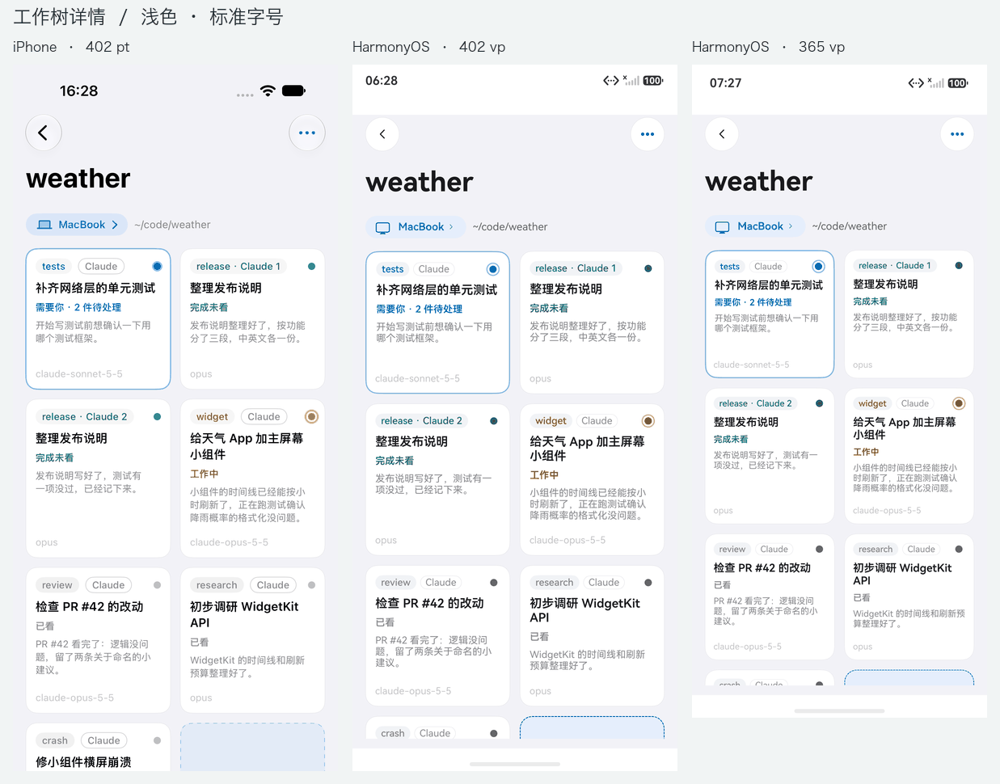
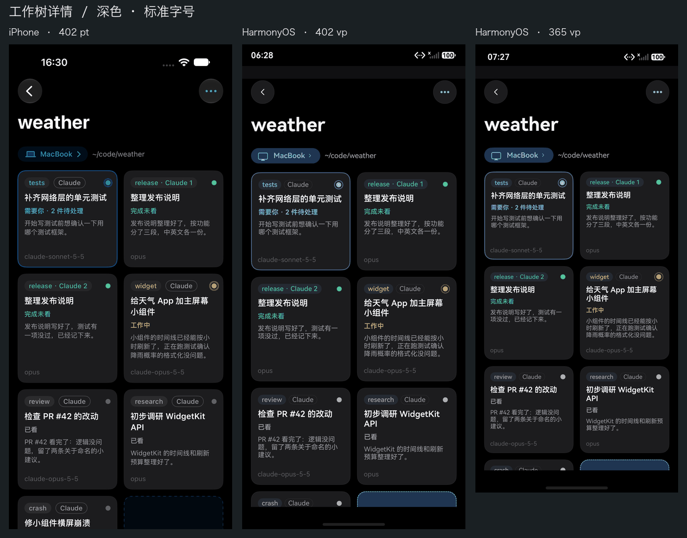
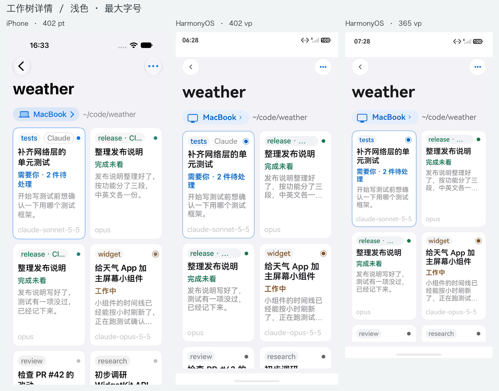

# 工作树详情 · Worktree details

[返回全部页面 · All pages](../README.md)

在选中的开发目录下查看会话和所属机器。
Open the weather terminal space and browse its agents across Git checkouts.

Three independent native captures, left to right: iPhone 402 pt, HarmonyOS 402 vp, HarmonyOS 365 vp. The complete screen, including system bars, is visible.

[Download all original screenshots and accessibility trees for this page](../originals/worktree.zip?raw=1) · [Source and capture method](../SOURCES.md)

Original archive SHA-256: 56ef69c036aeaa7139c789fb4d0734e7c5084e1d3b4b1e53a7faeb85892b66ea

## 浅色 · 标准字号

| Device | Pixels | Captured at | PNG digest | Hierarchy digest |
| --- | --- | --- | --- | --- |
| iPhone 402 pt | 1206 × 2622 | 2026-11-23T08:28:29.153+00:00 | 2cfa89dd6240e074 | 02902ca5b6c501e8 |
| HarmonyOS 402 vp | 1206 × 2622 | 2026-11-23T18:28:06+08:00 | f529d48db683511e | bcf2d1bcb0d3651c |
| HarmonyOS 365 vp | 1280 × 2832 | 2026-11-23T19:27:49+08:00 | 6594c39957c8b333 | 900b5cf544cfb8d9 |

## 深色 · 标准字号

| Device | Pixels | Captured at | PNG digest | Hierarchy digest |
| --- | --- | --- | --- | --- |
| iPhone 402 pt | 1206 × 2622 | 2026-11-23T08:30:57.322+00:00 | 5eddecb003217a67 | c42c431fcf385874 |
| HarmonyOS 402 vp | 1206 × 2622 | 2026-11-23T18:28:09+08:00 | 7d570de5611b8940 | f73893a464189724 |
| HarmonyOS 365 vp | 1280 × 2832 | 2026-11-23T19:27:58+08:00 | 3fdd986bcdab70bd | 1e3fd4a03abe28e2 |

## 浅色 · 最大字号

| Device | Pixels | Captured at | PNG digest | Hierarchy digest |
| --- | --- | --- | --- | --- |
| iPhone 402 pt | 1206 × 2622 | 2026-11-23T08:33:33.720+00:00 | e29d657768cfa6bf | f447b69aeb389dd1 |
| HarmonyOS 402 vp | 1206 × 2622 | 2026-11-23T18:28:14+08:00 | a1f20cbafef3a511 | 32828123b63d6f14 |
| HarmonyOS 365 vp | 1280 × 2832 | 2026-11-23T19:28:06+08:00 | 14c2fdbaec3ecf65 | 6244f11afacc9941 |

Full 64-character digests and ZIP entry paths are under this page in the [manifest](../manifest.json).

[← 仓库详情](project.md)
[新建 Agent →](new-agent.md)
