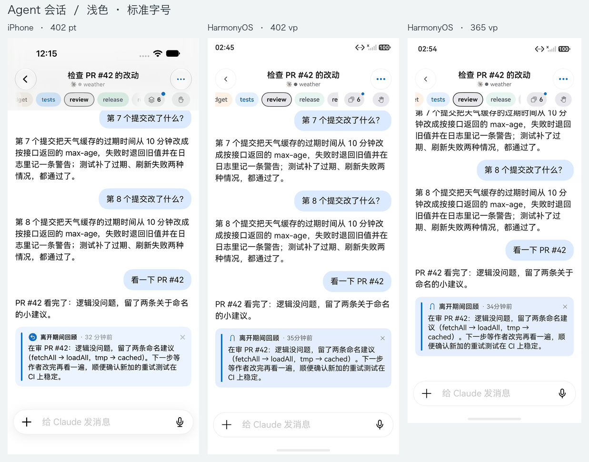
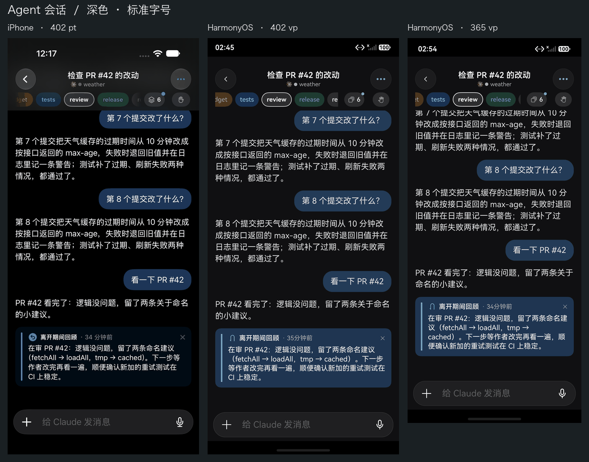
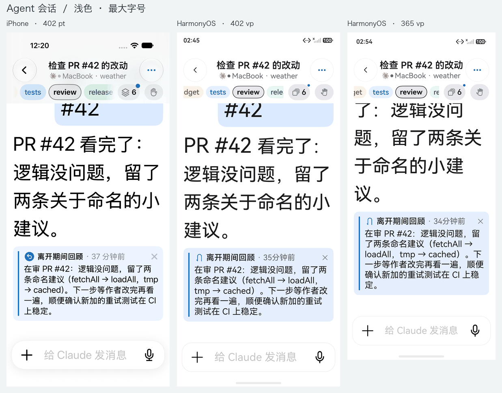

# Agent 会话 · Agent conversation

[返回全部页面 · All pages](../README.md)

打开 weather 的 PR #42 会话，核对用户消息、回复与回顾。
Open the PR #42 conversation with the seeded review history.

Three independent native captures, left to right: iPhone 402 pt, HarmonyOS 402 vp, HarmonyOS 365 vp. The complete screen, including system bars, is visible.

[Download all original screenshots and accessibility trees for this page](../originals/agent-chat.zip?raw=1) · [Source and capture method](../SOURCES.md)

Original archive SHA-256: dd3351038537d58f96c21f8983a9fbb4adf56ad4d8ea5e54a79b62b7c3be6cfa

## 浅色 · 标准字号

| Device | Pixels | Captured at | PNG digest | Hierarchy digest |
| --- | --- | --- | --- | --- |
| iPhone 402 pt | 1206 × 2622 | 2026-11-23T04:15:14.838+00:00 | bdb84262e2ab081e | ce4ae0e6d0b944e4 |
| HarmonyOS 402 vp | 1206 × 2622 | 2026-11-23T14:45:44+08:00 | 06c41f8a10de1fc2 | 51b53850f1828a28 |
| HarmonyOS 365 vp | 1280 × 2832 | 2026-11-23T14:54:12+08:00 | 4b54642c6db18c5f | 5aa37204d9d945fb |

## 深色 · 标准字号

| Device | Pixels | Captured at | PNG digest | Hierarchy digest |
| --- | --- | --- | --- | --- |
| iPhone 402 pt | 1206 × 2622 | 2026-11-23T04:17:35.199+00:00 | f0bdbbca55c5c57b | 29420290cd3e636a |
| HarmonyOS 402 vp | 1206 × 2622 | 2026-11-23T14:45:48+08:00 | 38f892647cf0de0a | 8510b50cab2a97bf |
| HarmonyOS 365 vp | 1280 × 2832 | 2026-11-23T14:54:16+08:00 | fbfcc9a14162f937 | ab03781434e24be5 |

## 浅色 · 最大字号

| Device | Pixels | Captured at | PNG digest | Hierarchy digest |
| --- | --- | --- | --- | --- |
| iPhone 402 pt | 1206 × 2622 | 2026-11-23T04:20:11.655+00:00 | 03307a2c285f2897 | 0d94f885e7a8d706 |
| HarmonyOS 402 vp | 1206 × 2622 | 2026-11-23T14:45:52+08:00 | f450e49ceef204aa | 04f746f8e6c51f56 |
| HarmonyOS 365 vp | 1280 × 2832 | 2026-11-23T14:54:20+08:00 | 042956d663571610 | fdf09f468c57280f |

Full 64-character digests and ZIP entry paths are under this page in the [manifest](../manifest.json).

[← Agents 列表](agents.md)
[会话小结详情 →](recap-detail.md)
