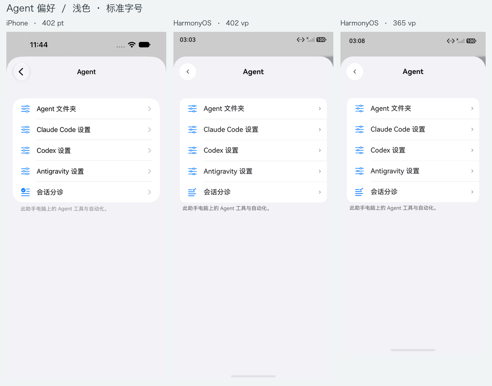
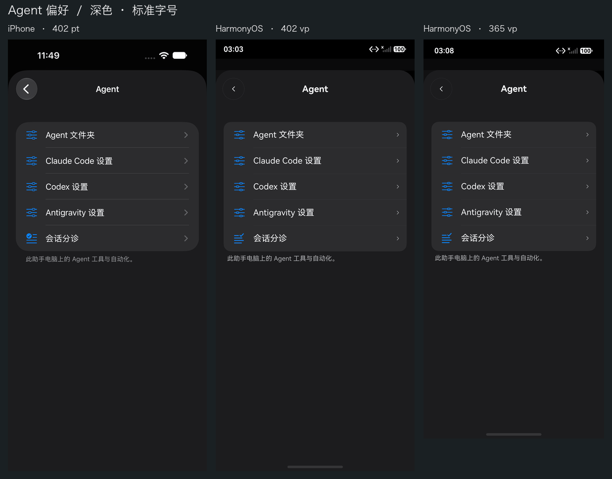
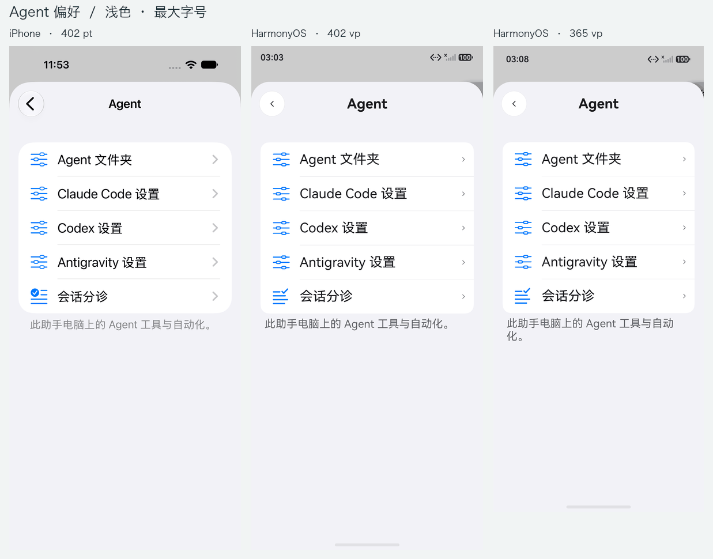

# Agent 偏好 · Agent preferences

[返回全部页面 · All pages](../README.md)

从设置进入 Agent 选项。
Open Agent preferences from Settings search and return to the same query.

Three independent native captures, left to right: iPhone 402 pt, HarmonyOS 402 vp, HarmonyOS 365 vp. The complete screen, including system bars, is visible.

[Download all original screenshots and accessibility trees for this page](../originals/agent-preferences.zip?raw=1) · [Source and capture method](../SOURCES.md)

Original archive SHA-256: 370451ca700ee81947b3c1d77c5004d0b4b60618c9a53447fb8d54b8215ae2c6

## 浅色 · 标准字号

| Device | Pixels | Captured at | PNG digest | Hierarchy digest |
| --- | --- | --- | --- | --- |
| iPhone 402 pt | 1206 × 2622 | 2026-11-23T03:44:49.291+00:00 | f8554286d96fff85 | 224931192c25a414 |
| HarmonyOS 402 vp | 1206 × 2622 | 2026-11-23T15:03:11+08:00 | 007ec366c53fb7b5 | 5bf79a4151451ba6 |
| HarmonyOS 365 vp | 1280 × 2832 | 2026-11-23T15:08:39+08:00 | f6294c1c90e436ea | 860e209d8c73097a |

## 深色 · 标准字号

| Device | Pixels | Captured at | PNG digest | Hierarchy digest |
| --- | --- | --- | --- | --- |
| iPhone 402 pt | 1206 × 2622 | 2026-11-23T03:49:29.583+00:00 | 44f11d3e00aff040 | 1c63083c1b1a15ba |
| HarmonyOS 402 vp | 1206 × 2622 | 2026-11-23T15:03:14+08:00 | 3379f80ed84a5696 | 67db0971b46051b6 |
| HarmonyOS 365 vp | 1280 × 2832 | 2026-11-23T15:08:43+08:00 | 6a51de39c3a91299 | 75f341efebdef8d3 |

## 浅色 · 最大字号

| Device | Pixels | Captured at | PNG digest | Hierarchy digest |
| --- | --- | --- | --- | --- |
| iPhone 402 pt | 1206 × 2622 | 2026-11-23T03:53:47.910+00:00 | 685aae4e5e0613d4 | 3498dc1d3bde22b2 |
| HarmonyOS 402 vp | 1206 × 2622 | 2026-11-23T15:03:18+08:00 | eb6a253011bd910d | b27bd6a3c4d106d0 |
| HarmonyOS 365 vp | 1280 × 2832 | 2026-11-23T15:08:47+08:00 | dba7e5426a0de1e2 | 75e165ad600046c0 |

Full 64-character digests and ZIP entry paths are under this page in the [manifest](../manifest.json).

[← 语言](language.md)
[搜索会话内容 →](search.md)
