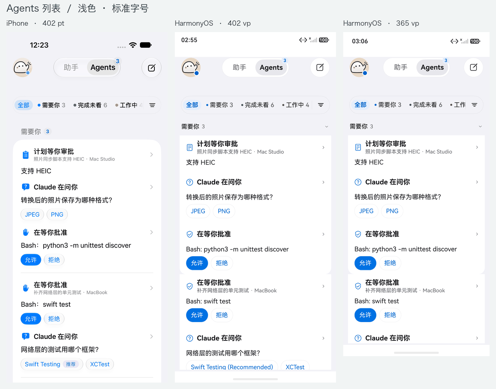
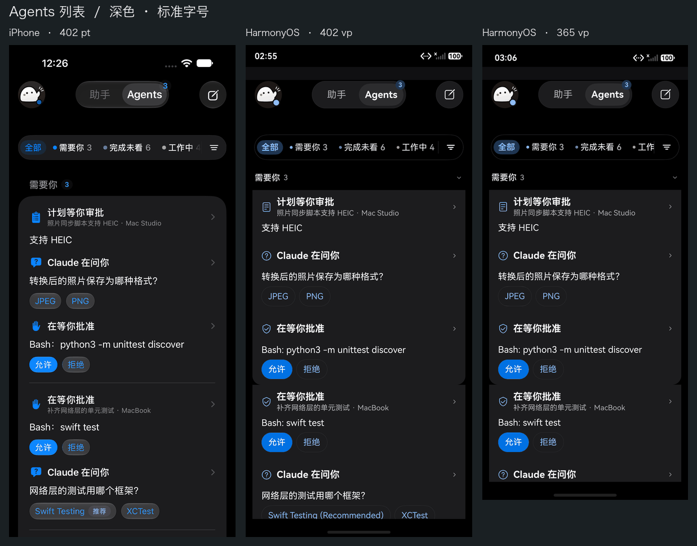
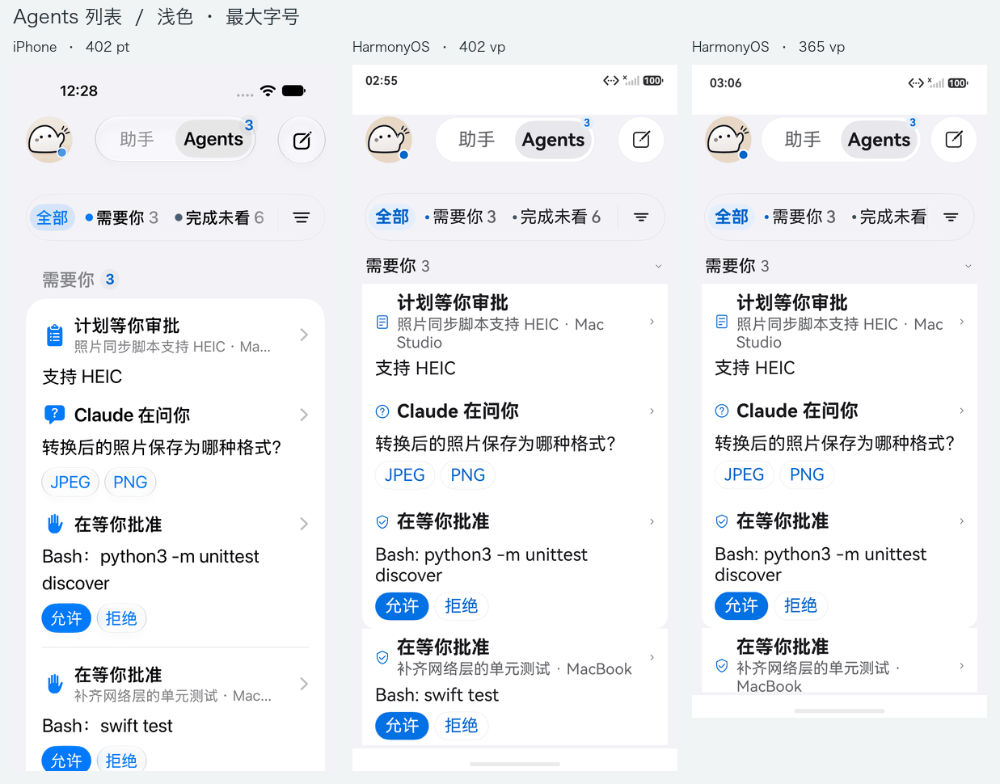

# Agents 列表 · Agent list

[返回全部页面 · All pages](../README.md)

按状态浏览 Agents，区分需要处理和正在工作的会话。

Three independent native captures, left to right: iPhone 402 pt, HarmonyOS 402 vp, HarmonyOS 365 vp. The complete screen, including system bars, is visible.

[Download all original screenshots and accessibility trees for this page](../originals/agents.zip?raw=1) · [Source and capture method](../SOURCES.md)

Original archive SHA-256: 4c4b8916e94d83f66414027a26c88c230a4b1b4568c806eae4488fa8b472ae3a

## 浅色 · 标准字号

| Device | Pixels | Captured at | PNG digest | Hierarchy digest |
| --- | --- | --- | --- | --- |
| iPhone 402 pt | 1206 × 2622 | 2026-11-23T04:23:39.981+00:00 | 64267b766236325d | dddbd6b41d63ac4f |
| HarmonyOS 402 vp | 1206 × 2622 | 2026-11-23T14:55:01+08:00 | 58abd4e4b3814039 | 826876232864e7f8 |
| HarmonyOS 365 vp | 1280 × 2832 | 2026-11-23T15:06:08+08:00 | 2bda67bd66a213c9 | bdcd7f73b18bc4eb |

## 深色 · 标准字号

| Device | Pixels | Captured at | PNG digest | Hierarchy digest |
| --- | --- | --- | --- | --- |
| iPhone 402 pt | 1206 × 2622 | 2026-11-23T04:26:10.203+00:00 | ba323079ff920db8 | 2e0e8f3c5826bd37 |
| HarmonyOS 402 vp | 1206 × 2622 | 2026-11-23T14:55:04+08:00 | 003a1e7f350d613f | ded77d50035854fa |
| HarmonyOS 365 vp | 1280 × 2832 | 2026-11-23T15:06:12+08:00 | 201950d7505d5d1b | ee215622d9075c8f |

## 浅色 · 最大字号

| Device | Pixels | Captured at | PNG digest | Hierarchy digest |
| --- | --- | --- | --- | --- |
| iPhone 402 pt | 1206 × 2622 | 2026-11-23T04:28:39.445+00:00 | 0f8b83ce8f970c13 | caf727465f70d7bd |
| HarmonyOS 402 vp | 1206 × 2622 | 2026-11-23T14:55:08+08:00 | db8bc911bd9df75c | f71ae93b1c116229 |
| HarmonyOS 365 vp | 1280 × 2832 | 2026-11-23T15:06:16+08:00 | 9afad6127d1a1e61 | eb9052a0d9bea7bc |

Full 64-character digests and ZIP entry paths are under this page in the [manifest](../manifest.json).

[← 提交 Agent 配置](start-ready.md)
[Agent 会话 →](agent-chat.md)
