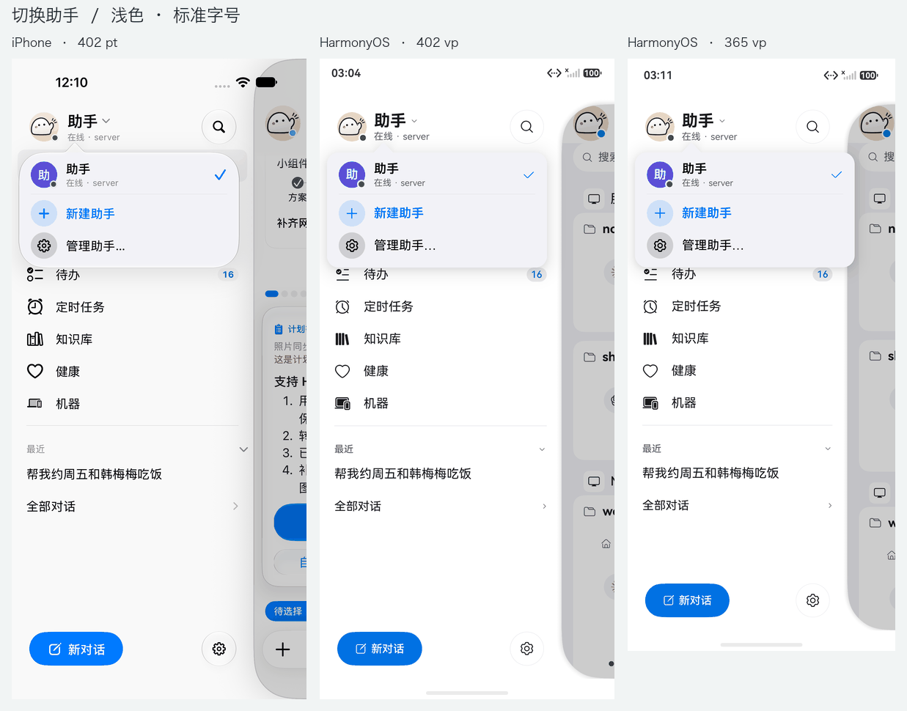
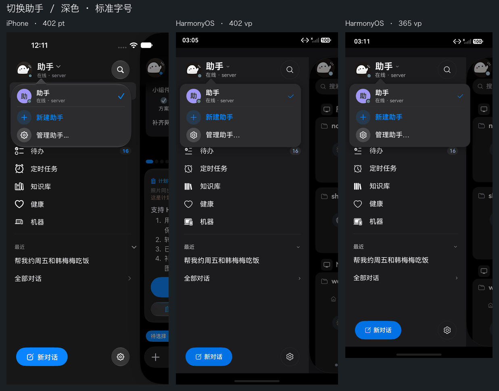
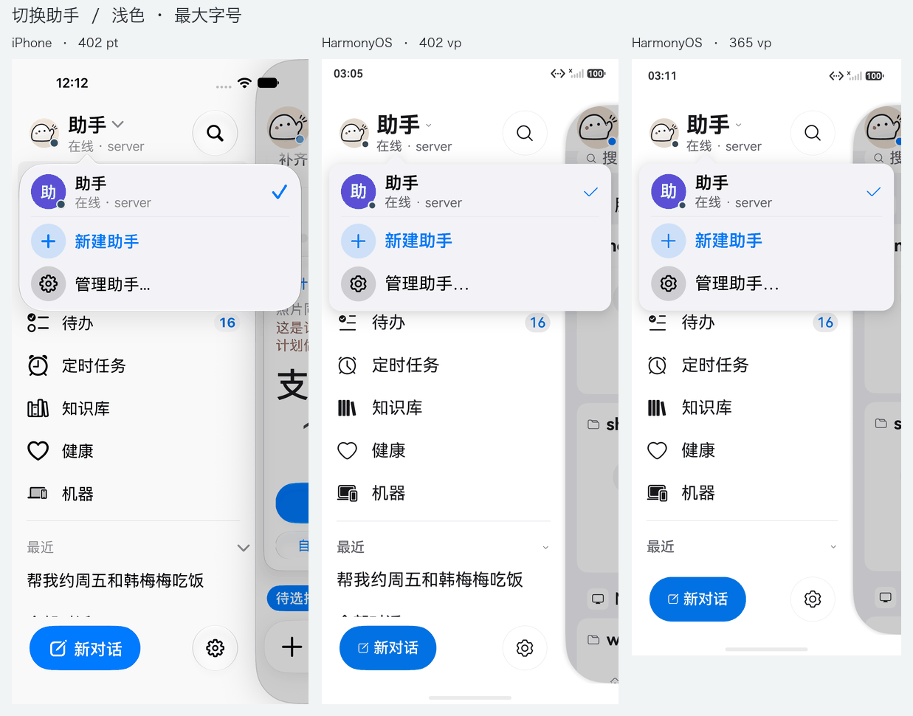

# 切换助手 · Switch assistants

[返回全部页面 · All pages](../README.md)

从当前助手打开助手切换菜单。

Three independent native captures, left to right: iPhone 402 pt, HarmonyOS 402 vp, HarmonyOS 365 vp. The complete screen, including system bars, is visible.

[Download all original screenshots and accessibility trees for this page](../originals/assistant-menu.zip?raw=1) · [Source and capture method](../SOURCES.md)

Original archive SHA-256: d509cca77403346e46eeb139f7073300a4c6e7e0b557d0d1704924354461e633

## 浅色 · 标准字号

| Device | Pixels | Captured at | PNG digest | Hierarchy digest |
| --- | --- | --- | --- | --- |
| iPhone 402 pt | 1206 × 2622 | 2026-11-23T04:10:21.131+00:00 | 6228f17ec6b1a711 | 17f8619c260b7d01 |
| HarmonyOS 402 vp | 1206 × 2622 | 2026-11-23T15:04:59+08:00 | 985c9c5c37cfc16a | 85ec07bf7f3dbf75 |
| HarmonyOS 365 vp | 1280 × 2832 | 2026-11-23T15:11:14+08:00 | bf2f3329970ec0d4 | 293d09b585c2c0fc |

## 深色 · 标准字号

| Device | Pixels | Captured at | PNG digest | Hierarchy digest |
| --- | --- | --- | --- | --- |
| iPhone 402 pt | 1206 × 2622 | 2026-11-23T04:11:09.917+00:00 | 009df4c3496f03b0 | 4aa69ca13a1bd2a2 |
| HarmonyOS 402 vp | 1206 × 2622 | 2026-11-23T15:05:04+08:00 | 8c90d9b4fc1ba33d | d65397d65ece298d |
| HarmonyOS 365 vp | 1280 × 2832 | 2026-11-23T15:11:18+08:00 | 7cb4f3f23b3ecd32 | 12f13e323ba4088d |

## 浅色 · 最大字号

| Device | Pixels | Captured at | PNG digest | Hierarchy digest |
| --- | --- | --- | --- | --- |
| iPhone 402 pt | 1206 × 2622 | 2026-11-23T04:12:11.740+00:00 | 9771400b01f357d6 | 040cda1812ad792b |
| HarmonyOS 402 vp | 1206 × 2622 | 2026-11-23T15:05:08+08:00 | 3579152ecfb23a3f | f7ceca5c6559c055 |
| HarmonyOS 365 vp | 1280 × 2832 | 2026-11-23T15:11:23+08:00 | f6a3132fa250d1c2 | ea18b4cac863cc82 |

Full 64-character digests and ZIP entry paths are under this page in the [manifest](../manifest.json).

[← 侧栏](drawer.md)
[设置 →](settings.md)
