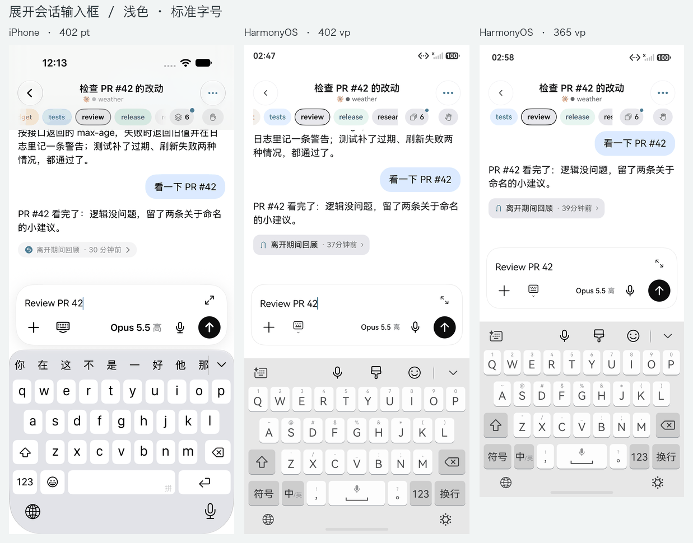
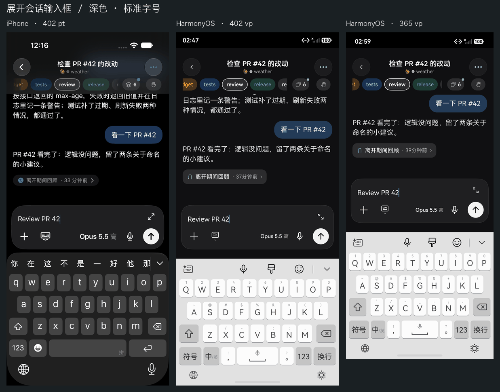
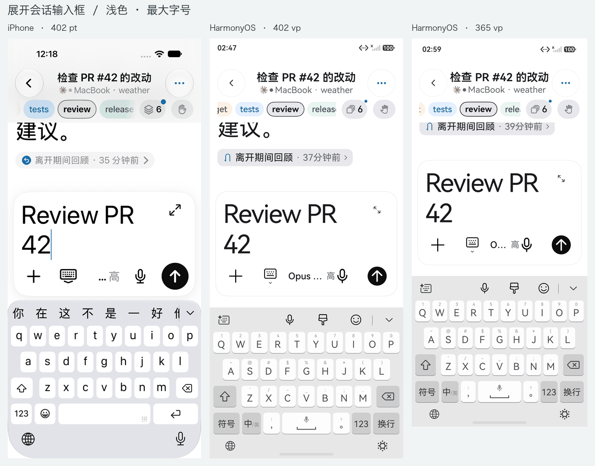

# 展开会话输入框 · Focused composer

[返回全部页面 · All pages](../README.md)

聚焦 PR #42 的输入框，核对草稿、键盘和发送控件的位置。
Focus the PR #42 composer and return from its full-screen editor to the same draft.

Three independent native captures, left to right: iPhone 402 pt, HarmonyOS 402 vp, HarmonyOS 365 vp. The complete screen, including system bars, is visible.

[Download all original screenshots and accessibility trees for this page](../originals/composer.zip?raw=1) · [Source and capture method](../SOURCES.md)

Original archive SHA-256: baca8036cb2bad8decbe27a222ca37f62713e32a959db90f1f8521918bd6b293

## 浅色 · 标准字号

| Device | Pixels | Captured at | PNG digest | Hierarchy digest |
| --- | --- | --- | --- | --- |
| iPhone 402 pt | 1206 × 2622 | 2026-11-23T04:13:42.916+00:00 | c83196b5c7b221ea | 310947d108f0df1f |
| HarmonyOS 402 vp | 1206 × 2622 | 2026-11-23T14:47:45+08:00 | 89b2426058034360 | 581784af1ca6ee90 |
| HarmonyOS 365 vp | 1280 × 2832 | 2026-11-23T14:58:57+08:00 | dd04543ba46d7139 | 7f861ceac772e1a9 |

## 深色 · 标准字号

| Device | Pixels | Captured at | PNG digest | Hierarchy digest |
| --- | --- | --- | --- | --- |
| iPhone 402 pt | 1206 × 2622 | 2026-11-23T04:16:01.683+00:00 | 07a12fec1b0c6a4e | ed1c4484a1704a96 |
| HarmonyOS 402 vp | 1206 × 2622 | 2026-11-23T14:47:49+08:00 | 346084ba2f62a1bf | 923806dc6e622507 |
| HarmonyOS 365 vp | 1280 × 2832 | 2026-11-23T14:59:01+08:00 | 6bc9d3f213f48b90 | 7b5c43903e836ef5 |

## 浅色 · 最大字号

| Device | Pixels | Captured at | PNG digest | Hierarchy digest |
| --- | --- | --- | --- | --- |
| iPhone 402 pt | 1206 × 2622 | 2026-11-23T04:18:22.858+00:00 | e3d8ae1bc2767cea | 1fb350e4ea05ff55 |
| HarmonyOS 402 vp | 1206 × 2622 | 2026-11-23T14:47:53+08:00 | 286cab9d7788abe4 | 1fa8f609fa30cba7 |
| HarmonyOS 365 vp | 1280 × 2832 | 2026-11-23T14:59:05+08:00 | 56be15f164f59746 | 77f1ee36ac05043a |

Full 64-character digests and ZIP entry paths are under this page in the [manifest](../manifest.json).

[← Persona 主对话](persona.md)
[回看会话记录 →](reading-history.md)
